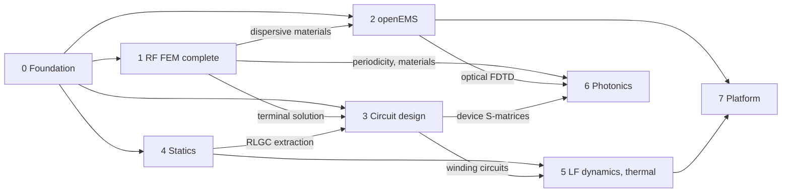

# Hertzon roadmap

Hertzon today is a frequency-domain 3D FEM simulator built on [EMerge](https://github.com/FennisRobert/EMerge),
with its own adaptive meshing (hzmesh, local Delaunay, bisection, Mmg), curved elements, fast and
interpolating sweeps, far field and RCS, optimization and an MCP server. This roadmap describes how it
grows into an open simulation suite: time domain, low frequency, circuits and photonics, built from open
solvers under one user interface.

Suggestions and discussion are welcome in the [issues](https://github.com/c8501024/Hertzon/issues).

**Size** of a work package: **S** small, **M** medium, **L** large, **XL** several large packages.

## Overview

| Step | Topic | Solver / building block | Size |
|---|---|---|---|
| [0](#step-0-foundation-one-model-several-solvers) | Foundation: one model, several solvers | Hertzon | L |
| [1](#step-1-complete-the-rf-fem-workflow) | Complete the RF FEM workflow | EMerge | L |
| [2](#step-2-openems-as-a-second-solver-ec-fdtd) | openEMS as a second solver (EC-FDTD) | openEMS, CSXCAD | L |
| [3](#step-3-circuit-design) | Circuit design | scikit-rf, ngspice, Qucsator | XL |
| [4](#step-4-electrostatics-magnetostatics-and-dc-conduction) | Electrostatics, magnetostatics and DC conduction | GetDP | L |
| [5](#step-5-low-frequency-dynamics-and-thermal-coupling) | Low-frequency dynamics and thermal coupling | Elmer FEM | XL |
| [6](#step-6-photonics) | Photonics | mode solver, gdstk, openEMS / MEEP | XL |
| [7](#step-7-platform) | Platform (runs alongside from step 2 on) | Hertzon | L |

Frequency coverage once all steps are done:

| Range | Typical use | Step |
|---|---|---|
| DC to ~100 MHz | capacitance and inductance matrices, forces, coils, motors | 4, 5 |
| DC to ~100 GHz | circuits, S-parameter networks, SPICE | 3 |
| ~100 MHz to ~300 GHz | RF FEM (today) | 1 |
| ~10 MHz to ~THz | broadband time domain, TDR | 2 |
| ~30 THz to ~1 PHz (1550 nm = 193 THz) | integrated optics | 6 |

The limits are not sharp: what matters is the size of the structure compared to the wavelength.

## Dependencies

Step 0 is on the critical path. After it, steps 1 to 4 can run largely in parallel. Photonics depends
on three earlier steps and therefore comes last.

## Step 0: Foundation, one model, several solvers

Today EMerge is wired into the solve flow (`hertzon/solver/run.py`, `bridge.py`). Before a second
solver arrives, Hertzon needs a layer that says what a solver can do, and a result format that
reports read regardless of the solver.

- [ ] **0.1 Solver interface (M).** A backend class reports its solution types, boundaries,
  excitations and mesh type. The Validation Check and the dialogs only offer what the selected backend
  supports. EMerge becomes the first backend.
- [ ] **0.2 Common result format (M).** Network data over frequency, time signals, fields on
  tetrahedral or rectilinear grids, scalar values (C, L, R, force, neff). Reports and field
  plots read only this format. *Needs 0.1.*
- [ ] **0.3 Stable face assignment and coordinate systems (L).** Ports and boundaries stay on the
  right face when the geometry changes or the solver is switched; relative and face coordinate systems.
- [ ] **0.4 Solution management for all solvers (M).** Mark results as out of date after a change,
  finish the parametric sweep (`hertzon/solver/parametric.py`), job queue. *Needs 0.2.*
- [ ] **0.5 Cross-solver benchmark suite (S–M).** The same models with several solvers, against
  analytic results, the Mie series and measurements. It grows with every step. *Needs 0.2.*

## Step 1: Complete the RF FEM workflow

The FEM core stays the centrepiece. These packages close the remaining gaps of a typical FEM workflow
(see [FEATURE_MATRIX.md](FEATURE_MATRIX.md)) and provide building blocks for later steps. Changes that
touch the EMerge core should go upstream to EMerge, so that Hertzon does not depend on a fork.

- [ ] **1.1 Terminal solution (M–L).** Terminal transformation, port field display, Z0 and
  γ as report quantities, ports-only solve. *Used by step 3.*
- [ ] **1.2 Periodic boundaries (L).** Primary/secondary boundaries, Floquet ports, impedance
  multiplier for symmetry. *Used by arrays, metamaterials and step 6 (grating couplers).*
- [ ] **1.3 Dispersive and anisotropic materials (M).** Debye, Djordjevic-Sarkar, Drude/Lorentz,
  tensors. *Used by steps 2 and 6.*
- [ ] **1.4 Field post-processing (M–L).** Fields calculator, losses, quality factor Q, field export,
  antenna parameter table, near field. *Used by step 5 (thermal).*
- [ ] **1.5 Modeler and usability (M).** Arcs and splines in polylines, interactive move/rotate,
  measure tools, clickable messages, report markers and axes, more modeler operations.

## Step 2: openEMS as a second solver (EC-FDTD)

[openEMS](https://openems.de) solves Maxwell's equations with EC-FDTD on a rectilinear grid in the
time domain. One run with a Gaussian pulse gives the whole band, plus time signals that FEM does not
provide. The same model from the Hertzon modeler is solved by selecting another solver.

- [ ] **2.1 Geometry export to CSXCAD (M).** Primitives directly, everything else from OpenCASCADE as
  polyhedra, conductors as sheets, materials from the library. *Needs 0.1.*
- [ ] **2.2 Automatic rectilinear grid (M–L).** The counterpart of adaptive meshing: grid lines on
  edges, third rule at metal edges, at most λ/20 in dielectrics, cell growth ≤ 1.5; convergence check
  by refining and comparing. *Needs 2.1.*
- [ ] **2.3 Excitations (M).** Lumped port, microstrip port, waveguide port, plane wave; pulse width
  from the sweep band, stop at −40 to −50 dB remaining energy; PML and Mur boundaries. *Needs 2.1.*
- [ ] **2.4 Results (M).** S-parameters by FFT, a new report type for time signals and TDR, NF2FF
  far field, field dumps in the format of 0.2. *Needs 0.2.*
- [ ] **2.5 Packaging (S–M).** The installers fetch openEMS for Windows and Linux, the same way they
  fetch EMerge today.
- [ ] **2.6 Cross-validation (S).** FEM against FDTD on the microstrip, patch and hairpin filter
  examples, as part of the suite in 0.5. *Needs 2.4.*

## Step 3: Circuit design

A circuit design type in the project, next to the 3D designs, with its own schematic editor. 3D
designs are placed on the schematic as linked blocks with pins and stay linked: when the 3D design is
solved again, the circuit follows.

- [ ] **3.1 Circuit design and schematic editor (L).** New design type in the project tree; schematic
  with wires, pins, ports, ground and variables; undo and redo; the same properties panel as in the 3D
  designs. *Needs 0.1.*
- [ ] **3.2 Component library (M).** R, L, C, ideal and lossy transmission lines, microstrip,
  stripline and coax models, S-parameter blocks from Touchstone files, sources and probes.
  *Needs 3.1.*
- [ ] **3.3 Dynamic link (M).** A 3D design placed as a block with one pin per port or terminal. It
  follows the 3D solution and its variables, so parametric sweeps and optimization run across both.
  *Needs 3.1, 0.4; terminal pins need 1.1.*
- [ ] **3.4 Linear frequency-domain analysis (M).** S, Y and Z of the whole schematic over
  frequency, sweeps, tuning with sliders, reports as in the 3D designs. Network algebra with
  scikit-rf. *Needs 3.1, 0.2.*
- [ ] **3.5 Push excitations (M).** Port voltages and currents from the schematic go back to the 3D
  design, which then shows fields and far field of the loaded structure. Edit Sources (magnitude and
  phase per port) in the 3D design as the simple form. *Needs 3.3, 3.4.*
- [ ] **3.6 Transient analysis (L).** S-parameter blocks as passive macromodels (vector fitting with
  passivity enforcement), ngspice as the transient engine, eye diagrams and TDR. *Needs 3.4.*
- [ ] **3.7 Harmonic balance (L).** Nonlinear components such as diodes and transistor models through
  Qucsator, for amplifiers and mixers. *Needs 3.6.*
- [ ] **3.8 Netlist exchange (S–M).** SPICE netlist and Touchstone import and export, MCP tools for
  circuit designs. *Needs 3.1.*

## Step 4: Electrostatics, magnetostatics and DC conduction

Quasi-static fields: capacitances, inductances, forces, current paths.
[GetDP](https://getdp.info) works directly with gmsh, which Hertzon already uses, and is licensed like
Hertzon. The hzmesh and Mmg refinement can be reused with a scalar error estimator (energy norm,
Zienkiewicz-Zhu).

- [ ] **4.1 Electrostatics and DC conduction (M–L).** Capacitance matrix, field strength and breakdown
  margin, resistance and current density in traces. *Needs 0.1, 0.2.*
- [ ] **4.2 Magnetostatics (L).** Inductance matrix, force and torque (Maxwell stress tensor, virtual
  work), permanent magnets, nonlinear B-H curves. *Needs 4.1.*
- [ ] **4.3 Adaptive meshing for scalar problems (M).** Based on hzmesh and Mmg. *Needs 4.1.*
- [ ] **4.4 Extraction into circuits (M).** RLGC parameters of lines and packages from 4.1 and 4.2 as
  components in the circuit design. *Needs 4.1, 4.2, 3.2.*

## Step 5: Low-frequency dynamics and thermal coupling

[Elmer FEM](https://www.elmerfem.org) adds eddy currents, nonlinear magnetics, rotating machines and
heat transfer.

- [ ] **5.1 Eddy currents, time-harmonic (L).** Skin and proximity effect, winding and core losses,
  induction heating (A-V formulation). *Needs 4.2.*
- [ ] **5.2 Transient with motion (XL).** Motors and actuators, windings coupled to a circuit.
  *Needs 5.1, 3.6.*
- [ ] **5.3 Thermal coupling (M).** Losses from 5.1 and from the RF solution as heat sources,
  temperature field with Elmer. *Needs 5.1, 1.4.*

## Step 6: Photonics

Integrated optics at 1550 nm needs wavelengths instead of frequencies, dielectric waveguides without
metal, and clean termination of open structures. EMerge's port mode solver already solves 2D eigenvalue
problems for wave ports and is the natural starting point.

- [ ] **6.1 Optical units and materials (S–M).** µm and nm, wavelength instead of frequency,
  refractive index n and k, Sellmeier models. *Needs 1.3.*
- [ ] **6.2 2D mode solver (L).** neff, group index ng, mode profiles, bend
  modes, leakage loss; robust PMLs with complex coordinate stretching at high index contrast. Extend
  EMerge's port mode solver or use femwell. *Needs 6.1.*
- [ ] **6.3 GDS import with layer stack (M).** gdstk for GDS, gdsfactory for PDK components.
  *Needs 0.3.*
- [ ] **6.4 3D devices (L).** FEM for compact structures such as ring resonators, couplers and grating
  couplers (with periodicity from 1.2); FDTD for larger ones through openEMS or MEEP. *Needs 1.2, 2.*
- [ ] **6.5 Eigenmode expansion (L).** For long, slowly varying structures such as tapers and MMI
  couplers. *Needs 6.2.*
- [ ] **6.6 Photonic circuits (M).** Device S-matrices as blocks in the circuit design from step 3.
  *Needs 3.4, 6.4.*

## Step 7: Platform

Runs alongside the other steps once the second solver is in.

- [ ] **7.1 Cluster and remote solves (L).** MPI for large models; Palace as an option for very large
  FEM runs.
- [ ] **7.2 Coupled analyses (L).** Linked designs: EM, then thermal, then structural mechanics
  (CalculiX where needed).
- [ ] **7.3 Plugin interface for further solvers (M).** Builds on 0.1.
- [ ] **7.4 MCP for every solver (S–M).** Extend the existing tools (`set_setup`, `run_simulation`,
  `get_results`) with the solver choice and the new result types.

Not planned for now: asymptotic methods (SBR), integral equations (MoM), 2.5D board analysis for
SI/PI and fluid dynamics. They can be added later as backends through 7.3.

## Licences of the building blocks

Hertzon is GPL-2.0-or-later. All building blocks below can be used with it. When Hertzon is
distributed together with GPL-3.0 or Apache-2.0 components, the combined package is under GPL-3.0,
which the "or later" clause allows. Contributions to Hertzon should therefore keep the "or later"
wording. As with EMerge today, the installers fetch external solvers separately and Hertzon runs them
as separate processes.

| Building block | Used for | Licence | Use with Hertzon | Integration |
|---|---|---|---|---|
| EMerge, gmsh | FEM core, geometry | GPL-2.0-or-later | yes | as today |
| openEMS | EC-FDTD | GPL-3.0 | yes, package under GPL-3 | process, Python bindings |
| CSXCAD | geometry for openEMS | LGPL-3.0 | yes | Python bindings |
| GetDP | statics, eddy currents | GPL-2.0-or-later | yes | process, `.pro` files |
| Elmer FEM | LF dynamics, motion, thermal | GPL-2.0-or-later, library LGPL-2.1 | yes | process, `.sif` files |
| Palace | very large FEM runs | Apache-2.0 | yes, package under GPL-3 | process |
| ngspice | SPICE transients | BSD-3-Clause (modified BSD) | yes | shared library |
| Qucsator | harmonic balance | GPL-2.0-or-later | yes | process, netlist |
| Xyce | large SPICE runs (optional) | GPL-3.0 | yes, package under GPL-3 | process |
| scikit-rf | network algebra, vector fitting | BSD-3-Clause | yes | Python package |
| femwell | optical mode solver | GPL-3.0 | yes, package under GPL-3 | Python package |
| scikit-fem | FEM basis of femwell | BSD-3-Clause | yes | Python package |
| MEEP, MPB | optical FDTD, band diagrams | GPL-2.0-or-later | yes | process, Linux only |
| gdstk, gdsfactory | GDS import, PDKs | BSL-1.0, MIT | yes | Python package |
| KLayout | layout viewer (optional) | GPL-3.0-or-later | yes, package under GPL-3 | optional |
| CalculiX | structural mechanics | GPL-2.0-or-later | yes | process |

Open points:

* **emsutil**, a dependency of EMerge, has no licence stated in its package (see
  [THIRD_PARTY.md](THIRD_PARTY.md)). This should be clarified with the EMerge author.
* **Intel MKL** (PARDISO, through EMerge) is free to redistribute but not open source. It is not part
  of the Hertzon installers.
* Licences must be checked again in each project's repository before it is integrated. This table is
  a technical overview, not legal advice.

## Risks

* **EMerge core.** Periodicity, the terminal solution and dispersive materials touch the EMerge core.
  What can go upstream should be agreed with the EMerge author early.
* **Windows packaging.** openEMS, Elmer, GetDP and ngspice are available for Windows; MEEP and Palace
  practically only for Linux. Optical FDTD is therefore planned through openEMS first.
* **Validation.** Every solver needs reference cases. The benchmark suite from 0.5 is part of every
  step, not an appendix at the end.
* **One application.** Several solvers must not mean several user interfaces. Step 0 decides whether
  Hertzon still feels like one program.

## First steps

1. Design the solver interface and the result format (0.1, 0.2) and move EMerge to it as the first
   backend.
2. openEMS spike: export the microstrip example to CSXCAD, solve it with openEMS and compare
   S21 with EMerge. This shows how large 2.1 and 2.2 really are.
3. GetDP spike: compute the capacitance of a microstrip line electrostatically and compare it with the
   line theory from hfsynpy.
4. Circuit design (step 3) once openEMS is in, starting with the schematic editor and the dynamic
   link.
