# Hertzon tutorial: from an empty window to S-parameters, gain and RCS

This guide walks through complete simulations step by step:

* [1. A waveguide with wave ports](#1-waveguide-with-wave-ports) (WR-90 with an inductive post, field on a
  cut plane, animation as GIF)
* [2. A coaxial cable](#2-coaxial-cable-with-wave-ports) (50 Ω line with TEM wave ports)
* [3. A half-wave dipole](#3-half-wave-dipole) (lumped port, open region, far field and gain, and the
  [half model with a symmetry plane](#36-half-model-with-a-symmetry-plane))
* [4. The radar cross section of a sphere](#4-radar-cross-section-of-a-sphere) (incident plane wave, RCS)
* [7. A chip capacitor on a microstrip line](#7-a-chip-capacitor-on-a-microstrip-line) (Lumped Elements tab,
  Lumped RLC, groups)
* [9. A differential pair](#9-a-differential-pair-with-the-terminal-solution) (terminal solution, one wave port
  for two traces, mixed-mode S-parameters)
* [10. Tune a patch antenna with sliders](#10-tune-a-patch-antenna-with-sliders) (derivative tuning: patch
  length and inset with sliders, S11, pattern and gain follow live; S11 and gain over the patch length)
* [11. A stub filter as a circuit](#11-a-stub-filter-as-a-circuit-and-its-3d-layout) (circuit design, line
  calculator, automatic junctions, copy and paste; the 3D layout, solved, tuned and copied back)
* [12. A board from Gerber files](#12-import-a-board-from-gerber-files) (Import PCB: copper layers, drill
  files, outline and the stackup)
* [13. A 2.4 GHz LNA](#13-a-24-ghz-lna-from-the-schematic-to-the-board) (transistor model, bias with ngspice,
  stability, compression with harmonic balance, footprints, Board Layout, the 3D layout of the board and Board
  Circuit)
* [14. A broadband diode mixer](#14-a-broadband-diode-mixer-with-harmonic-balance) (a 3D balun as a block, a diode
  ring with the manufacturer's card, the two-tone mixer analysis; full-wave block or circuit model)
* [15. Subdesigns in one large schematic](#15-connect-subdesigns-into-one-large-schematic) (Design Wizard blocks
  on one board, Connect with 50 Ω lines and round bends, Match Phase with a phase offset, the 3D layout of the
  whole system)
* [16. A circuit from a 3D design](#16-a-circuit-from-a-3d-design-calibrated-and-kept-in-step) (Create Circuit,
  a 3D block for what the circuit cannot model, Calibrate to 3D, Sync with 3D)

and shows how to let an AI assistant do the same work for you through
[Hertzon's MCP server](#5-let-an-ai-assistant-build-and-run-it-mcp), how to
[export a printed circuit board as Gerber files](#6-gerber-export-of-a-printed-circuit-board) for manufacturing,
and how to [compute your own quantities with equations](#8-your-own-quantities-with-equations) (return loss,
power through a port, a field of your own) in the Fields Calculator.

Every finished model is in `examples/` and opens with **File > Open Example**, with its reports and field
plots ready: **Analyze All** (F5), then double-click a report or a field plot in the project tree.

> **Fastest start: let an AI assistant do it.** Open **Tools > AI Assistants (MCP)...**, press
> *Register* next to Claude Code, Claude desktop, Codex or VS Code and tick **Let AI assistants work in
> this window**. Then ask: *"Draw a half-wave dipole for 1 GHz with a lumped port, solve it and give me
> the input impedance and the gain."* The model appears in the open window while the assistant builds it.
> Details in [section 5](#5-let-an-ai-assistant-build-and-run-it-mcp).

Every step below uses menu names as they appear in Hertzon. Most commands are on the ribbon too
(tabs **Desktop**, **View**, **Draw**, **Model**, **Simulation**, **Lumped Elements**, **Results**; a circuit
design has its own tabs), and every one is in the menu bar.

## 0. The basics in two minutes

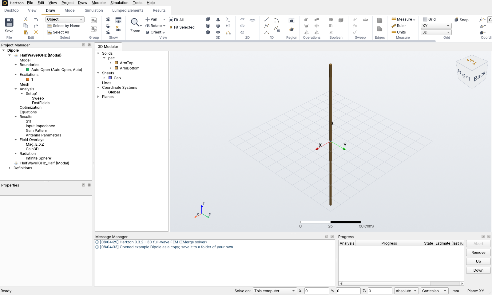
*The Hertzon window with the dipole of section 3: ribbon on top, Project Manager and Properties on the left, 3D Modeler tree and 3D view in the middle, messages and progress at the bottom.*

**The window.** On the left, the **Project Manager** shows the project tree (designs, Boundaries,
Excitations, Analysis, Results, Field Overlays, Radiation). Below it is the **Properties** panel of whatever
is selected. In the middle, the **3D Modeler** tree lists the objects (solids by material, sheets, lines)
next to the 3D view. At the bottom are the **Message Manager** and the **Progress** of running analyses.

**Selecting.** Press **O** to select whole objects and **F** to select single faces (E for edges, V for
vertices). Click to select, Ctrl+click to add. Drag a box with the left mouse button to select everything
that lies completely inside it (objects, or faces, edges and vertices in those modes); Ctrl + drag adds to
the selection. **Edit > Select by Name** finds an object in a large model.

**Groups.** **Edit > Group** (Ctrl+G) joins the selected objects into one group: a click on a member then
selects the whole group, and Move, Rotate, Mirror, Copy or Delete act on all of it. **Edit > Ungroup**
(Ctrl+Shift+G) dissolves it again. The model tree lists the groups under **Groups**. SMD components from
the **Lumped Elements** tab are inserted as a group, and the integration line of a port moves with its sheet.

**Navigating.**

| | Mouse | Alternatives |
|---|---|---|
| Rotate | Middle button drag | Alt + left drag |
| Pan | Shift + left drag | Ctrl + middle drag |
| Zoom | Mouse wheel (at the cursor) | Right drag, Shift + middle drag, Alt + Shift + left drag |

A plain left drag does not move the view, it draws the selection box. Without a middle button (touchpad), the
**Rotate** and **Pan** buttons on the Draw tab turn the left mouse button into rotate or pan mode
until you press Esc or click the button again. **View > Fit All** (or the ribbon button) brings
everything into view.

**Drawing with exact values.** You can draw by clicking on the grid, or type a coordinate into the
X/Y/Z fields of the status bar and press Enter. For the tutorials it is easiest to draw roughly and then
type the exact values: in the **3D Modeler** tree next to the view, expand the object and click its
creation entry (for example *CreateBox*), then edit Position, sizes and so on in the **Properties** panel.
Clicking the object itself shows its name, material and display attributes. **Draw > Create Primitive by
Dialog...** asks for all values at once instead.

**Thicken.** **Draw > Thicken Sheet...** turns a sheet into a solid. A positive thickness grows to the
positive side of the sheet's main axis (+Z for a sheet in the XY plane), a negative one to the other side.
While the dialog is open, an arrow on each sheet shows the direction; **Reverse direction** flips it.

**Fillet and chamfer.** **Modeler > Fillet...** rounds corners, **Modeler > Chamfer...** cuts them off. On a
solid, select its edges (**E**); on a flat sheet such as a patch, select its corner vertices (**V**): each
selected corner gets one fillet with the radius, or is cut off by the distance. When the radius or distance
does not fit, the object stays unchanged and a message says why.

**Variables.** Every number accepts expressions with units, such as `a/2`, `lambda0/4` or `2.5mm+t`. Define
variables in **Project > Design Properties...** and change them later: the model, ports and integration
lines follow. **Constants & Functions...** in the same dialog lists what a value may use: the constants
(`pi`, `c0`, `e0`, `u0`), the functions (`sin`, `sqrt`, `if`, ...), the units and the other variables, with
a search field. Double-click an entry (or **Insert**) to put it at the cursor of the selected value; a
function goes around selected text.

**Solving.** **Simulation > Validation Check** lists problems before you start. **Simulation > Analyze All**
(F5) solves every enabled setup. Each adaptive pass appears in the Progress window, and **Results >
Solution Data...** shows the convergence table, the mesh statistics and the matrix data. New setups refine
the mesh with **hzAURA (EMerge)**: after each pass the elements with the largest error are split in place,
and new nodes on curved faces (cylinders, spheres, free-form surfaces) land exactly on the CAD surface.
**Curved elements** (on by default) make the tetrahedra at those surfaces follow the true shape. Both
settings are in the setup (tabs **Advanced** and **Options**); the examples use them throughout.

**Field plots, cut planes and animations.** **Results > Mag E** (or Vector E, Mag H, Mag Jsurf, ...)
plots the field on the selected faces or objects. With **Plot on** XY, YZ or XZ and a **Cut position**
(any expression, e.g. `b/2`) it plots on a cut plane through the whole model instead. For a plane of
any shape and size, draw a sheet as **Non Model** object (Modeler > New Objects > Non Model, or answer
the question after drawing) and plot on it: the plot is cut from the solver mesh, ends exactly on the
sheet's outline and follows the sheet when you move or resize it, without solving again. Right-click a
field plot > **Animate** runs the phase from 0 to 360°. **Export GIF...** in the animation bar saves the
animation as a looping GIF exactly as the view shows it: same size, colours, scale and speed.

**Overlapping objects.** Hertzon checks overlapping solids exactly. An object completely inside
another (substrate in an air box, a via in the substrate) is the usual case and needs nothing: the inner
object applies there, and the air region is always background. A partial overlap of two objects with
different materials is an **error** that blocks the analysis until you resolve it, with one exception: with
the design setting **Material override** (on by default) a metal overrides a
dielectric (or air) whatever its size. You find the setting in the Properties window when the design is
selected in the project tree. The **Validation Check** lists every overlap that matters:

| Overlap | Example | Material override on (default) | Material override off |
|---|---|---|---|
| Conductor partly in a dielectric | via sticking out of the substrate, trace over the board edge | ✔ note: the conductor applies | ✖ error |
| Two dielectrics (or two conductors) of different materials, partly | substrate and a glue layer shifted into each other | ✖ error | ✖ error |
| Dielectric completely inside a conductor | dielectric inside a PEC bounding box | ⚠ warning: the dielectric has no effect | not listed (the dielectric applies) |
| One object completely inside another otherwise | substrate in the air box | not listed (the inner object applies) | not listed |
| Same material | two copper pieces touching | not listed (nothing changes) | not listed |

Analyze, optimization and parametric runs (also from scripts and the AI link) stop with the Validation
Check open when it finds an error; the solver checks the same rule once more.

Select an overlap and click **Resolve Overlap**, or **Resolve All Overlaps**: Hertzon subtracts the object
whose material applies (the conductor, otherwise the smaller object) from the other one (**Subtract** with *Clone tool objects before operation*, so both stay). The
model then shows exactly what is solved, and the geometry is free of overlaps (for example before an export). Undo (Ctrl+Z) takes it back.

> The very first analysis after installing or updating compiles Hertzon's solver kernels and takes a few
> minutes longer. The installer already does this once, so normally you do not notice it.

**Updates.** When a new version is out, a small dialog after the start shows what changed since your
version, with **Install**, **Skip this version** and **Later** (at most once every 7 days; in between the
status bar names the new version). Install keeps your settings and the Python environment and asks to save
open changes first. **Help > Check for Updates...** checks at any time; Tools > Options > General switches
the check at start off.

---

## 1. Waveguide with wave ports

**Goal:** S11 and S21 of a WR-90 rectangular waveguide (22.86 × 10.16 mm) with a metal post in the
middle, from 8 to 12 GHz. The finished project is `examples/WaveguidePost.hzn`.

### 1.1 New design and variables

1. **File > New**. The start page asks what to simulate: choose **3D FEM**, solution type **Modal**, units
   **mm**, and click **Create**. The project starts with one empty design.
2. **Simulation > Solution Type...**: check **Modal** and leave **Auto open region** at **Off**.
   A waveguide is a closed problem: every outer face that is not a port is a perfect conductor.
3. **Project > Design Properties...**: add the variables

   | Name | Value |
   |---|---|
   | `a` | `22.86mm` |
   | `b` | `10.16mm` |
   | `L` | `50mm` |
   | `r_post` | `1.5mm` |

### 1.2 Geometry

1. **Draw > Box**, then set in Properties: Position `0,0,0`, XSize `a`, YSize `L`, ZSize `b`. Rename the
   object to `Waveguide` (Name field). Material stays **vacuum**: the box is the air inside the guide.
2. **Draw > Cylinder**: CenterPosition `a/2,L/2,0`, Radius `r_post`, Height `b`, Axis `Z`. Name it
   `Post` and set **Material** to **pec**.
3. Select `Waveguide` first, then Ctrl+click `Post`, and choose **Modeler > Boolean > Subtract**. The post
   is cut out of the air box. Its surface becomes a perfect conductor automatically, like the outer walls.


*The air box of the waveguide with the post cut out of it. The two end faces (blue) carry the wave ports.*

### 1.3 Wave ports

A wave port sits on an outer face of the model. Hertzon computes its modes (here the TE10 mode of the guide)
with a 2D eigenmode solve and feeds the 3D problem with it.

1. Press **F** (face selection) and click the end face of the box at y = 0.
2. **Simulation > Excitations > Assign > Wave Port** (or the large **Wave Port** button on the
   Simulation tab). Keep **Number of modes 1** and **Mode type Auto**, then press OK. It becomes port 1.
3. Select the face at y = L and assign a second **Wave Port**. It becomes port 2.

> Instead of a face of the box you can also draw a rectangle exactly on the end face (**Draw >
> Rectangle**, Axis `Y`) and assign the port to that sheet. The example file does this.

### 1.4 Solution setup and sweep

1. **Simulation > Analysis Setup > Add Solution Setup...**:
   * Solution frequency **Single**, Frequency `10GHz`, a frequency in the upper part of the band,
     where the mesh needs to be finest.
   * Maximum number of passes `6`, Maximum Delta S `0.02`.
   * Leave the **Advanced** tab at **Mesh refinement: hzAURA (EMerge)** and the **Options** tab at
     **Curved elements** on: the round post is then meshed with curved elements on its true surface.
2. Select `Setup1` in the tree, then **Simulation > Analysis Setup > Add Frequency Sweep...**:
   Sweep type **Interpolating**, Distribution **Linear Count**, Start `8GHz`, Stop `12GHz`, Count `201`.
   An interpolating sweep solves only as many frequencies as it needs and fits the rest.

### 1.5 Solve and look at the results

1. **Simulation > Validation Check**, then **Simulation > Analyze All** (F5).
2. Watch the passes in the Progress window. The analysis stops as soon as S changes by less than 0.02
   between two passes.
3. **Results > Create Report > Create Modal Solution Data Report > Rectangular Plot**: choose
   `dB(S(1,1))` and `dB(S(2,1))` over frequency. **Smith Chart** shows S11 on the Smith chart.
4. **Results > Mag E** with nothing selected: set **Plot on** to `XY` and **Cut position** to `b/2`. The
   field appears on the plane halfway up the guide. **View > Orientation > Top** looks onto it.
5. Right-click the plot (`Mag_E_Cut` in the example) under **Field Overlays** > **Animate**. The wave runs
   from port 1 to the post and is partly reflected. **Export GIF...** in the bar under the view saves it.
6. **File > Export Touchstone...** writes `WR90_Post.s2p` for other tools.


*S11 and S21 from 8 to 12 GHz. The thin post acts as a shunt inductance and reflects most of the power, less at higher frequencies (S21 from −15.4 dB at 8 GHz to −7.2 dB at 12 GHz).*


*`Mag_E_Cut`: Mag E on the cut plane halfway up the guide (z = b/2) at 10 GHz, seen from the top. The wave comes from port 1 at the bottom, forms a standing wave in front of the post and leaks past it.*


*The same plot animated over the phase (Animate) and saved with **Export GIF...**: the GIF has the size, colours, scale and speed of the view.*

> **What you should get** (this model solved with Hertzon 0.2.2 and hzAURA: 2 adaptive passes, 1 376
> tetrahedra, a few seconds): at 10 GHz S11 = −0.41 dB and S21 = −10.5 dB.

---

## 2. Coaxial cable with wave ports

**Goal:** a 20 mm long 50 Ω coax line with PTFE filling, from 1 to 10 GHz. It should be nearly perfectly
matched: |S11| far below −30 dB and |S21| ≈ 0 dB, with the phase of S21 falling linearly with
frequency. The finished project is `examples/Coax.hzn`.

For a coax with inner radius *a*, outer radius *b* and permittivity εr:
Z0 = 60 Ω / √εr · ln(b/a). With εr = 2.1 (Teflon) and *a* = 0.5 mm, 50 Ω needs *b* = 1.675 mm.

### 2.1 Design and variables

1. **Project > Insert Design** (or **File > New**), **Solution Type**: **Modal**, Auto open **Off**.
2. **Design Properties**: `a = 0.5mm`, `b = 1.675mm`, `L = 20mm`.

### 2.2 Geometry

1. **Draw > Cylinder**: CenterPosition `0,0,0`, Radius `b`, Height `L`, Axis `Z`. Name `Dielectric`,
   material **Teflon (tm)**. Its outer surface is the outer conductor: an outer face without a
   boundary is a perfect conductor.
2. **Draw > Cylinder**: CenterPosition `0,0,0`, Radius `a`, Height `L`, Axis `Z`. Name `Inner`,
   material **pec**.
3. Select `Dielectric`, Ctrl+click `Inner`, **Modeler > Boolean > Subtract**. The dialog shows
   `Dielectric` under *Blank Parts* and `Inner` under *Tool Parts*. Tick **Clone tool objects before
   operation** if you want to keep the inner conductor as a visible PEC object. Without it, the hole's
   surface is a perfect conductor anyway, which gives the same result.


*The PTFE cylinder with the PEC inner conductor. The end face (blue) is one of the circular port sheets.*

### 2.3 Wave ports on the annular end faces

1. **Draw > Circle**: CenterPosition `0,0,0`, Radius `b`, Axis `Z`. Name `Port1`.
2. **Draw > Circle**: CenterPosition `0,0,L`, Radius `b`, Axis `Z`. Name `Port2`.
3. Select `Port1` (press **O**), **Simulation > Excitations > Assign > Wave Port**, OK. Do the same for
   `Port2`.

   The port solver finds the TEM mode of the ring between inner and outer conductor by itself. Mode type
   **Auto** is right here. **TEM** would force it.
4. Optional: in the port's **Post Processing** tab, **Renormalize** to `50ohm` and **Deembed** a
   distance if you want the reference plane elsewhere.

The line impedance Zo of a TEM port comes from the voltage along a line between the two conductors, which the
solver finds by itself. To choose it, open the port's **Modes** tab: one row per mode, **Integration Line**
**None** (the solver's line) or **New Line...**, which closes the dialog for two clicks in the 3D view (from the
signal conductor to the ground) and opens it again; the coordinates can also be typed. Right click the port ›
**Draw Integration Line** is the short way. The line changes Zo of its mode, not the S-parameters of the port
modes. With more than two conductors on the port face, such as a grounded coplanar
line whose top grounds end in the air, Hertzon takes a line from the narrowest conductor to the largest one and
warns: grounds that are joined only away from the port float in the port mode. Join them at the port instead,
as `examples/GroundedCPW.hzn` does by letting the top grounds reach the conducting side walls.

### 2.4 Setup, sweep and results

1. **Add Solution Setup...**: Frequency `5GHz`, Maximum passes `6`, Maximum Delta S `0.02`.
2. **Add Frequency Sweep...**: **Interpolating**, Linear Count, `1GHz` to `10GHz`, Count `37`.
3. **Analyze All**.
4. Plot `dB(S(1,1))`, `dB(S(2,1))` and `ang_deg(S(2,1))`. A deep S11 over the whole band shows that the
   line is matched to the port, which means its impedance is the 50 Ω you designed.
5. **Results > Vector E**, **Plot on** `XY`, **Cut position** `L/2`: the field across the line. **Results >
   Mag E**, **Plot on** `XZ`, **Cut position** `0`: the field along it. The example has both
   (`Vector_E_Cross`, `Mag_E_Along`).


*S11 stays below −33 dB from 1 to 10 GHz, S21 is at 0 dB.*


***Vector E** on the cross-section halfway along the line (plane XY at z = L/2): the radial TEM field between inner and outer conductor, strongest at the inner conductor.*


***Mag E** on the plane XZ through the axis at phase 0°: the field passes through zero about halfway along the line, half a wavelength at 5 GHz. **Animate** shows it travel from port 1 to port 2 without a standing-wave pattern, because the line is matched.*

> **What you should get** (this model solved with Hertzon 0.2.2 and hzAURA: 2 adaptive passes, 8 854
> tetrahedra, about 20 seconds): S11 stays below −33 dB from 1 to 10 GHz, and S21 is better than −0.03 dB.
> The phase of S21 falls by 34.8° per GHz. The theoretical value for 20 mm of PTFE line is
> 360° · √2.1 · 20 mm / c0 = 34.8° per GHz.

---

## 3. Half-wave dipole

**Goal:** a dipole for 1 GHz, made of two PEC rods with a small feed gap, fed by a lumped port.
Results are the input impedance (about 73 Ω at resonance), S11, the radiation pattern and the gain
(about 2.15 dBi). The finished project is `examples/Dipole.hzn`.

### 3.1 Design with an open region

1. **Insert Design**, then **Simulation > Solution Type...**: **Modal**, **Auto open region: Auto Open**,
   **Open boundary: Auto**.

   Auto Open puts an air box around the model and an absorbing boundary on its surface, at least a
   third of a wavelength away. You do not draw an air box yourself. Choose **PML** instead of Auto if
   the outer boundary must be very close to the model.
2. **Design Properties**: `Larm = 70mm` (one arm, about λ/4 a little shortened), `r = 1mm` (rod radius),
   `g = 2mm` (feed gap).

### 3.2 Geometry

1. **Draw > Cylinder**: CenterPosition `0,0,g/2`, Radius `r`, Height `Larm`, Axis `Z`. Name `ArmTop`,
   material **pec**.
2. **Draw > Cylinder**: CenterPosition `0,0,-g/2`, Radius `r`, Height `-Larm`, Axis `Z`. Name
   `ArmBottom`, material **pec**. A negative height draws downwards.
3. **Draw > Rectangle**: Position `-r,0,-g/2`, Axis `Y`, XSize `2*r`, ZSize `g`. Name `Gap`. This
   sheet fills the gap between the two rod ends and becomes the port.

### 3.3 Lumped port

1. Select `Gap` (**O**), **Simulation > Excitations > Assign > Lumped Port** (or the **Lumped Port**
   ribbon button).
2. **Full port impedance**: `73ohm` (or `50ohm`, if you want S11 against a 50 Ω generator).
3. **Integration line** (**Modes** tab): Hertzon places the line between the two conductors that touch the
   sheet, from the centre of one contact to the centre of the other, here from one arm to the other along Z:
   `0,0,-g/2;0,0,g/2`. The line is drawn as an arrow on the model. To set it yourself, choose **New Line...**
   and click both points in the 3D view (the dialog opens again afterwards), or type start and end point; right
   click the port in the project tree > **Draw Integration Line** does the same, **Auto Integration Line**
   places it automatically again.

### 3.4 Far field, setup and sweep

1. **Simulation > Radiation > Insert Far Field Setup > Infinite Sphere...** (ribbon: **Far Field**):
   θ 0..180° and φ 0..360°. Set both steps from the default 10° to `2deg` for smooth pattern plots.
   This tells Hertzon where to evaluate the radiation.
2. **Add Solution Setup...**: Frequency `1GHz`, Maximum passes `10`, Maximum Delta S `0.02`.
3. **Add Frequency Sweep...**: **Interpolating**, Linear Count, `0.7GHz` to `1.3GHz`, Count `121`.
   This is enough for S-parameters and impedance over frequency.
4. For gain, patterns and antenna parameters **over frequency**, add a second sweep: **Fast**, Linear
   Count, `0.7GHz` to `1.3GHz`, Count `7`, with **Save fields (all frequencies)**. Far fields are computed
   from the stored fields, so only a Discrete or Fast sweep with Save fields has them at every frequency;
   an Interpolating sweep has S-parameters only, and the far field reports then offer LastAdaptive.
5. **Validation Check**, **Analyze All**.

### 3.5 Results

1. **Results > Create Report > Create Modal Solution Data Report > Rectangular Plot**:
   `dB(S(1,1))` shows the resonance. Choose the category **Z Parameter** for `re(Z(1,1))` and
   `im(Z(1,1))`, the input impedance. Resonance is where the imaginary part crosses zero.
2. **Create Far Fields Report > Radiation Pattern**: `dB(GainTotal)` over θ at φ = 0° is the
   familiar figure eight. **3D Polar Plot** shows the doughnut. With the solution **Setup1 : Sweep** of
   the Fast sweep, **Frequency** picks the pattern at each sweep frequency. Right-click > **Marker** sets
   markers, **Beamwidth / Side Lobes...** gives the opening angle (-3 dB) and the side lobe level;
   **Create Far Fields Report > Rectangular Plot** shows the same cut over the angle.
3. **Results > Overlay 3D Pattern on Model** puts the 3D pattern onto the dipole.
4. **Create Antenna Parameters Report > Data Table**: peak gain, directivity, radiated power and
   radiation efficiency; with the Fast sweep as solution over frequency (**Rectangular Plot**).
5. **Results > Mag E** on a cut plane through the dipole, then **Animate**: you can watch the waves
   leave the antenna.


*S11 against the 73 Ω port: resonance at 0.98 GHz with −46 dB.*


***Radiation Pattern**, dB(GainTotal) over θ at φ = 0°: the figure eight with 2.2 dBi at θ = 90° and deep nulls along the dipole axis.*


***Overlay 3D Pattern on Model**: the doughnut-shaped gain pattern around the dipole.*


***Mag E** on the XZ plane with a logarithmic scale (Field plot **Attributes**: Log, limits 3 to 3000 V/m). The field is strongest at the rod ends and in the feed gap and falls off with distance, slowest broadside.*

> **What you should get** (this model solved with Hertzon 0.2.2 and hzAURA: 4 adaptive passes, 49 782
> tetrahedra, about three minutes on 4 cores): the input impedance is 71.6 Ω, purely real, at 0.979 GHz.
> Against the 73 Ω port the deepest S11 is −46 dB at 0.98 GHz. The peak gain is 1.67, that is 2.22 dBi,
> at θ = 90°. A thin half-wave dipole has 73 Ω and 2.15 dBi in theory.

The example opens with these reports (`S11`, `Input Impedance`, `Gain Pattern`, `Antenna Parameters`), the
field plot `Mag_E_XZ` and the 3D pattern `Gain3D`, and with the Fast sweep `FastFields` of step 4.

### 3.6 Half model with a symmetry plane

The dipole is mirror symmetric to the plane x = 0: the electric field lies in that plane and the magnetic
field crosses it at right angles, as on a perfect magnetic conductor. A **Symmetry** boundary of type
**Perfect H** on that plane lets you solve only the half x ≥ 0, with fewer elements and in less time. The
far field (gain, pattern, RCS) is computed for the whole dipole: Hertzon adds the mirror image at the
symmetry plane. The finished design is `HalfWave1GHz_Half` in `examples/Dipole.hzn`.

1. Select the design and choose **Project > Copy Design**, then rename the copy.
2. **Simulation > Solution Type...**: **Auto open region: Off**. The symmetry plane has to be an outer face
   of the model, so the air box is drawn by hand instead of by Auto Open.
3. Select `ArmTop` and `ArmBottom`, **Modeler > Boolean > Split...**: plane **YZ**, keep **Positive**. Only
   the halves at x ≥ 0 remain.
4. Set the `Gap` sheet to Position `0,0,-g/2`, XSize `r`: the half of the port sheet.
5. **Design Properties**: add `pad = 143mm`, a third of the wavelength at the lowest sweep frequency
   (0.7 GHz), the distance Auto Open used for the full model.
6. **Draw > Box** `AirBox`: Position `0,-r-pad,-g/2-Larm-pad`, XSize `r+pad`, YSize `2*(r+pad)`,
   ZSize `g+2*(Larm+pad)`, material **air**. Its face at x = 0 lies exactly on the cut faces of the arms.
7. Press **F**, select the face of `AirBox` at x = 0 and choose **Simulation > Boundaries > Assign >
   Symmetry**, type **Perfect H**. Select the other five faces and assign **Radiation**.
8. Set the **Full port impedance** of the lumped port to `146ohm`. The symmetry plane cuts the port in half:
   it sees the same voltage and half the current, so twice the impedance of the full port. (The impedance
   multiplier of the Symmetry boundary is not applied by the solver yet, so set the port itself.)
9. **Validation Check**, **Analyze All**.


*The half model: the air box drawn from the plane x = 0, whose face there is the Perfect H symmetry plane (highlighted). The half dipole lies on that face, in its middle.*

> **What you should get** (Hertzon 0.2.2, hzAURA: 4 adaptive passes, 18 515 tetrahedra, 45 seconds on 4
> cores instead of about three minutes for the full model): resonance at 0.978 GHz with 143.5 Ω against
> the 146 Ω port, that is 71.8 Ω for the full dipole (full model: 71.6 Ω at 0.979 GHz). The peak gain of
> the mirrored far field is 2.4 dBi, 0.2 dB above the full model.

Change `Larm` and **Analyze All** again to move the resonance. Or let **Simulation > Optimization > Add
Optimization...** find the length for S11 < −20 dB at 1 GHz.

---

## 4. Radar cross section of a sphere

**Goal:** the monostatic and bistatic RCS of a perfectly conducting sphere of radius 100 mm at 1 GHz,
lit by a plane wave. For a sphere the exact answer is known (Mie series), so this is the classic way
to check an RCS setup. The finished project is `examples/SphereRCS.hzn`, and the 250 mm sphere in
`examples/NATO-Sphere.hzn` is set up the same way.

### 4.1 Design

1. **Insert Design**, **Solution Type**: **Modal**, **Auto Open**, **Open boundary: Radiation**.
   With an incident plane wave Hertzon solves for the scattered field, and the incident wave enters
   through the radiation boundary. It is used for plane waves whatever boundary is picked here, and
   the region gets one wavelength of air around the object, as the radiation boundary is more
   accurate the farther out it lies. The far field is integrated over a box λ/8 around the object.
2. **Design Properties**: `R = 100mm`.

### 4.2 Geometry

1. **Draw > Sphere**: CenterPosition `0,0,0`, Radius `R`. Name `Sphere`, material **pec**.

That is the whole model: the air region and its radiation boundary come from Auto Open.

### 4.3 Incident plane wave

1. With nothing selected, **Simulation > Excitations > Assign > Incident Plane Wave**.
2. **Vector input format: Cartesian**, **k direction** `0,0,1` (the wave travels in +z), **Eo vector**
   `1,0,0` (x polarization), **E0** `1` V/m, zero phase at `0,0,0`.

   With **Spherical** you give the direction of incidence as θ, φ and a polarization angle instead.

### 4.4 Far field and setup

1. **Insert Far Field Setup > Infinite Sphere...**: θ 0..180°, φ 0..360°, both steps `2deg`. RCS is computed
   on this sphere.
2. **Add Solution Setup...**:
   * Frequency `1GHz`, Maximum passes `8`.
   * With only an incident wave there are no S-parameters. Convergence uses **Maximum Delta Energy**
     instead, the relative change of the scattered energy between passes. The default `0.001` fits.
   * **Options** tab: **Order of basis functions: Second Order** and **Curved elements** on (default).
     Curved second-order elements follow the sphere surface exactly and give accurate RCS with
     few elements. The refinement (hzAURA) puts every new node of the sphere surface onto the sphere.
3. **Analyze All**.

### 4.5 Results

The example has the reports of this section (`Bistatic RCS`, `Monostatic RCS`) and the field plot `Mag_E_XZ`.

1. **Create Far Fields Report > Radiation Pattern** with **Bistatic RCS**: `dBsm(BistaticRCSTotal)` in
   dBsm over θ at φ = 0° (the E-plane) and φ = 90° (the H-plane). θ = 180° is the backscatter
   direction, θ = 0° the forward scatter.
2. **Create Monostatic RCS Report > Data Table** gives the backscatter RCS in m² and dBsm.
   **Rectangular Plot** draws it over the adaptive passes, so you see it converge.
3. **Results > Mag E** on a cut plane (for example the XZ plane) shows the shadow behind the sphere and the
   standing wave in front of it. In **Simulation > Excitations > Edit Sources...** choose whether the plot
   shows the **Total**, the **Scattered** or the **Incident** field.


*Total **Mag E** on the XZ plane at phase 0°. The wave comes from below (k = +z, E along x): its wave fronts are bent around the sphere, with a standing wave in front of it and the shadow behind it. **Animate** shows the wave pass the sphere.*


*Bistatic RCS in dBsm over θ at φ = 0°. The forward scatter at θ = 0° is strongest. θ = 180° is the backscatter, the monostatic RCS.*


***Monostatic RCS** over the adaptive passes: −13.45 dBsm after the first and −13.74 dBsm after the second pass, when the scattered energy has converged. The Mie series gives −13.48 dBsm.*

> **What you should get** (this model solved with Hertzon 0.2.2 and hzAURA: 2 adaptive passes, 5 657 curved
> second-order tetrahedra, about ten seconds): a monostatic RCS of 0.0423 m² (−13.74 dBsm). The Mie
> series gives 0.0448 m² (−13.48 dBsm), so the difference is about 0.25 dB. With more passes (Minimum
> number of passes) the value moves by about ±0.15 dB around −13.7 dBsm.
> `examples/benchmark/sphere_rcs/mie_pec.py` computes the Mie value for any radius and frequency.

For your own RCS models, import the geometry with **Modeler > Import...** (STEP, IGES, BREP or STL)
and set the material to pec. `examples/DroneRCS.hzn` does that with a drone from an STL file.

---

## 5. Let an AI assistant build and run it (MCP)

Hertzon includes an MCP server, a standard interface through which AI assistants use programs. With it,
Claude Code, the Claude desktop app, Codex or VS Code (Copilot agent mode) can build every model of this
tutorial for you, run it and read the results. They can also explain them and change the design until a
goal is met.

### 5.1 Set it up once

1. **Tools > AI Assistants (MCP)...**
2. Press **Register** next to your assistant:

   | Assistant | Where Hertzon is registered |
   |---|---|
   | Claude Code | `~/.claude.json` |
   | Claude desktop app | `claude_desktop_config.json` |
   | Codex | `~/.codex/config.toml` |
   | VS Code | the user `mcp.json` |

   Without the GUI: `python -m hertzon.mcp --install claude` (or `desktop`, `codex`, `vscode`, `all`).
   `python -m hertzon.mcp --config` prints the settings for any other MCP client.
3. Tick **Let AI assistants work in this window**. Everything the assistant does then happens in your
   open window: you see objects appear, **Ctrl+Z** undoes them, and its analyses run in the normal
   solve queue with the normal progress display. Without the live link the assistant works on `.hzn`
   files and solves in the background.
4. Start a new session of your assistant so it loads the Hertzon server.


***Tools > AI Assistants (MCP)...**: the live link checkbox and one Register button per assistant.*

### 5.2 Ask for a simulation

Write what you want in plain language. Some examples matching this tutorial:

* *"Create a WR-90 waveguide, 50 mm long, with a PEC post of radius 1.5 mm in the middle, wave ports on
  both ends, and sweep 8-12 GHz. Plot S11 and S21."*
* *"Build a 50 Ω PTFE coax, 20 mm long, with wave ports, and check that S11 is below −30 dB from 1 to
  10 GHz."*
* *"Draw a half-wave dipole for 1 GHz with a lumped port, solve it and give me the input impedance at
  resonance and the peak gain. Then shorten it until S11 at 1 GHz is below −20 dB."*
* *"Compute the monostatic RCS of a 100 mm PEC sphere at 1 GHz and compare it with the Mie series."*
* *"Open examples/PatchAntenna.hzn, explain what the model does, and render a picture of it."*

The assistant works step by step with the same building blocks you used above, and tells you what it did.

### 5.3 What the assistant can do

| Area | Tools |
|---|---|
| Projects | `create_project`, `open_project`, `get_project`, `save_project`, `get_context` |
| Settings and materials | `set_design` (units, variables, solution type, Auto Open), `list_materials`, `add_material`, `get_schema` |
| Geometry | `add_object`, `import_geometry`, `modify_object`, `add_operation` (subtract, unite, ...), `delete`, `get_geometry` (faces with index, centre, normal; edges and vertices for Fillet/Chamfer), `set_coordinate_system` |
| Boundaries and ports | `assign`, `modify_assignment` (boundaries, wave/lumped ports, plane waves, mesh operations) |
| Analysis | `set_setup`, `set_sweep`, `set_far_field_sphere`, `validate`, `run_simulation`, `get_status`, `abort_simulation` |
| Results | `get_results` (S-parameters, impedances, gain, RCS, convergence), `show_result` (a report, a field plot, the 3D view or the convergence table as a picture drawn by Hertzon, as shown in the window), `render_image` (a picture of the model), `set_report` (`open=true` shows it in the window), `set_field_plot`, `set_equation` (Fields Calculator) |
| Parametric and optimization | `set_parametric`, `set_optimization` (Conjugate Gradient, Latin Hypercube + Nelder-Mead, Derivative Trust Region or Space Mapping), run and read with `run_simulation`, `get_status`, `get_results`; `apply_optimization` takes the best result over into the design |
| Derivative tuning | `compute_tuning` (tuning model of up to 6 variables on the solved mesh), `get_tuning` (S-parameters at other variable values without solving) |
| Design assistants | `list_structures` and `create_structure` (Tools > Design Wizard), `create_patch_antenna`, `create_hairpin_filter`, `create_hairpin_diplexer` (the designers of the rectangular patch, hairpin filter and hairpin diplexer in the Design Wizard): complete designs with setup, sweep and optimization |
| Circuits | `create_circuit`, `get_circuit`, `edit_circuit` (parts, wires, 3D design and Touchstone blocks), `run_simulation` / `get_results` / `render_image` on the schematic, `circuit_layout` (3D layout, update, back to the schematic), `import_3d_designs` |
| Connectors | `list_edge_connectors` (SMA, 2.92 mm, 2.4 mm library), `attach_edge_connector` (a connector with its launch footprint at a lumped port at the board edge), `set_connector_mode` (Ideal, Transition, 3D; flatten, remove, optimize_launch, apply_footprint), `get_connectors` |
| Files and boards | `export` (Touchstone, STEP, Gerber, EMerge script), `import_pcb` (Gerber, Excellon, job files), `set_stackup`, `manage_design` (copy, delete), `list_examples`, `open_example` |
| Scripting | `run_python` for anything else, with the Hertzon model API |

### 5.4 The Claude plugin (optional)

The tools above let an assistant do every step; the Hertzon plugin for Claude Code tells it in which order and
what to check. It brings three skills, which Claude loads when they fit the request:

| Skill | What it adds |
|---|---|
| `hf-design-loop` | the design workflow: goal in a design log, start from a Design Wizard or example, baseline, one idea at a time with sweeps, derivative tuning and optimizers, verification, report with the time per step |
| `antenna-design` | open region, feeds, adaptive frequencies for several bands, far-field efficiency instead of S11 alone, typical tuning knobs |
| `results-check` | mesh convergence, ports, power balance, efficiency split, counter tests, confirmed cause versus hypothesis |

and two commands: `/hertzon:design 2.45 GHz patch on 1.6 mm FR4, S11 below -15 dB` runs the whole workflow,
`/hertzon:verify` checks the open design before you trust its numbers.

The plugin also adds a **Hertzon pane** beside the chat (Claude Code in the terminal, the desktop app and the
IDE extensions). Every picture Hertzon draws for the assistant appears there: a report, a field plot, the 3D
view or the convergence table, drawn by Hertzon exactly as in its window (`show_result`). The arrows page
through earlier pictures, `/hertzon-results` opens the pane, and while an analysis runs the line above the prompt
shows its adaptive pass, tetrahedra and Delta S. The pictures are kept in `~/.hertzon/shown`.

It is installed together with the MCP server: **Register** next to Claude Code (5.1) also installs the plugin from
your Hertzon folder, so it matches your version of Hertzon and is updated with it. Hertzon needs the `claude`
command for that; otherwise it shows the line to type in Claude Code:

```
/plugin install hertzon --marketplace c8501024/hertzon
```

(On Claude Code older than 2.1.275: `/plugin marketplace add c8501024/hertzon`, then `/plugin install hertzon@hertzon`.)

Simulation results can be wrong, whether you or an assistant set the model up. Check them as described in
the README's *No warranty* section.

---

## 6. Gerber export of a printed circuit board

**Goal:** manufacturing data (Gerber X2 copper layers, board outline, Excellon drill files) of a planar
design. The project is `examples/GerberTestBoard.hzn`: a 40 x 30 mm FR4 board, 1.6 mm thick, with copper
shapes on top (rectangle, circle, a plane with a round cut-out and an island in it, overlapping rectangle
and circle, an ellipse, a 35 µm thick trace body, a via pad), a ground plane with clearances on the bottom,
a copper via, a mounting hole and a milled slot. A port sheet, a radiation sheet and the air region show
that simulation helpers stay out of the files. `examples/PatchAntenna.hzn` and `examples/HairpinFilter.hzn`
export the same way.

1. Open the project and choose **File > Export > Gerber...** (ribbon: **Project > Import / Export > Export
   Gerber**).
2. **Board plane and origin:** keep *Global*, plane *XY*, origin *Lower left corner of the board outline*.
   For a board drawn in another plane pick its coordinate system and plane; all files use this one frame
   and the bottom layer is not mirrored.
3. **Layer assignment** tab: Hertzon suggests the target of every object. Copper sheets (Perfect E or
   Finite Conductivity) go to *L1 Top* or *L2 Bottom* by their height, the copper trace body is cut at half
   its thickness, the via becomes a *Plated hole* and the substrate the *Board outline*. Port, radiation
   sheet and region are *Simulation helpers* and cannot be exported. Change a target with its drop-down list.
4. **Layers** tab: the copper layers from top to bottom with their elevation. Rename a layer (the name goes
   into the file name) or untick it to leave it out.
5. **Preview:** the copper as it will be written, the outline, PTH (white) and NPTH (red) holes and the
   origin. The copper cut-out shows the island inside it, the overlapping rectangle and circle are one shape,
   and the ground clearance around the mounting hole is free. The message list says which curves are
   approximated (here the ellipse, within the 1 µm curve tolerance; circles and arcs stay exact).
6. Choose the folder and press **Export**. A message lists the written files (**Open Folder** opens them):

| File | Content |
|---|---|
| `TwoLayerBoard-L1_Top.gbr`, `TwoLayerBoard-L2_Bottom.gbr` | copper layers |
| `TwoLayerBoard-Profile.gbr` | board outline with the slot |
| `TwoLayerBoard-PTH_L1-L2.drl` | the via, 0.8 mm, plated |
| `TwoLayerBoard-NPTH.drl` | the mounting hole, 3.2 mm, non-plated |
| `TwoLayerBoard-export-report.txt` | settings, layers, objects, holes and messages |


Open the files in any Gerber viewer (e.g. the KiCad Gerber viewer) to compare them with the preview.
If something cannot be exported unambiguously (a tilted copper sheet, a thick conductor that is no via),
the dialog names the object; errors keep the *Export* button disabled. How layers, polarity, arcs and
drills are derived is described in [GERBER_EXPORT.md](GERBER_EXPORT.md).

---

## 7. A chip capacitor on a microstrip line

**Goal:** a DC-block capacitor (2.2 pF, size 0603) in a 50 Ω microstrip line, as it would be mounted:
pads, the part with its typical series inductance and loss, and the field solution around it. The finished
design is `Microstrip50_DCBlock` in `examples/Microstrip.hzn`, next to the plain line `Microstrip50`.

1. Open `examples/Microstrip.hzn` (**File > Open Example**), select the design `Microstrip50` and choose
   **Project > Copy Design**.
2. **Design Properties**: add `gap = 1mm`. Rename `Trace` to `TraceA` and set its YSize to
   `Lsub/2-gap/2`. Draw a second trace `TraceB`: **Draw > Rectangle**, Position `-w/2,Lsub/2+gap/2,h`,
   Axis `Z`, XSize `w`, YSize `Lsub/2-gap/2`. Add it to the boundary `Copper_Trace` (and to the mesh
   operation), so both halves are the same 35 µm copper.
3. Press **O**, click `TraceA` and Ctrl+click `TraceB`. On the **Lumped Elements** tab open the menu of
   **Capacitor** and pick **0603**.
4. In the dialog enter `2.2pF`, keep **Planar** and **Typical ESL and ESR** (0.45 nH and 0.05 Ω for 0603)
   and press OK. Hertzon puts the part into the gap: two pads from the trace ends to the land pattern
   (made of the same copper as `TraceA`), the element sheet `C1` with the **Lumped RLC** boundary
   `C1_RLC` (Series RLC) and its integration line from pad to pad.
5. The three parts form the group `C1` (model tree, **Groups**): a click on any of them selects the whole
   part, so **Edit > Arrange > Move** moves pads, element and integration line together.
6. **Analyze All** and plot `dB(S(1,1))` and `dB(S(2,1))` (report `S Parameters` in the example).


*The line with the 0603 capacitor in the middle: the two pads and the element sheet (green) between them form the group `C1`.*


*S11 and S21 from 1 to 6 GHz. At 1 GHz the 2.2 pF still block part of the signal (S21 −1.6 dB); at 3.4 GHz the capacitance, the ESL and the inductance of the pads cancel and the line is matched (S11 −54 dB). Near 4.75 GHz a narrow resonance of the mounted part takes up to 1.4 dB (also found with a discrete sweep).*

For a measured part, choose **Touchstone** on the Lumped Elements tab and the vendor's .s2p file; with
**3D** the part gets a body with metal terminations and its mounted inductance comes from the field
solution instead of the typical ESL. See [LUMPED_ELEMENTS.md](LUMPED_ELEMENTS.md).

---

## 8. Your own quantities with equations

**Goal:** define your own result quantities in the **Fields Calculator** and show them in reports and
field plots: the return loss of a port from the S-parameters, the power that flows through each port from
the fields, and the power flow along the guide as a field of its own. We use the waveguide of
[section 1](#1-waveguide-with-wave-ports); the equations, reports and the field plot of this section are in
`examples/WaveguidePost.hzn` as well.

An **equation** has a name and a formula, for example `RL = -dB(S(1,1))`. Hertzon works out its type from
the formula:

| Type | Example | Where it is shown |
|---|---|---|
| Value of the S-parameters (no fields needed) | `RL = -dB(S(1,1))` | Solution data reports, category **Equations**, at every frequency of the solution |
| Value from the fields (an integral, a maximum, a point value) | `P_in = flux(Port1Sheet, re(S))` | **Fields reports**, at every frequency with saved fields |
| Field (a value at every point) | `Sy = y(re(S))` | **Plot Fields**, like Mag E, on faces, objects or cut planes |

Equations are saved with the design and listed in the project tree under **Equations**.

### 8.1 Return loss from the S-parameters

1. Open `examples/WaveguidePost.hzn` (or your model from section 1) and solve it (**Analyze All**, F5).
2. **Results > Calculator**. The **Equations** tab opens next to the 3D Modeler, and the ribbon shows the
   **Equation** page with fields, symbols, fractions, integrals and functions.
3. Type `RL = -dB(S(1,1))` and press **Save** (optionally with a description above the formula). While you
   type, the formula is shown typeset; on the right, the type (**Scalar value**), the unit and where to
   use it. An error is underlined where it is.
4. Right-click `RL` under **Equations** in the project tree > **Add to Report**. The report shows the return
   loss over the whole interpolating sweep from 8 to 12 GHz: an equation of S-parameters needs no fields,
   so it is computed at every frequency of the sweep. In an existing report, choose the category
   **Equations** and the quantity `RL`.


*The Equations tab: the formula typeset in the middle, the same as one line of text below it, the type and unit on the right. The ribbon shows the Equation page while the tab is open.*


*`RL` over the interpolating sweep (report `Return Loss` in the example): from 0.13 dB at 8 GHz over 0.41 dB at 10 GHz to 0.92 dB at 12 GHz. The post reflects most of the power, so the return loss is small.*

Equations can combine the network data in any way: `Y(1,1)`, `Z(1,1)` and `VSWR(1)` work as well, for
example `mismatch = 1 - |S(1,1)|^2` for the share of the power that enters the guide.

### 8.2 Power through the ports from the fields

The ports are fed with 1 W. The active power that flows through the port sheet is the flux of the real part
of the Poynting vector `S` through it.

1. In the Equations tab, type `P_in = ` and open **Integral > Flux through a face** on the ribbon. Hertzon
   switches to the 3D Modeler and a box asks for the face: click the sheet of port 1 at y = 0 (or choose
   `Port1Sheet` in the box) and press **Use**. Back in the Equations tab the name stands below the
   integral sign. Fill the box with **Function > Re** and the field **S**. As text this is
   `P_in = flux(Port1Sheet, re(S))`, which you can also type directly. **Save**.
2. The same for port 2: `P_out = flux(Port2Sheet, re(S))`. The flux counts along the normal of the sheet,
   here +y for both sheets, so both values are positive. `flip(Port2Sheet)` would count the other way.
3. **Results > Create Report > Create Fields Report > Data Table**, then add `P_out` next to `P_in`
   (category **Equations**). A Fields report computes its values from the saved fields, so it has the
   frequencies with fields: here the adaptive solution at 10 GHz, because the interpolating sweep stores
   only S-parameters. With a discrete or fast sweep with **Save fields**, a Fields report shows the value
   over frequency.


*`P_in` typeset: the face below the integral sign, Re{S}·n dA. Type: scalar value, unit W, computed in the direction of the normal of `Port1Sheet`.*


*Fields report `Port Powers` at 10 GHz: 91.8 mW enter at port 1 and 91.5 mW leave at port 2.*

> **What you should get:** with 1 W incident, the power that enters the guide is 1 W · (1 − |S11|²) =
> 89.8 mW, and the power that leaves at port 2 is 1 W · |S21|² = 89.8 mW. The flux integrals give 91.8 mW
> and 91.5 mW: the guide is lossless, so in and out agree to 0.4 %, and both agree with the S-parameters to
> 2 % on this coarse mesh of 1 376 tetrahedra. A tighter Maximum Delta S brings them closer.

### 8.3 A field of your own

1. Type `Sy = y(re(S))`, the y component of the active power density, and **Save**. Its type is
   **Scalar field** with the unit W/m².
2. **Results > More > Equations > Sy** (or right-click `Sy` in the project tree > **Plot Field...**): set
   **Plot on** to `XY` and **Cut position** to `b/2`, as for the Mag E plot of section 1.
3. **View > Orientation > Top**. The plot shows how the power flows from port 1 around the post to port 2.
   It is drawn on screen again whenever you change and save the equation.


*`Sy` on the cut plane halfway up the guide at 10 GHz (field plot `Sy_Cut` in the example): the power passes the post on both sides, up to 880 W/m².*

### 8.4 The library, functions and other designs

Right-click **Equations** in the project tree > **Open Library...** for ready-made equations and functions:
loss densities, energy densities, the RMS and instantaneous field, and functions such as `power(A)`,
`voltage(L)`, `current(C)`, `loss_diel(V)`, `loss_wall(A, sig)`, `energy_e(V)` and `q_diel(V)` (quality
factor from the dielectric loss). Tick one or more, or a whole group, and **Import**; they are copied into
the design and can be changed there. With the function `power`, `P_out = power(Port2Sheet)` gives the same
as above.


*Open Library: the ready-made equations (field densities) and functions (integrals over a geometry passed as argument).*

A few more examples of what the language covers:

| Equation | Meaning |
|---|---|
| `W = energy_e(Waveguide) + energy_m(Waveguide)` | Stored energy in the guide (J), with functions of the library |
| `E_peak = max(Waveguide, \|E\|)` | Peak field strength in a volume (V/m) |
| `V = int_line(Radial, E)` | Voltage along a drawn line, e.g. between inner and outer conductor of a coax |
| `P_mid = flux(cut_xz(L/2), re(S))` | Power through a cut plane at y = L/2, no sheet needed |
| `p_wall = 0.5*rs(5.8e7 S/m)*\|Js\|^2` | Wall loss density of a copper surface (W/m²), with the surface resistance `rs(σ)` |

Numbers can carry units (`5.8e7 S/m`, `2mm`), and design variables can be used. Right-click **Equations** >
**Export Equations...** writes all equations and functions of a design into a file; **Import
Equations...** reads them into another design or project. AI assistants can create equations, reports
and field plots of them as well (MCP tools `set_equation`, `set_report`, `set_field_plot`).

---

## 9. A differential pair with the terminal solution

**Goal:** the differential S-parameters of an edge-coupled microstrip pair (100 Ω differential on 0.508 mm
RO4350B, 20 mm long). The finished project is `examples/DifferentialPair.hzn`.

1. **Simulation > Solution Type...**: choose **Terminal**. The S-parameters then refer to terminals (one per
   trace) instead of port modes.
2. **Design Properties**: `h = 0.508mm`, `w = 0.8mm`, `s = 0.4mm`, `L = 20mm`, `Wbox = 6mm`, `Hair = 3mm`.
3. Draw the box `Substrate` (Rogers RO4350B (tm)) and `Air` above it, both `Wbox` wide and `L` long, and the
   traces `TraceP` and `TraceN` as rectangles on top of the substrate, `w` wide with the gap `s` between them.
   Assign them **Perfect E**. The outer faces of the box are a perfect conductor, the ground of the lines.
4. Draw one sheet across each end of the box (Axis `Y`, `Wbox` by `h+Hair`) and assign a **Wave Port** to
   each. Hertzon finds the two traces on each port face and gives the port two terminals (`P1_TraceP`,
   `P1_TraceN`) with the box as reference, so it solves two modes: the even and the odd mode of the pair.
   Each mode leaves the model with its own propagation constant, so neither reflects at the port.
5. **Simulation > Excitations > Diff. Pairs**: pair terminal 1 with 2 and 3 with 4. The differential mode
   refers to 100 Ω, the common mode to 25 Ω.
6. **Analyze All** and plot `dB(S(Diff1,Diff1))` and `dB(S(Diff2,Diff1))`, the mode conversion
   `dB(S(Comm1,Diff1))`, and `Zo(i)` and `Gamma(i)` of the port modes (reports in the example). The
   differential return loss stays below −20 dB from 1 to 12 GHz and the conversion into the common mode
   below −36 dB.
7. The terminals are numbered in port order: 1 = `P1_TraceP`, 2 = `P1_TraceN`, 3 = `P2_TraceP`,
   4 = `P2_TraceN` (shown under the quantity in the report dialog). Reports can also name them:
   `dB(S(P2_TraceP,P1_TraceP))` is the same as `dB(S(3,1))`.
8. To see the differential field, open **Edit Sources** (right click Excitations): it lists the terminals.
   Set `P1_TraceP` to 0.5 W at 0° and `P1_TraceN` to 0.5 W at 180° (1 W in the differential mode), the
   other terminals to 0. Field plots and animations then show the differential mode (same phase: the common
   mode). No new solve is needed.

Changing the pairs needs no new solve: the mixed-mode quantities are computed from the terminal S-parameters.
Ports with several modes are named the same way in modal designs: `S(P1_M2,P1_M1)` is the coupling from
mode 1 to mode 2 of port P1, and a Floquet port uses its modes (`S(FP1_TM00,FP1_TE00)`).

## 10. Tune a patch antenna with sliders

**Goal:** move the resonance of a patch antenna to 2.45 GHz with sliders for the patch length and the
inset of the feed, and watch S11, the radiation pattern and the realized gain follow live, from one
solve. Then plot S11 and the gain against the patch length. The project is `examples/PatchAntenna.hzn`,
an inset-fed patch on 1.6 mm FR4. The method behind the sliders is explained in [TUNING.md](TUNING.md).

### 10.1 A sweep with fields

S-parameters can be tuned over any sweep. Patterns and antenna parameters need the fields at every
frequency, as for a normal solve.

1. **File > Open Example > PatchAntenna**.
2. Right-click **Setup1** > **Add Frequency Sweep...**: **Discrete**, Linear Step, `2.2GHz` to `2.7GHz`,
   Step `0.025GHz`, with **Save fields (all frequencies)**. A discrete sweep is tuned at its own points,
   here 21 frequencies.
3. **Analyze All** (F5). Open an S11 plot: **Results > Create Report > Rectangular Plot**,
   `dB(S(1,1))`, solution **Setup1 : Sweep2** (the new sweep).

### 10.2 Compute the derivatives

1. Ribbon **Results > Tuning**, or right-click the sweep in the project tree > **Derivative Tuning...**.
   The **Derivative Tuning** panel docks at the right, next to the report.
2. **Setup** `Setup1`, **Sweep** `Sweep2`. In **Variables**, check `Lp` (the length of the patch, which
   sets the resonance) and `inset` (how far the feed line reaches into the patch, which sets the
   matching).
3. **Compute Derivatives**. The solver takes the converged mesh of the setup, works out how every node
   moves when `Lp` and `inset` change, and builds a small model of the antenna around the solved values.
   The Progress window shows the steps. In our run this took about 40 s on top of the solve. The model
   is stored with the results.

When the model is ready, the panel shows a slider for each variable with its range, for example
`19.86 … 39.04` for `Lp`. The range is as far as the mesh can stretch without remeshing.

### 10.3 Move the sliders

Drag the `Lp` slider, or type `27` next to it. The S11 report now shows two curves:

* dashed: `dB(S(1,1))`, the solved antenna;
* solid: `dB(S(1,1))  (tuned: Lp = 27mm)`, the antenna with the shorter patch. The resonance has moved up.

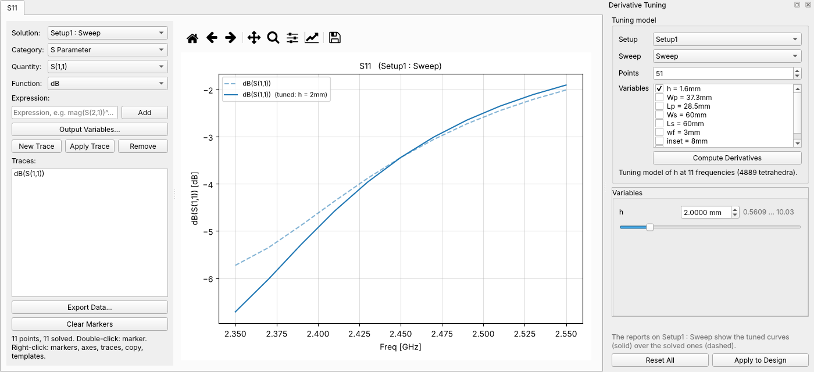

Shorten `Lp` until the dip sits at 2.45 GHz, then move `inset` to see how deep the dip gets. Every
report on this solution follows the sliders: Smith chart, data table, and any expression such as
`re(Z(1,1))`. Markers, Copy Data and Export include the tuned curves as drawn.

1. **Create Far Fields Report > Radiation Pattern**, `dB(RealizedGainTotal)` at 2.45 GHz. The tuned
   pattern is drawn over the solved one. Here the realized gain at 2.45 GHz goes up, because the tuned
   antenna is better matched at that frequency. **3D Polar Plot** shows the tuned pattern in 3D.

   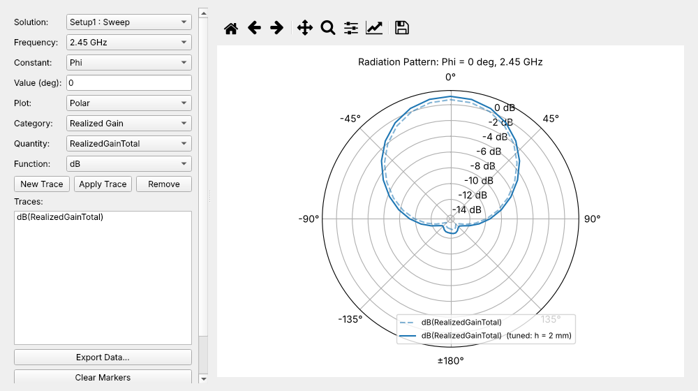

2. **Create Far Fields Report > Antenna Parameters**, `dB(PeakRealizedGain)` and `RadiationEfficiency`.
   The tuned curves are drawn over the sweep frequencies, and the gain maximum moves with the resonance.
   The first time, the far fields of the model are computed once per frequency, with a progress bar.
   After that, the sliders move in a fraction of a second.

   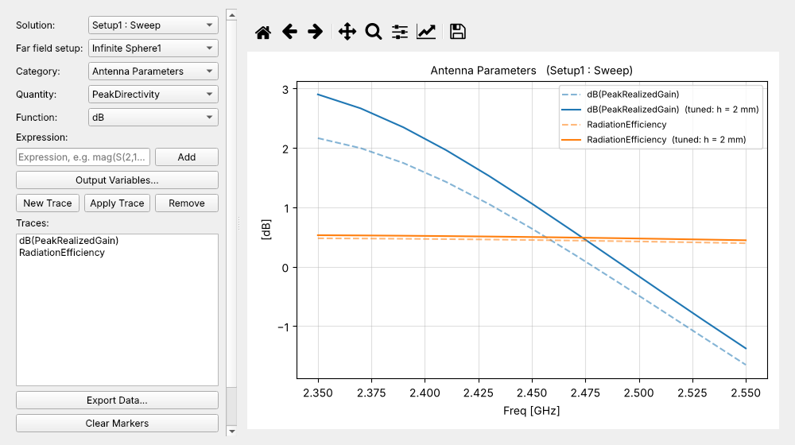

When a slider moves into the outer part of its range, an orange hint under the sliders says that the
accuracy drops there. **Reset All** puts every slider back to its solved value.

### 10.4 Plot against the patch length

A report can also show a quantity over a variable instead of over frequency.

1. In the S11 report, set **X axis** to `Lp` and **At** to `2.45 GHz`.
2. The curve shows S11 at 2.45 GHz over the whole range of `Lp`. The dashed vertical line is the solved
   length, the solid line the slider value. The shaded parts at both ends are the outer part of the
   range, where the accuracy drops.

   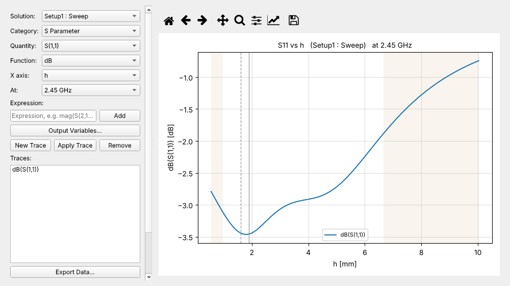

3. The Antenna Parameters report has the same **X axis** choice. The peak realized gain over `Lp` shows at
   a glance which length gives the most gain at 2.45 GHz. Notice that the curve bends oddly in the shaded
   part on the right: that is where the model is no longer reliable.

   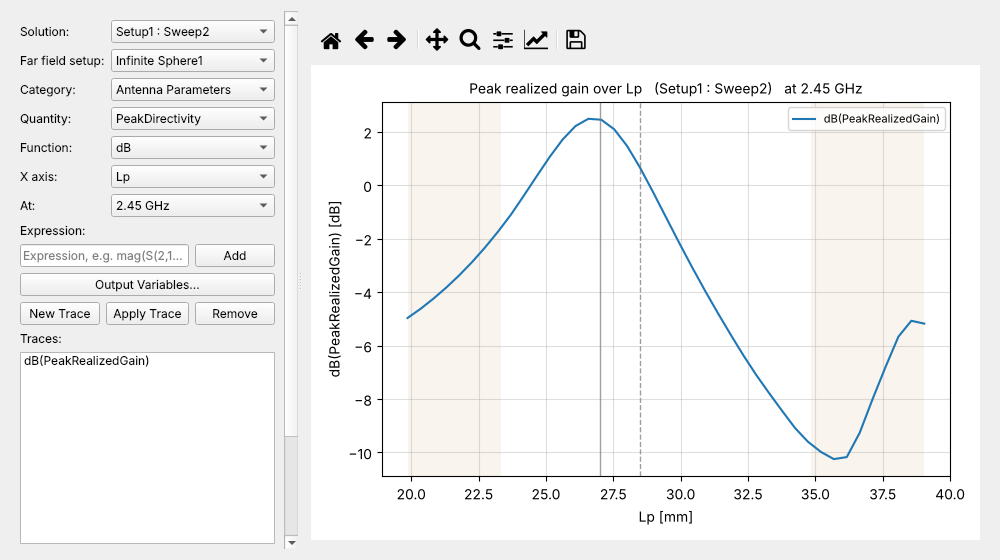

The other variables stay at their slider values, so moving `inset` changes these curves too. This works
with the tuning panel closed as well, from the stored model.

### 10.5 Keep the result

1. Set the sliders to the values you want and click **Apply to Design**. The design variables `Lp` and
   `inset` take the slider values.
2. **Analyze All** again. The new solve is the reference: close to the solved values it agrees with the
   tuned curves, and the further the sliders were moved, the larger the difference.

Tune up to six variables at once, for example also `Wp` (patch width) or `h` (substrate height), to see
how they interact. Variables that change the topology of the model, or that move a wave port, cannot be
tuned. See [TUNING.md](TUNING.md) for the details and the limits.

---

## 11. A stub filter as a circuit and its 3D layout

**Goal:** a band-stop filter for 2.45 GHz from two open quarter-wave stubs on a 50 Ω microstrip line,
designed as a **circuit** in a fraction of a second, then turned into a **3D layout**, solved full-wave,
tuned there and copied back into the schematic. The finished project is `examples/StubFilter.hzn`.
Everything a circuit design offers is described in [CIRCUIT.md](CIRCUIT.md).

### 11.1 A circuit design

1. **File > New**. On the start page choose **Circuit**, keep **Linear Network**, enter the project name
   `StubFilter` and click **Create**. **Project > Rename Design...** names the design `StubFilter` too, so the
   layout below is called `StubFilter_Layout`. A schematic opens in place of the 3D modeler, with its own ribbon
   (Desktop, Schematic, Lumped Elements, Transmission Lines, Data, Simulation, Results) and the part library
   with a search field next to it.

   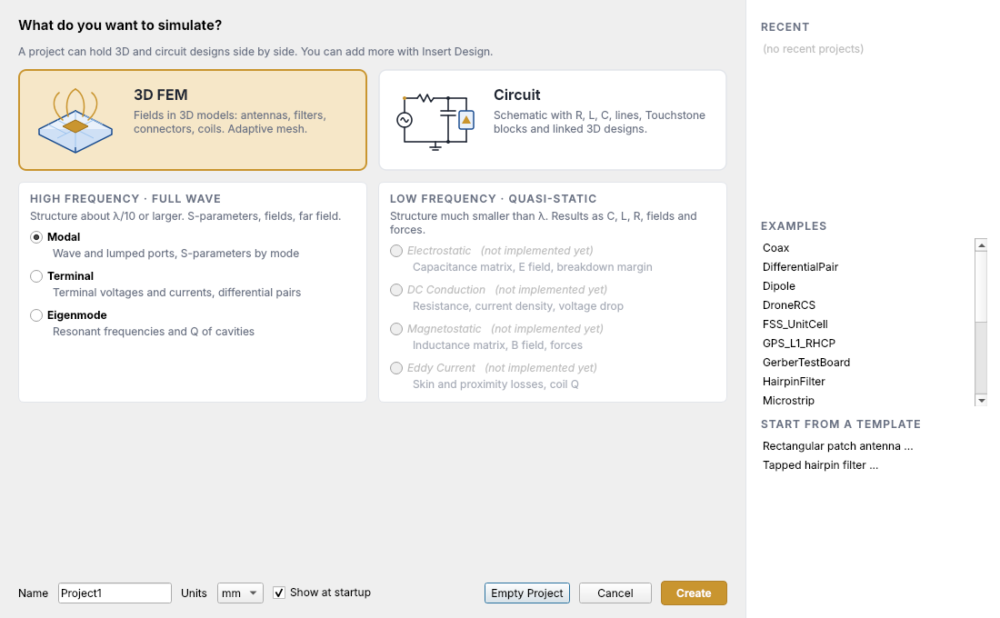
   *The start page of **File > New**: 3D FEM or Circuit, the solution type, the units and the name; on the right
   the recent projects, the examples and the templates. **Project > Insert Design** shows the same choice.*

2. Drag a **Substrate** (Transmission Lines) into the schematic. Its defaults are a 0.508 mm board with
   εr 3.66, tan δ 0.0037 and 35 µm copper; keep them. Every line names its substrate in *Subst* (`Sub1`).

### 11.2 Draw the schematic

Parts are placed by dragging them from the library, or with a double-click on the library entry (or a
ribbon button) and a click in the schematic. While a part hangs at the mouse, **R** rotates and **M**
mirrors it; **Esc** returns to Select.

1. Place a **Microstrip Line** `MS1`. Double-click it: in the **Line calculator** of its dialog enter
   Z0 `50ohm`, electrical length `90deg` at `2.45GHz` and press **Calculate W and L**: W = 1.079 mm,
   L = 18.23 mm. Keep W and set L to `10mm` (a feed line). *Now* shows Z0 = 50.0 Ω and εeff of the line
   while you type.
2. Place a **Microstrip Open Stub** `MSO1` to the right of `MS1`, pointing down. In its line calculator use
   the same values: W = 1.079 mm and L = **18.02 mm**. For an open stub the calculator subtracts the
   length by which the fringing field at the open end lengthens it.
3. Place `MS2` (W 1.079 mm, L 18.23 mm, the quarter wave between the stubs), a second stub `MSO2` and
   `MS3` (W 1.079 mm, L 10 mm). Faster: select `MSO1`, **Ctrl+C**, move the mouse to the new place and
   **Ctrl+V**: the copy is named `MSO2` and keeps its values and substrate.
4. Place a **Power Port** at each end (Schematic tab). They are numbered 1 and 2, with 50 Ω.
5. Press **W** and draw the wires: click on a pin, click the corners, a click on another pin or on a wire ends
   the wire. Draw one wire from `MS1` to `MS2` and end it on the pin of `MSO1` on the way, the same for
   `MSO2`. Dragging a part later keeps its wires attached.

Where three microstrip lines meet, a diamond appears: **Automatic** junctions (Transmission Lines >
Discontinuities, on by default) model the meeting point as a microstrip **tee** with the widths of the
lines. Its tooltip names the model.

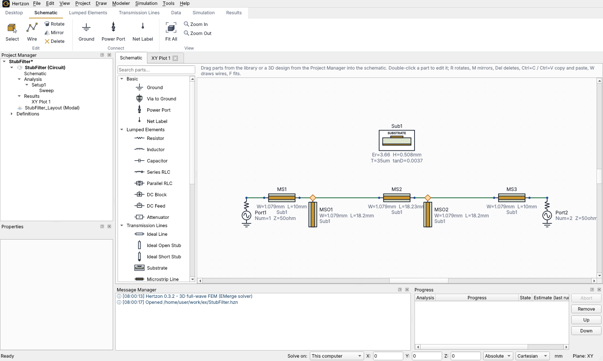
*The stub filter: two open stubs a quarter wave apart, an automatic tee (diamond) where each stub meets the
line, and the part library on the left.*

### 11.3 Sweep, analyze, plot

1. **Simulation > Sweep** opens the sweep in the Properties panel: **Distribution** *Linear Count* from `1GHz`
   to `4GHz`, **Count** `301`.
2. **Simulation > Analyze** (F5). The network is solved at once.
3. **Results > Rectangular Plot**: `dB(S(1,1))` and `dB(S(2,1))`.

The notch is at **2.47 GHz**, 20 MHz above the design: the tee junctions shift the reference planes of the
stubs. Set L of both stubs to `18.2mm` (double-click each, or edit it in the **Properties** panel) and analyze
again: the notch is at 2.45 GHz, and S21 stays below −20 dB from 2.12 to 2.76 GHz.

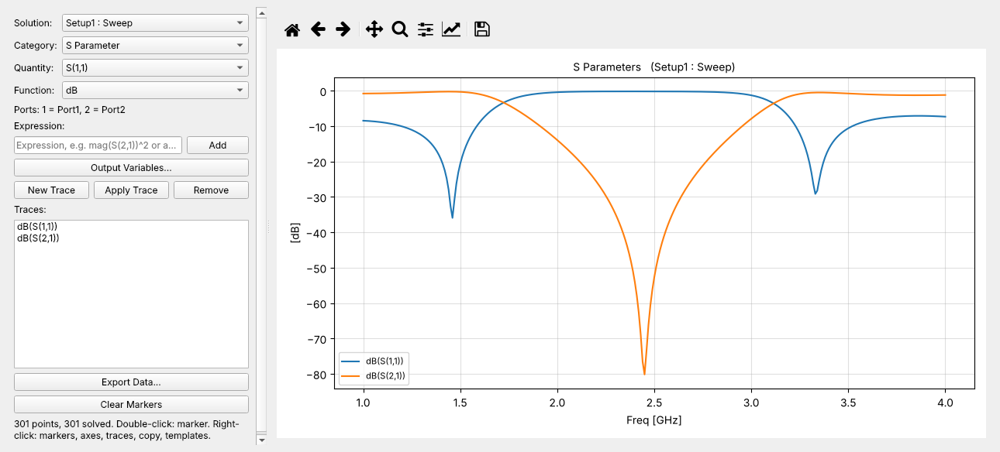
*S11 and S21 of the circuit from 1 to 4 GHz with 18.2 mm stubs: the stop band around 2.45 GHz.*

**Full-wave line model.** Transmission Lines > Line Model > **Full Wave** takes the propagation constant and
impedance of each microstrip cross-section from a mode solve instead of the closed-form formulas. The first
analysis solves each cross-section (about 10 s each on a desktop) and caches it; here the notch stays at
2.45 GHz, so the line formulas are not where the difference to 3D below comes from.

### 11.4 The 3D layout

1. **Simulation > Create 3D Layout**. Hertzon builds the 3D design `StubFilter_Layout`: the substrate with
   its ground plane, the traces end to end as in the schematic (the stubs point in -y as they do in the
   schematic), the tee junctions and the two power ports as **Lumped Ports** on the board edge. Every
   dimension is a design variable named after its part (`MS1_W`, `MS2_L`, `MSO1_L`, `Sub1_H`, ...), and the
   setup has the sweep of the circuit (interpolating).
2. **Simulation > Analyze All** (F5). On a 4-core computer the adaptive passes converge after 7 passes with
   about 20 000 tetrahedra, and the interpolating sweep needs 17 solutions; together about a minute.
3. **Results > Create Modal Solution Data Report > Rectangular Plot** (or right-click *Results*):
   `dB(S(1,1))` and `dB(S(2,1))`, the same report as for the circuit.

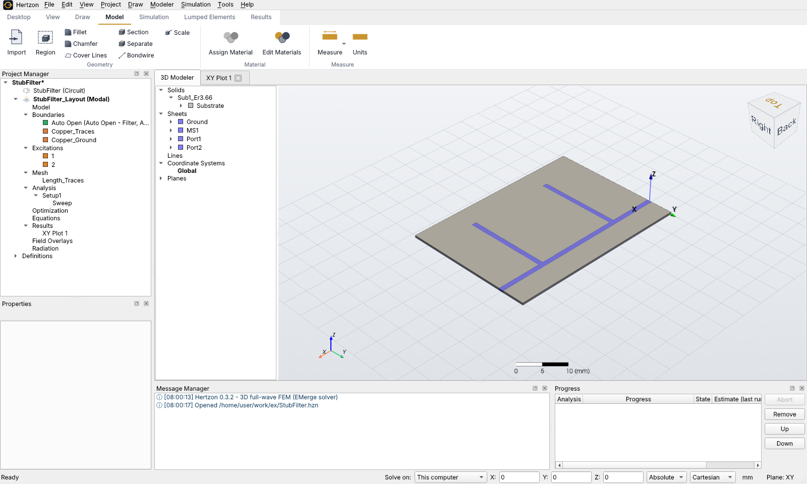
*The 3D layout built from the schematic: the feed line with the two stubs, the board and the ground plane.*

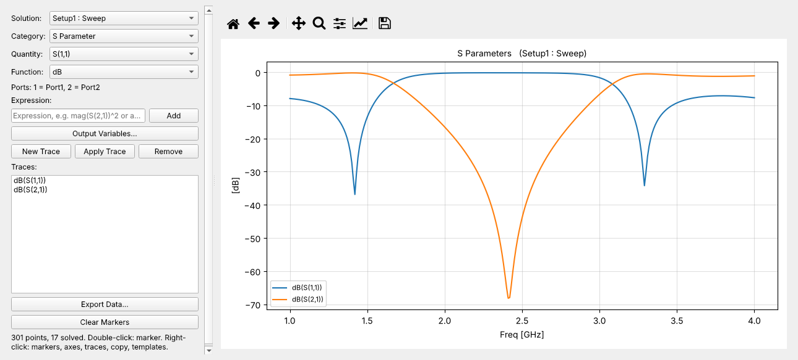
*The full-wave solution of the layout: the notch is at 2.41 GHz, S21 below −20 dB from 2.07 to 2.74 GHz.*

The full-wave notch is 40 MHz (1.6 %) lower than in the circuit: the open ends and the tees radiate and
couple a little more than their closed-form models say. This is what the 3D layout is for.

### 11.5 Tune in 3D and copy back

1. In `StubFilter_Layout` open **Project > Design Properties...** and set `MSO1_L` and `MSO2_L` to `18mm`.
2. **Analyze All**: the notch of the 3D layout is now at **2.45 GHz** (S21 below −20 dB from 2.09 to 2.77 GHz).
3. Go back to the circuit design and click **Simulation > Update Schematic**. The Message Manager lists the
   changes (`MSO1.L: 18.2mm → 18mm`, ...), and the schematic has the dimensions of the 3D layout.

The way back works for every dimension: a trace width changed directly on the object of the layout comes
back too. In the other direction, **Update 3D Layout** rebuilds the layout after you added, removed or
exchanged parts in the schematic; its setups and reports stay.

**More in a circuit:** drag a solved 3D design from the Project Manager into the schematic to use it as an
S-parameter block, or drag a `.hzn` file in to copy the 3D designs of another project (Data > 3D Design >
From Project File). *Create 3D Layout* then builds those blocks in with their geometry, turned so that the
lines attach at their ports. **Via to Ground** shorts a line through N vias (their inductance and coupling
included), and **Coplanar Line**, **Coupled Microstrip**, the junction parts and the lumped R, L and C complete
the library. See [CIRCUIT.md](CIRCUIT.md).

---

## 12. Import a board from Gerber files

**Goal:** a simulation model from the manufacturing files of a board: substrate in the board shape, the
copper of each layer, vias and holes, all on a stackup whose variables drive the geometry. This section reads
back the files written in [section 6](#6-gerber-export-of-a-printed-circuit-board); files from KiCad, Altium or
Eagle work the same way. The reference of the import is [PCB_IMPORT.md](PCB_IMPORT.md).

1. Write the files of `examples/GerberTestBoard.hzn` as in section 6 into a folder.
2. **File > New**, **3D FEM**, units **mm**, **Create**.
3. **File > Import PCB (Gerber, Excellon)...** (also **Import PCB** on the ribbon). Press **Add folder...** and
   choose the folder. A zip archive or single files work too.
4. The table says what each file is and how it was found (*Found by*: X2 attribute, job file, file name). Here
   the two copper layers and the outline come from their X2 attributes, the two drill files are Excellon, and
   the export report is *Other (not loaded)*. Change an entry with its drop-down list if a file was
   recognised wrongly.
5. **Stackup:** without a job file (`.gbrjob`) Hertzon assumes a usual 2-layer board of 1.6 mm and says so.
   **Edit stackup...** opens the stackup editor: set the core thickness, εr and tan δ of your board and choose
   for each copper layer whether it is a sheet with finite conductivity (thin conductor) or solid copper.
6. The preview shows the selected file; **Shift + drag** limits the import to a part of the board. *What will be
   made* lists the result before anything is built.
7. Press **Import**.

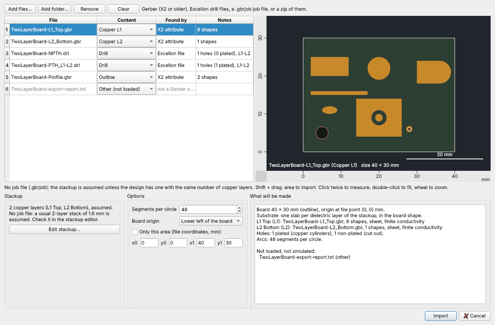
*Import PCB with the files of the test board: two copper layers, the outline and two drill files, the stackup
assumed (no job file), and the list of what will be made.*

The design now holds the substrate `Sub_Core_1_2` in the board shape (the slot, the mounting hole and the via
cut out), 8 copper shapes on `L1 Top` and the ground plane on `L2 Bottom` (groups *PCB L1 Top*, *PCB L2
Bottom*), the via as a copper cylinder (*PCB Vias*) and the boundaries `Cu_L1_Top` and `Cu_L2_Bottom`.
The stackup writes the variables `stk_Core_1_2_t`, `stk_L1_Top_zs`, `stk_total` and so on, read-only in
Design Properties: change a thickness in **Modeler > PCB Stackup...** and every object moves with it.

What is not simulated (solder mask, silkscreen, paste) is not loaded, and the import report names it. Import
again to replace the earlier import. Then add ports, a region and a setup as in the sections above.

---

## 13. A 2.4 GHz LNA: from the schematic to the board

**Goal:** a one-transistor low-noise amplifier for 2.4 to 2.5 GHz that can be built as drawn, with its bias, its
stability, the parts on their footprints, the placed board, the 3D layout of that board and the board put back
under the transistor. The finished project is `examples/LNA_2G4.hzn` (**File > Open Example > LNA_2G4**); this
section builds it up in the order a designer would, and every step can be checked in the example. The parts, the
values and the results are listed in [CIRCUIT.md](CIRCUIT.md#example-a-24-ghz-lna-that-can-be-built).

**Who computes what:** Hertzon draws the schematic, models the lines, junctions, vias and parts and reduces the
whole linear circuit to the transistor pins; [ngspice](https://ngspice.sourceforge.io) gives the bias point and
the small-signal admittance of the transistor; [circuitRF](https://github.com/potatobeanradio/circuitRF) runs the
harmonic balance. Install both (ngspice 43 or later) and put them on `PATH`, see
[CIRCUIT.md](CIRCUIT.md#nonlinear-devices). The design *LNA_Measured* of the example needs neither: it has the
transistor's measured S-parameters in place of the model.

### 13.1 The schematic

1. **File > New**, **Circuit**, name `LNA_2G4`, **Create**. Drag a **Substrate** in and set it to the board:
   H `0.508mm`, Er `3.66`, TanD `0.0037`, T `35um` (RO4350B).
2. **Nonlinear > Nonlinear Device** `Q1`: *Kind* **Verilog-A**, *File* `models/nsvf4009sg4.va` (onsemi's
   Gummel-Poon parameters of the NSVF4009SG4 with its package), *Pins* `b c e1 e2` (the part has two emitter
   leads). Hertzon compiles the `.va` file with `openvaf-r` on the first analysis.
3. The signal path, left to right: a **Power Port** `RF_in`, a 50 Ω **Microstrip Line** `TL_in` (W `1.1mm`,
   L `5mm`), the input match `C1` and `L1` in series (**Lumped Elements > Series RLC** with the parasitics of the
   0402 parts: C1 = 3.6 pF with 0.3 nH and 0.15 Ω; L1 = 1.2 nH as a **Parallel RLC** with its loss and winding
   capacitance), a short trace `TL_b` (0.4 × 0.8 mm) to the base. From the collector a trace `TL_c`, the output
   DC block `C2` (3.9 pF), `TL_out` and the Power Port `RF_out`.
4. **Emitter degeneration:** from each emitter pin a trace `TL_e1`, `TL_e2` (0.4 × 0.85 mm) to a **Via to
   Ground** with two vias of 0.3 mm. Their inductance sets the input match and keeps the stage stable; with the
   vias in the schematic, the analysis sees them as the board has them.
5. **Bias:** **Nonlinear > DC Voltage Source** `VCC` (5 V), the collector resistor `R1` (180 Ω) and the feedback
   resistor `R2` (24 kΩ) from the collector to the base: VCE = 3 V and IC = 10 mA, and the current follows the
   current gain of the part. The collector is fed through `L2` (6.8 nH, also the shunt element of the output
   match) and `R3` (12 Ω), bypassed after R3 by `C3` (68 pF) to a via, and `C4` (1 µF) decouples the supply.
6. Connect with wires (**W**) or with **Net Labels** of the same name.

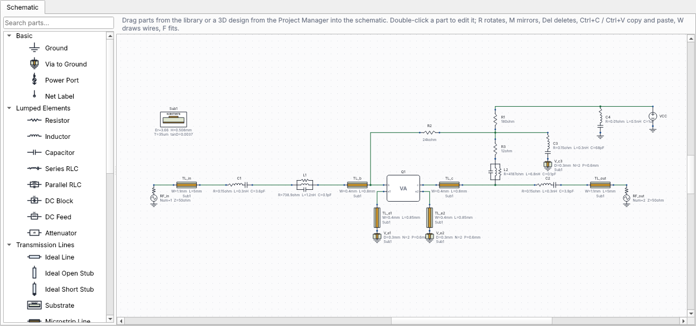
*The schematic of `LNA_2G4`: the 50 Ω feed lines, C1/L1 and C2/L2 as the matching networks, the emitter traces
with their vias, and the collector-feedback bias from VCC. Every line and via is a part, so the analysis sees the
board.*

### 13.2 Bias, gain and stability

1. **Simulation > Sweep**: the setup *SParameters_ngspice* has two sweeps, *Band* (2 to 3 GHz) and *Wide*
   (10 MHz to 12 GHz) for the stability. Its *Analysis* is **S-Parameters**.
2. **Analyze** (F5). ngspice solves the bias point first (the ports are their 50 Ω to ground, as on an
   instrument), then the small-signal admittance of Q1 about it; Hertzon adds it to the network. The bias is in
   `operating_point.json` of the results: VCE 3.01 V, supply current 10.3 mA.
3. **Results > Rectangular Plot** `dB(S(2,1))`, `dB(S(1,1))`, `dB(S(2,2))`: 13.2 to 12.9 dB gain, S11 and S22
   below −14 dB in the band.
4. **Stability:** the report *Stability (mu > 1)* plots the two Edwards-Sinsky factors `mu_load` and
   `mu_source`, defined once under **Output Variables...** of the report dialog from the S-parameters. Both stay
   above 1 from 10 MHz to 12 GHz: the stage is unconditionally stable. R3 is what makes it so below the band
   (C3 bypasses there, so the collector sees R3 as a load).
5. **Compression:** add an analysis (right-click *Analysis* > *Add Analysis*), *Analysis* **Harmonic Balance**,
   *Fundamental* `2.45GHz`, *Harmonics* `5`, *Drive port* `RF_in`, *Available power* `-30:1:0`. circuitRF runs
   it on Hertzon's network and writes `harmonic_balance.csv` with the power of every harmonic at every port:
   the output 1 dB compression point is 6.1 dBm (setup *Compression_circuitRF* of the example).

The same board with onsemi's measured transistor data (design *LNA_Measured*, Hertzon alone) gives 13.6 to
13.3 dB and S11, S22 below −13.9 dB, so the model and the measurement agree within a few tenths of a dB:

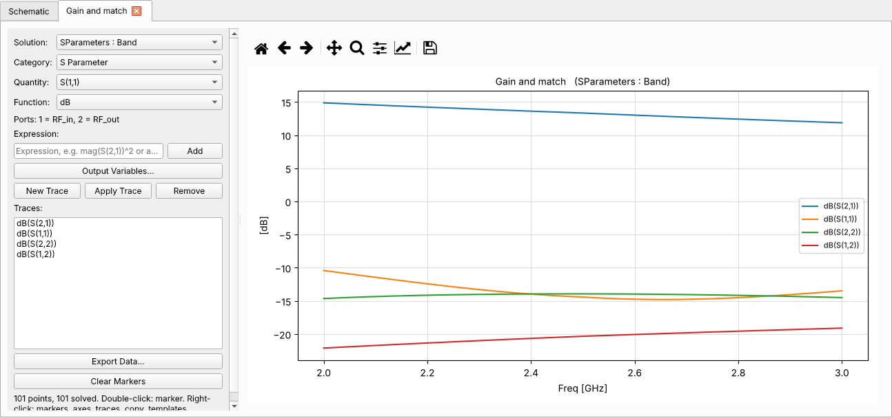
*LNA_Measured: gain and match from 2 to 3 GHz with the measured S-parameters of the NSVF4009SG4 at VCE = 3 V,
IC = 10 mA.*

### 13.3 Footprints and the board

1. Double-click `Q1`. Under **Footprint** choose `SC-82FL_MCPH4` (built in, as onsemi recommends it) or a
   KiCad `.kicad_mod` file of the part; **Pads** says which pad belongs to which pin: `b=3; c=1; e1=4; e2=2`.
   The drawing colours each pad by its pin and lists a pin without a pad as an error.
2. Give every R, L and C its package: `C_0402`, `L_0402`, `R_0402`.

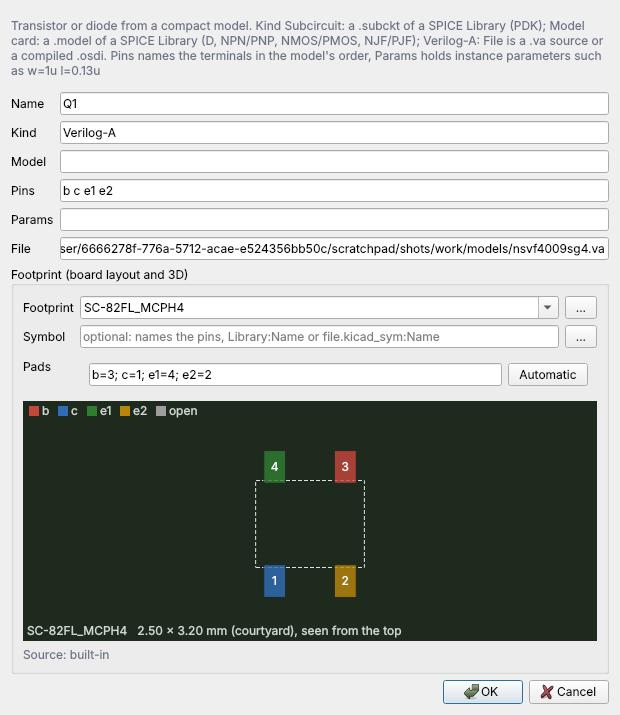
*The dialog of Q1: the Verilog-A model with its pins, and the footprint with the pads coloured by pin.*

3. **Simulation > Board Layout** shows the board from the top. The first time, every part is placed as the
   schematic is drawn. Drag the parts where they belong, **R** turns them; connections the copper does not make
   yet are dashed (ratsnest), copper of two nets on each other is outlined in red, and the status line counts
   both. **Track** draws copper the schematic does not have, such as the DC line to VCC.

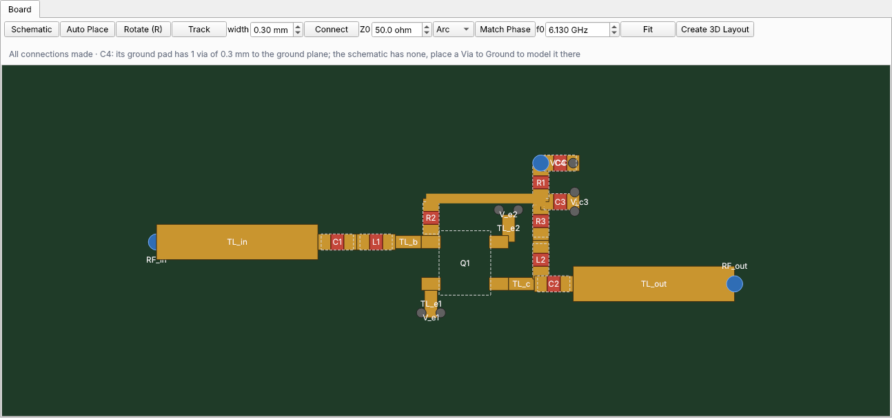
*Board Layout of the LNA: the 50 Ω lines, the 0402 parts on their pads, Q1 in SC-82FL with its emitter traces and
vias, the bias network folded up above the signal path. "All connections made" in the status line.*

### 13.4 The 3D layout and the board under the transistor

1. **Create 3D Layout** (on the board toolbar or Simulation > 3D Layout). Hertzon builds `LNA_Layout` as placed:
   the substrate and the ground plane, the copper of the lines and pads, the vias, every R, L and C as a Lumped
   RLC sheet between its pads, and a **Lumped Port at every pad of Q1** (`Q1_b_pad3`, `Q1_c_pad1`, `Q1_e1_pad4`,
   `Q1_e2_pad2`) and at the supply (`VCC_supply`). The messages list what the board has and the schematic has
   not, for example the via in the ground pad of C4 and the DC track.
2. Analyze `LNA_Layout` (F5). This is the board alone, full wave: lines, pads, vias and the coupling between
   them.
3. Back in the schematic, **Simulation > Board Circuit**. It makes `LNA_Board`: the solved layout as one block,
   Q1 connected pad by pad to its ports by net labels, the power ports and VCC at theirs, with the setups of the
   schematic. It also makes `LNA_BoardModel`, the schematic without its devices, as the circuit model of the
   block: the bias point needs the DC paths of the board, which the full-wave data (above 0 Hz) do not have.
4. Analyze `LNA_Board`: the S-parameters of the transistor on the full-wave board, with the bias from ngspice;
   the harmonic balance works the same.

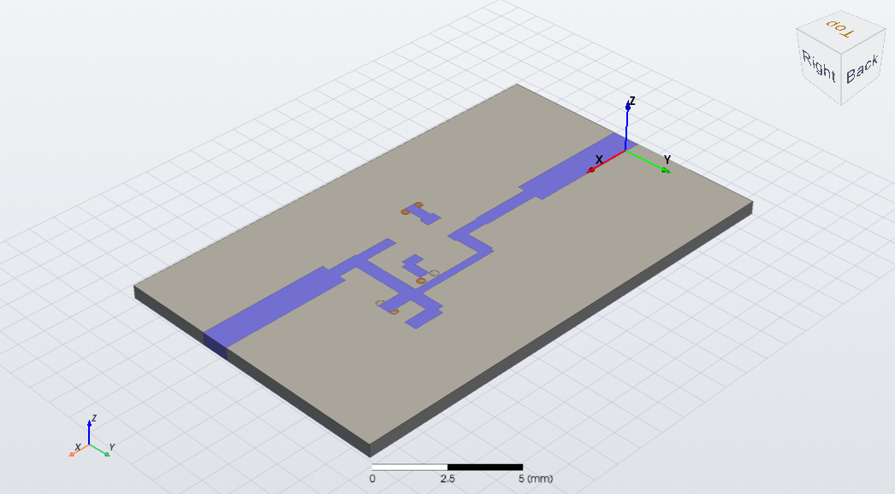
*`LNA_Layout`, built from the placed board: the feed lines, the pads of the 0402 parts and of Q1, the vias of the
emitters and of the bypass capacitor.*

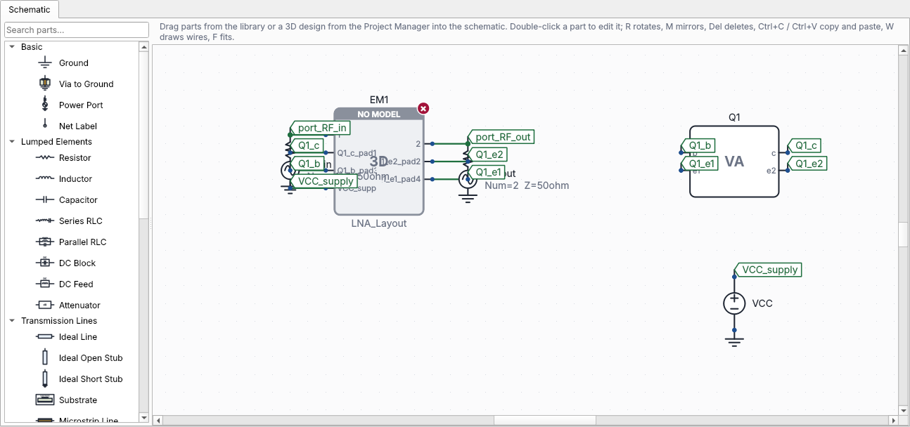
*`LNA_Board`: the 3D layout as a block with a port per pad, Q1 on its pads and VCC on its supply port. The block is
grey (NO MODEL) until `LNA_Layout` is solved.*

This chain is checked end to end: lines and a transistor laid out, solved in 3D and put back on their pad ports
give the S-parameters of the schematic within 0.1 dB in S21 from 1 to 4 GHz (`tests/test_circuit_layout.py`).

---

## 14. A broadband diode mixer with harmonic balance

**Goal:** a double-balanced diode-ring mixer for RF and LO of about 1.25 to 4 GHz and an IF of 100 MHz: two baluns
solved as a 3D design, the diode ring with the manufacturer's model card, and the conversion loss and the
isolations over the band from a two-tone harmonic balance. The finished project is `examples/Mixer_DBM.hzn`
(**File > Open Example > Mixer_DBM**), made by [examples/make_mixer.py](../examples/make_mixer.py). Hertzon builds
the network and solves the balun (EMerge); circuitRF runs the harmonic balance.

### 14.1 The balun as a 3D design

The design *Balun* is a broadside-coupled Marchand balun in stripline inside a standard 1.6 mm 4-layer board
(RO4350B cores, RO4450F prepreg): the primary on layer 3, the two coupled secondaries on layer 2 right above it.
Edge coupling on one layer is far too weak for a broadband Marchand balun; broadside coupling across the thin
prepreg is what makes it work from 1.25 to 4 GHz. Its five Lumped Ports are the unbalanced input, the two
balanced outputs and the two cold ends.

Analyze it first (a few minutes): select *Balun* and **Analyze All**. Its sweep runs from 0.05 to **26 GHz**,
far above the band, for a reason that 14.3 explains.

### 14.2 The mixer circuit

1. Insert a circuit design (**Project > Insert Design > Circuit**), here `Mixer`.
2. Drag the 3D design *Balun* from the Project Manager into the schematic twice: `BalunLO` and `BalunRF`. Each is
   a block with one pin per port.
3. **Nonlinear > SPICE Library** `LIB1`, *File* `mixer/hsms282x.lib` (the HSMS-282x card of the Broadcom data
   sheet). Four **Nonlinear Devices** `D1` to `D4`, *Kind* **Model card**, *Model* `HSMS282X`, *Pins* `a k`, as a
   ring a-b-c-d; the LO balun drives a-c, the RF balun b-d. `LA` to `LD` (0.5 nH) are the leads of the
   SOT-143 package.
4. The IF comes from the cold ends of the RF balun: an 0402 bypass capacitor `Cb1`, `Cb2` (10 pF with its series
   inductance) at each end, a coplanar line `IF1`, `IF2` to the IF junction, the choke `LCH` (47 nH) and the
   Power Port `IF`. The cold ends of the LO balun are grounded.
5. Three Power Ports: `LO` (1), `RF` (2), `IF` (3).

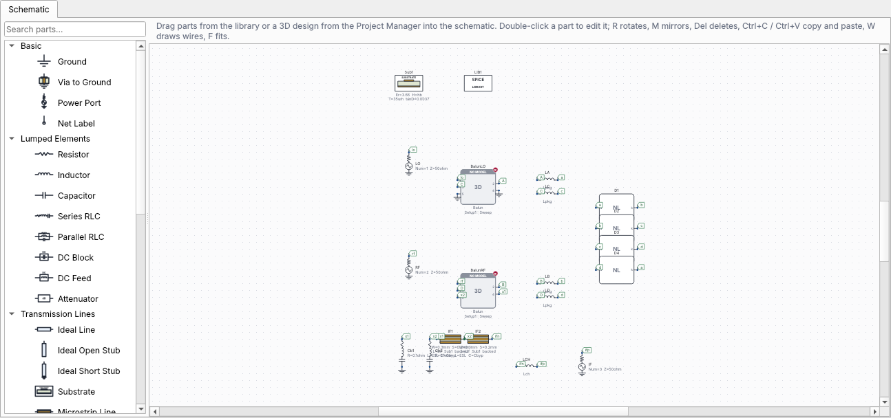
*The schematic of `Mixer_DBM`: the two balun blocks (grey, *NO MODEL*, until *Balun* is solved), the diode ring
with the package leads, the IF path with the bypass capacitors, the coplanar lines and the choke.*

### 14.3 Full-wave block or circuit model

The colour of a block says what the next analysis takes. A two-tone harmonic balance needs the network not only
in the band but at every mixing product up to the mixing order times the highest frequency, here up to 5 × 5 GHz
= 25 GHz. Block data are never extrapolated, so:

| Block colour | Meaning |
|---|---|
| blue, *FULL-WAVE FEM* | the solved data cover every frequency the analysis needs |
| red, *CIRCUIT* | the circuit model chosen for the block (right-click > *Use Circuit Model*) |
| red dashed, *CIRCUIT (AUTO)* | the data were chosen but do not cover the analysis: the circuit model stands in, with a warning |
| grey, *NO MODEL* | no usable model: not solved yet, or not covering the analysis and no circuit model; the analysis stops and names the ranges |

That is why the balun is swept to 26 GHz. A block that has a circuit design with the same ports as its circuit
model (the blocks of a Design Wizard structure, or a layout made with *Create 3D Layout*) can switch to it; the
section below uses that.

### 14.4 The mixer analysis

1. Right-click *Analysis* > *Add Analysis*, then set *Analysis* to **Mixer** in its properties: *LO port* `LO`,
   *LO power* `7` (dBm), *RF port* `RF`, *RF power* `-20`, *IF port* `IF`, *RF start* `1GHz`, *RF stop* `5GHz`,
   *RF points* `17`, *IF frequency* `100MHz`, *LO side* **Low** (f_LO = f_RF − f_IF), *Mixing order* `5`. This is
   the setup *Band* of the example.
2. A second analysis *LODrive* with *LO power* `-3:1:13` and RF fixed at 3 GHz shows how much LO the ring
   needs.
3. **Analyze**. circuitRF solves both tones at once on Hertzon's network; every point takes about 0.7 s at order
   5. The results are in `mixer.csv` of each setup: conversion loss, LO-to-RF, LO-to-IF, RF-to-IF and RF-to-LO
   isolation and the IF power for every LO power and RF frequency, with a flag for a point that did not converge
   (flagged, not dropped).

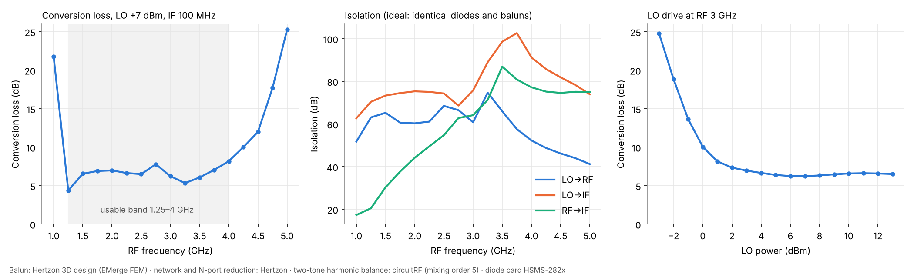
*The results of `Mixer_DBM` from `mixer.csv` (plotted outside Hertzon; harmonic-balance results are not in the
report dialog yet): conversion loss 4.4 to 8.2 dB from 1.25 to 4 GHz at +7 dBm LO, LO-to-RF isolation ≥ 52 dB
and LO-to-IF ≥ 63 dB (ideal, identical diodes and baluns), and the conversion loss over the LO power at 3 GHz.*

**Mixing order:** a diode ring at order 5 is within about 0.2 dB of order 9 (at most 0.7 dB), and the time grows
fast with the order (3.6 s per point at 9). A single diode needs about 13. The harmonic balance of a single
HSMS-282x diode was checked against an ngspice transient analysis within 0.13 dB
([examples/mixer/check_ngspice.py](../examples/mixer/check_ngspice.py)).

---

## 15. Connect subdesigns into one large schematic

**Goal:** the reflectometer test set of a two-port network analyzer at 2.45 GHz from finished blocks: a
Wilkinson divider and two 15 dB coupled-line couplers of the Design Wizard, placed on one board and connected by
the router with 50 Ω lines, round bends and the three lines to the receivers R, A and B **matched in phase**. The
finished project is `examples/VNA_TestSet_2G4.hzn` (**File > Open Example > VNA_TestSet_2G4**).

### 15.1 Blocks from the Design Wizard

1. **File > New**, **Circuit**, name `VNA_TestSet_2G4`, **Create**; rename the design to `TestSet`.
2. **Tools > Design Wizard**, *Wilkinson divider* at 2.45 GHz on 0.508 mm RO4350B, **Create**. The wizard adds
   the 3D design `Wilkinson_2.45GHz` and its circuit `Wilkinson_2.45GHz_Circuit`. Then *Coupled-line coupler*
   with a coupling of 15 dB: `Coupler_15dB_2.45GHz` and its circuit.
3. Drag `Wilkinson_2.45GHz` into the schematic (`DIV`) and the coupler twice (`CPL1`, `CPL2`). Each block takes
   the wizard's circuit as its circuit model. Choose the model per block: right-click > **Use Circuit Model**
   (red, *CIRCUIT*: milliseconds, no 3D solve needed) or **Use Full-Wave FEM Model** (blue, once the 3D design is
   solved). The example uses the circuit models, so everything in this section runs without a 3D solve.
4. Add the ports of the analyzer model: `SRC` (1), `R` (2), `A` (3), `B` (4), `DUT1` (5), `DUT2` (6), `TERM2`
   (7), and the two 50 Ω terminations of the unused coupler ports (`R_iso1`, `R_iso2`, 0603, each to a **Via to
   Ground**).
5. Draw the connections as they belong together, with wires or net labels; where on the board they run does not
   matter yet: SRC to the divider input, one divider output to R, the other through CPL1 to DUT1; the coupled port
   of CPL1 to A; DUT2 through CPL2 to TERM2, the coupled port of CPL2 to B.

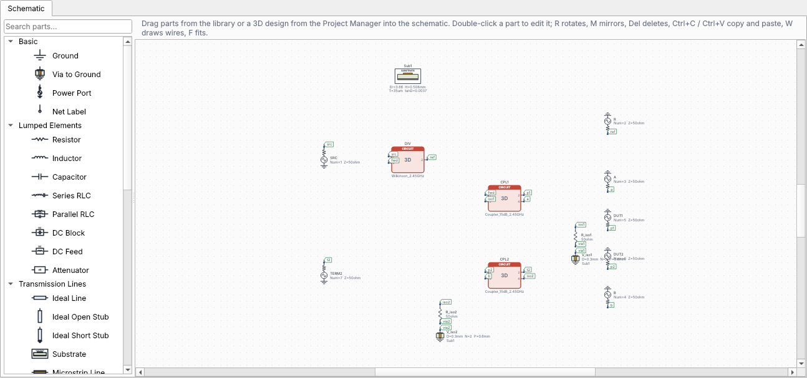
*The schematic of the test set: three Design Wizard blocks (red: circuit model), the seven ports and the two
terminations, connected by net labels. The block colours are explained in [14.3](#143-full-wave-block-or-circuit-model).*

### 15.2 Place and Connect

1. **Simulation > Board Layout**. Each block is one part with its copper seen from the top and a pin at every
   port; the lumped resistor of the divider is red. Drag the blocks roughly where they belong: the divider
   left, the couplers in a column right of it, the ports along the right and left edges, **R** turns a part.
2. Set **Z0** `50 ohm` and the bend style **Arc** in the toolbar, then **Connect**. For every connection still
   missing (only for the selected parts, if any are selected) Hertzon lays a microstrip line of 50 Ω on the
   circuit's substrate: at right angles round the other copper with a gap of 3 line widths, few bends, a circular
   bend of radius 3 W at each corner (**Miter**: 50 % mitered). Where a pin is more than 2 % wider or narrower than
   the line, a linear taper of 3 line widths joins them, so the impedance has no step.
3. Hover a route for its length and its phase at **f0**. Double-click a bend to set its radius (or a 50 % miter
   for a 90 degree bend), for that bend or for all bends of the route.

### 15.3 Match the phase

The three receiver paths must have the same electrical length so that the ratios A/R and B/R do not turn with
frequency more than needed.

1. Set **f0** `2.450 GHz`.
2. Click the route from DIV to R, Ctrl+click the routes from CPL1 to A and from CPL2 to B.
3. **Match Phase**. The dialog asks for each route's phase relative to the group: 0 for all is equal phase; +90
   deg would make one route lag by 90 degrees more (the feed of a circularly polarized antenna, for example).
4. **OK**. Each route that is short of the target gets a meander, a row of U-shaped detours in its longest
   straight piece, first from the electrical length and then corrected on the route's circuit model to within 0.2
   degrees. In the example the three routes are 157.7 mm long and have 778.37 degrees at 2.45 GHz each.

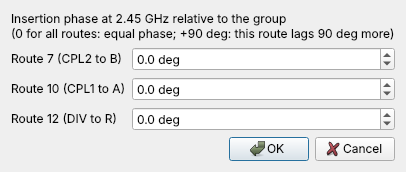
*The Match Phase dialog for the three receiver routes: 0 deg for all, equal phase.*

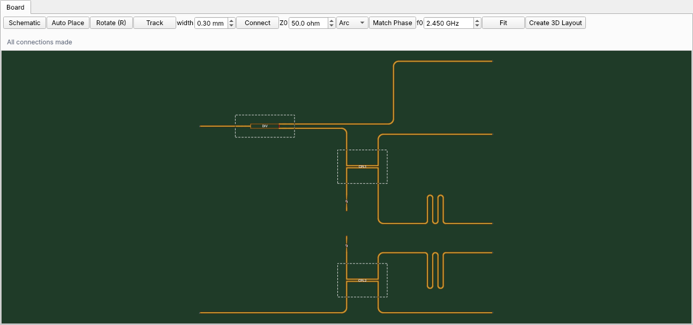
*The board of the test set after Connect and Match Phase: 50 Ω lines with round bends, the meanders that give the
lines to A and B the phase of the line to R, the terminations in line with the coupler ports.*

Move a block: its routes turn red and no longer count as connections. Select them, **Del**, **Connect** and
**Match Phase** again; matching again starts from the routes without their meanders.

### 15.4 Analyze the whole system and lay it out

1. Back to the schematic (**Schematic** on the board toolbar) and **Analyze**. The routes are part of the
   circuit: the analysis replaces the ideal connections of the schematic by the chain of each route (straight
   pieces as microstrip lines, tapers as five steps, mitered bends as MMBEND, round bends as lines of their arc
   length) and says so in the messages.
2. The report *Test set paths* shows the paths of the analyzer at 2.45 GHz: SRC to R −3.7 dB, SRC to DUT1
   −3.9 dB, DUT1 to A −15.0 dB (coupled), DUT2 to B −15.0 dB, DUT2 to TERM2 −0.9 dB.
3. **Create 3D Layout** copies the 3D design of every block into one layout, turned and moved as placed, with
   the routes as copper: the full-wave check of the whole board is one analysis away.

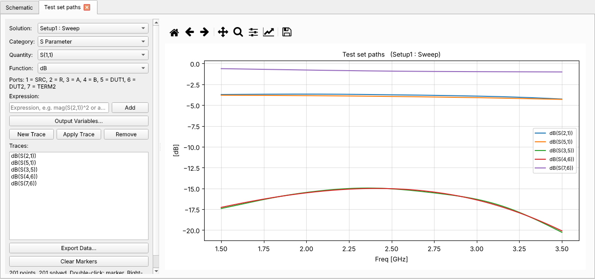
*The test set with the routed lines: the two halves of the divider (S21, S51), the coupled paths to A and B
(S35, S46) and the through path to TERM2 (S76).*

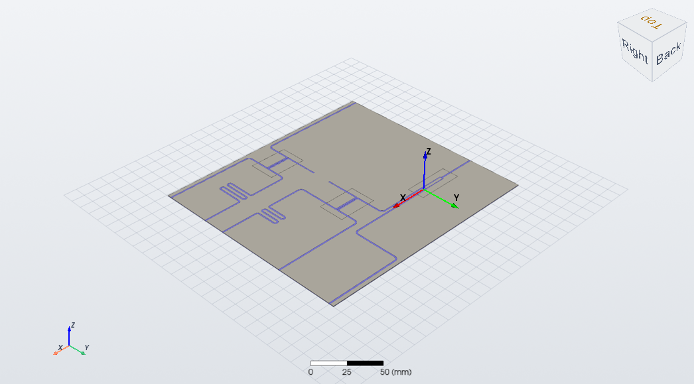
*`TestSet_Layout`: the divider and the couplers from their 3D designs with the routes and the meanders as copper.*

The microstrip coupler has a directivity of only a few dB (its even and odd modes travel at different speeds);
the calibration of the analyzer removes it, as for every real test set. See the report *Directivity of the A
coupler*.

---

## 16. A circuit from a 3D design, calibrated and kept in step

**Goal:** the other direction of [section 11](#11-a-stub-filter-as-a-circuit-and-its-3d-layout): a circuit
recognized from a planar 3D design, a 3D block for the copper the circuit cannot model, correction factors fitted
to the full-wave solution, and both designs kept in step. The example is the Wilkinson divider of the Design
Wizard.

### 16.1 Create Circuit

1. **File > New**, **3D FEM**, **Create**. **Tools > Design Wizard**, *Wilkinson divider*, 2.45 GHz, **Create**.
   Select the 3D design `Wilkinson_2.45GHz`.
2. **Simulation > Circuit > Create Circuit**. Hertzon cuts the copper into pieces of constant cross-section and
   gives each piece a circuit model: the feed lines, the two quarter-wave arms as lines, tees, the isolation
   resistor as R. Every dimension is the 3D design's variable where one has the same value (`Feed1_W`, `Wa`,
   `Lb`, ...), and the circuit analyzes the band of the 3D design's sweep (1.715 to 3.185 GHz).
3. The junction where both arms leave the feed on one side has no circuit model. Nothing is guessed: it becomes
   a **3D design block** `Wilkinson_2.45GHz_EM1`, a small 3D design with that copper, the substrate under it, a
   short piece of every line and a Lumped Port at each end, and the lines in the circuit are shortened by those
   pieces. The messages list this and everything else that was approximated or neglected (here a weak coupling
   between the arms).

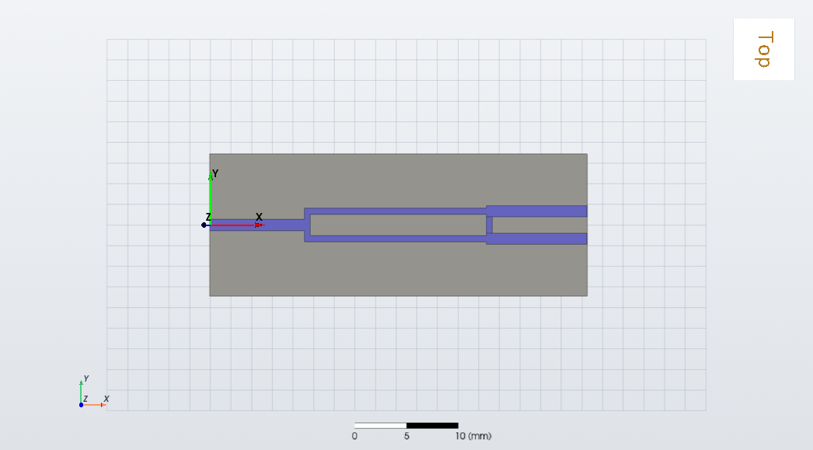
*The Wilkinson divider of the Design Wizard, seen from the top: the feed, the two arms and the isolation resistor.*

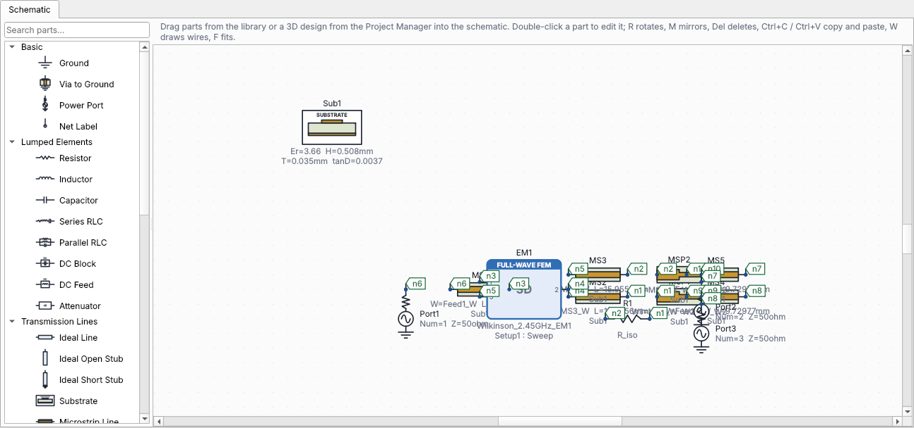
*The recognized circuit `Wilkinson_2.45GHz_Circuit2` (the wizard's own circuit is `..._Circuit`): the lines,
tees and R1, with the junction as the 3D block EM1 (blue: solved). Elements are connected by net labels.*

### 16.2 Solve and calibrate

1. Analyze `Wilkinson_2.45GHz` and `Wilkinson_2.45GHz_EM1` (**Analyze All**; on a 4-core computer about half a
   minute each). Save the project.
2. In the circuit, **Simulation > 3D Design > Calibrate to 3D**, *Lengths and widths (Cal_L, Cal_W),
   recommended*. Hertzon fits the factors to the solved S-parameters of the 3D design: `Cal_L` multiplies the
   line lengths, `Cal_W` the widths. They are design variables in the part properties (`8.1421mm*Cal_L`,
   `Feed1_W*Cal_W`), so the dimension variables stay the physical sizes shared with the 3D design.
3. The Message Manager gives the result: RMS |S_circuit − S_3D| **0.061 → 0.023** with Cal_L = 1.040 and
   Cal_W = 1.000. **Analyze** the circuit to see it.

Calibrated, the circuit is the fast model of the 3D design: tune or optimize it in milliseconds, and the
correction stays. A factor at the limit of the fit (0.7 or 1.3) is reported: it stands in for something the
models lack. *Cal_Er* (permittivity) overlaps with the widths; keep the recommended set unless the substrate is
in doubt.

### 16.3 Keep both in step

Change something on either side, for example the feed length `lf` of the 3D design to 12 mm. **Simulation >
3D Design > Sync with 3D** in the circuit (or **Sync Circuit** in the 3D design) lists what differs: variables of
the same name with other values, a dimension typed as a number in the circuit or a 3D size that is no variable,
and elements on one side only. Choose the direction of each row, **→ Circuit** or **→ 3D design**, or all at once,
and **Apply**.

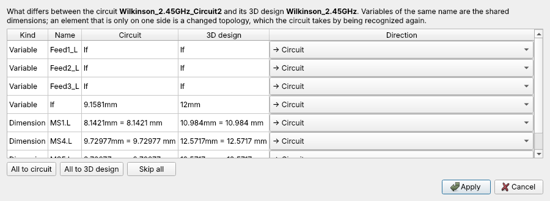
*Sync with 3D after `lf` was set to 12 mm in the 3D design: the variable, the feed lengths that use it and the
feed lines next to the 3D block (typed as numbers in the circuit, since the block shortened them), each taken to
the circuit.*

A changed topology (a stub added in 3D) is taken to the circuit by recognizing it again in place; its variables,
correction factors, setups and reports stay, and 3D blocks with the same copper are reused. The method, its
limits and the checks are in [CIRCUIT.md](CIRCUIT.md#circuit-from-a-3d-design).

---

## Where to go next

* `examples/` has twenty finished projects, from a microstrip line to a Rotman lens, a circuit with its 3D layout, an LNA, a diode mixer and a VNA test set, all with hzAURA
  and curved elements; most open with their reports and field plots. See the table in the
  [README](../README.md#examples).
* [CIRCUIT.md](CIRCUIT.md) is the reference of circuit designs: every part, the analyses, nonlinear devices,
  the 3D layout, footprints, Board Layout, the router and Create Circuit.
* **Tools > Design Wizard** with the cards *Rectangular patch*, *Hairpin bandpass* and
  *Hairpin diplexer / triplexer* opens their designers, which create complete, parametrized designs with setup, sweep and optimization from a few specifications.
* **Results > Calculator** computes your own quantities from the fields and S-parameters
  ([section 8](#8-your-own-quantities-with-equations)); **Open Library...** under Equations has ready-made ones.
* [TUNING.md](TUNING.md) explains derivative tuning: the workflow, the method (morphed mesh, matrix
  derivatives, reduced model), its accuracy and its limits.
* [MESHER.md](MESHER.md) explains how adaptive meshing works. [FEATURE_MATRIX.md](FEATURE_MATRIX.md)
  shows what is implemented.
* **Solve on** in the status bar sends the analyses to another computer in your network or to a cloud
  server that Hertzon creates for the session (experimental, [REMOTE.md](REMOTE.md)).
* **Tools > Solver Benchmark** times the projects of `examples/benchmark/scaling` on your computer and
  suggests the number of cores and sweep processes; its *Solver Comparison* tab times the matrix solvers
  (e.g. PARDISO, SPARTA on the CPU and on the GPU) with all cores, optionally also with parallel frequencies
  in the sweeps.
* **File > Export > EMerge Python Script** turns any design into a stand-alone EMerge script.
* **File > Export > Gerber...** writes Gerber X2 and Excellon files of a board ([section 6](#6-gerber-export-of-a-printed-circuit-board)).
