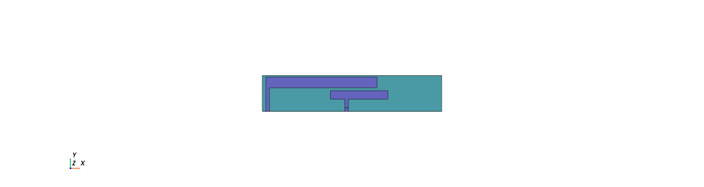
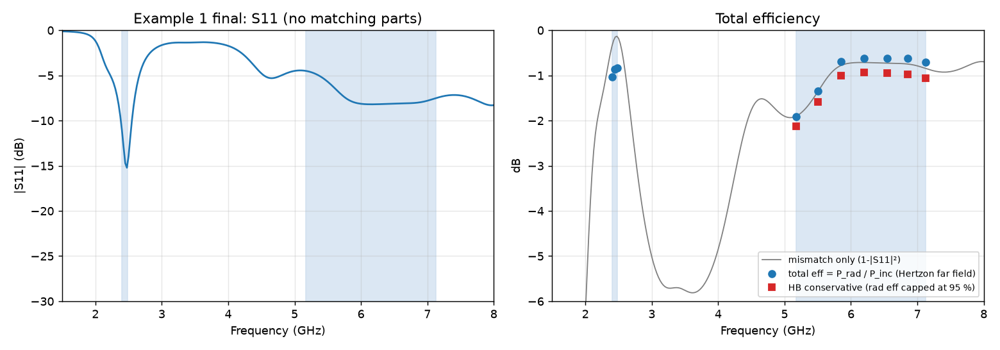

# Coupled-Fed Shorted-Strip Antenna for Meta's AI-Glasses Temple-Arm Benchmark (Example 1)

November 2026

## Abstract

A coupled-fed shorted-strip antenna reaches about 81 % average total efficiency in both WLAN 802.11ax bands (2401–2483 MHz and 5170–7125 MHz) in Meta's AI-glasses temple-arm benchmark, Example 1, without any matching components. The design was found by an LLM agent (Claude) that drove the open full-wave FEM solver Hertzon through its MCP interface: it built the model, ran 50 simulations in parametric sweeps, searched lossy matching networks in post-processing and verified the final design with far-field efficiency at ten frequencies. Wall-clock time from the request to the verified design was 2 h 25 min, of which about 85 min was solver time on one 64-core workstation. An independent Ansys HFSS simulation of the final design gives 85 % and 77 %, confirming the result. The key enabler is the solver's MCP (Model Context Protocol) interface: it lets a general-purpose LLM, with no antenna-specific training or surrogate model, run the whole loop from geometry to verified far-field efficiency.

## 1 Introduction and how results are to be shared

Meta Reality Labs published two antenna design problems based on AI-glasses temple arms in the Industry Activities column of IEEE Antennas and Propagation Magazine, vol. 68, no. 5, October 2026 [1]. The article argues that the antenna community lacks shared benchmarks comparable to ImageNet or SWE-bench, and proposes that industry openly shares well-scoped design problems which tool vendors, AI startups and university groups then solve with their own AI approaches.

The article does not define a formal submission format, leaderboard or scoring procedure. What it asks for is:

- Attempt the two examples with your own AI approach and share the results with the Meta authors directly; the article invites readers to "reach out with results, ideas, and new approaches".
- The aim is collaborative, not a competitive ranking of vendors.
- The single figure of merit is free-space total antenna efficiency in both bands, weighted equally.
- The IEEE AP-S Industrial Initiative Committee (chair Jiang Zhu) will lead an effort to establish AI design benchmarks across sectors, so a submission route through that committee is likely to follow.

A companion article by Cadence in the same issue reports an LLM-assisted antenna agent on a wearable challenge shared by Meta [2]. This report follows the same idea with a different stack: a general-purpose LLM agent controlling an open FEM solver. We report the time per step so the effort can be compared, as the article stresses data cost and simulation time as the main barriers.

## 2 Benchmark definition (Example 1)

Example 1 represents the typical size of an AI-glasses temple arm: a solid copper PCB with a small dielectric window in which the antenna must fit.

| Item | Specification |
| --- | --- |
| PCB | 120 × 12.5 × 1 mm, all copper (σ = 5.8·10⁷ S/m) |
| Keep-out window | 25 × 5 mm notch at the long edge, 20.5 mm from the left end, full PCB thickness, Dk 3.7, tan δ 0.02 |
| Bands | 2401–2483 MHz and 5170–7125 MHz, weighted equally |
| Goal | Maximize free-space total antenna efficiency |
| Antenna metal | Copper, zero thickness allowed, one or both PCB layers, vias allowed |
| Feed | One feed; any number of additional ground connections |
| Lumped parts | Optional matching network of at most 5 lossy 0201 parts from a vendor catalog; ground connections may also carry 0201 L/C |
| Not allowed | Any change to the PCB, chassis or keep-out window |

## 3 Method

All design simulations used Hertzon 0.2.8, a 3D finite-element frequency-domain solver (EMerge backend), on one 64-core Windows workstation. The agent worked through Hertzon's MCP interface only: it created geometry, set variables, assigned boundaries and ports, ran setups and parametric sweeps and read back S-parameters and far fields. No human edited the model.

Simulation model:

- PCB as a copper solid; the keep-out as a lossy dielectric box filling the notch.
- Antenna traces as zero-thickness copper sheets (finite conductivity) on the top face of the keep-out.
- One 50 Ω lumped port, 0.5 × 0.5 mm, bridging a gap between the PCB edge and the feed trace, with an explicit integration line.
- Automatic open region with a radiation boundary.
- Adaptive meshing at 2.45 and 6.1 GHz together, first-order elements, ΔS ≤ 0.015 with two converged passes; final meshes 45–60k tetrahedra.
- Interpolating sweep 1.5–8 GHz for S11; a discrete sweep at 10 in-band frequencies with fields saved for far-field efficiency.

Total efficiency is taken directly as radiated power over incident power from the far-field integration (5° grid). Candidates were screened from S11 alone with an assumed radiation efficiency, then the final design was verified with full far fields.

For the optional matching network, the agent wrote a small Python tool (`tools/match.py`) that searches ladder networks of 1–3 series or shunt L/C parts and optimizes their values for the equally weighted average total efficiency. Parts are modelled as lossy (inductor Q = 30 at 2.4 GHz rising with √f, capacitor Q = 150). Vendor S-parameter files were not available.

## 4 Design evolution

The high band set the pace: the 2.4 GHz band was matched within the first hour, while 5.17–7.125 GHz (32 % fractional bandwidth in a 5 mm window) took four topology changes. The score below is the screening estimate of average total efficiency over both bands (S11-based, radiation efficiency assumed, best matching network of up to 2–3 parts).

| Stage | Topology | Runs | Best score | Main finding |
| --- | --- | --- | --- | --- |
| 1 | IFA with a short high-band branch from the feed | 3 | — | 2.4 GHz resonance easy to place; no useful 5–7 GHz resonance |
| 2 | IFA + grounded parasitic strip from the right notch wall | 12 | 61 % | Parasitic mainly detunes the low band; high band stays near 40 % |
| 3 | Coupled-fed shorted strip: feed strip 0.4 mm under a shorted arm | 9 | 62 % | Better high band, but needs a matching network to fix 2.4 GHz |
| 4 | Same, wider strips (arm 1.5 mm, feed strip 1.2 mm) | 7 | 66 % | Wider strips broaden the high band slightly |
| 5 | Feed moved from x = 24 to 29–35 mm, feed strip extended left of the feed | 14 | 73 % | Feed near the middle of the arm gives a second high-band resonance |
| 6 | Arm shortened so the native resonance sits at 2.45 GHz, no matching parts | 5 | 81 % | Matching networks only traded one band for the other; dropping them was best |

Two observations generalize. First, every matching network found for stages 2–5 improved one band at the expense of the other; the better route was to move the antenna's own resonances. Second, the coupled feed under a shorted arm combines a quarter-wave mode of the shorted arm at 2.4 GHz with feed-strip and higher-order modes in the 5–7 GHz band, so the two bands can be tuned almost independently: the arm length sets the low band, the feed position and feed-strip lengths set the high band.

## 5 Final design and results

The final antenna reaches 81 % average total efficiency in both bands without any lumped parts: 79–82 % across 2401–2483 MHz and 64–87 % across 5170–7125 MHz. All metal lies on the top layer of the keep-out; coordinates are from the left PCB end (x) and the bottom PCB edge (y).

| Element | Position and size |
| --- | --- |
| Shorting leg | x = 21.0–21.5 mm, from the notch bottom (y = 7.5) up to the arm |
| Shorted arm | x = 21.0–36.5 mm (length 15.5), y = 10.8–12.3 mm (width 1.5) |
| Feed leg | x = 32.0–32.5 mm, port gap y = 7.5–8.0 mm, leg up to the feed strip |
| Feed strip | x = 30.0–38.0 mm (2 mm left and 6 mm right of the feed), y = 9.2–10.4 mm (width 1.2), 0.4 mm below the arm |
| Matching network | none |

Radiation efficiency is 85 % at 2.4 GHz, limited mainly by the tan δ = 0.02 keep-out. In the high band the far-field integration returns 1–3 % more radiated than accepted power, a numerical error; capping radiation efficiency at 95 % gives a conservative high-band average of 76 % instead of 81 %. The low band is matched better than −10 dB; the high band is limited by mismatch, worst at the 5.17 GHz edge.

## 5a Cross-check with Ansys HFSS

An independent HFSS model of the final design confirms the result: 85 % average total efficiency at 2.4 GHz and 77 % across 5170–7125 MHz, against 81 % and 76–81 % in Hertzon. The geometry was rebuilt from the same dimensions by script (`hfss/Meta_Ex1_CoupledFedStrip_HFSS.py`) in Ansys Electronics Desktop 2025 R1 (lumped port, finite-conductivity copper sheets, radiation boundary 32 mm from the board, multi-frequency adaptive meshing at 2.45 and 6.1 GHz, ΔS ≤ 0.01). It converged after 11 passes in about 3 min.

| Frequency (GHz) | Hertzon total eff. (%) | HFSS total eff. (%) | HFSS radiation eff. (%) |
| --- | --- | --- | --- |
| 2.401 | 78.8 | 85.3 | 86.9 |
| 2.442 | 81.9 | 86.0 | 86.9 |
| 2.483 | 82.4 | 84.4 | 86.8 |
| 5.170 | 64.4 | 61.4 | 94.5 |
| 5.500 | 73.4 | 68.8 | 94.9 |
| 5.850 | 85.1 | 81.8 | 96.7 |
| 6.200 | 86.6 | 82.7 | 97.0 |
| 6.550 | 86.6 | 81.6 | 97.3 |
| 6.850 | 86.7 | 81.3 | 97.9 |
| 7.125 | 85.0 | 79.4 | 98.4 |
| **Band average** | **81 / 81** | **85 / 77** | |

The two solvers agree within 2–7 percentage points at every frequency. HFSS gives a slightly better match at 2.4 GHz and slightly lower high-band values, close to the conservative 76 % Hertzon estimate. HFSS radiation efficiency stays below 100 % in the high band (94–98 %), which confirms that Hertzon's P_rad > P_acc there is a small far-field integration error, not real gain.

## 6 Effort and timing

The whole study took 2 h 25 min of wall-clock time from the request to the verified design, with 50 full-wave simulations and about 85 min of solver time. Times are reconstructed from message and result-file timestamps (±2 min, UTC, 6 November 2026). Typical runs had 45–60k tetrahedra and took 3–4 min; up to four variations ran in parallel.

| Step | Start | End | Wall time | Solver time |
| --- | --- | --- | --- | --- |
| Search for the benchmark (not found online, user pointed to AP Magazine) | 19:17 | 19:26 | 9 min | – |
| Find and read the article on IEEE Xplore | 19:26 | 19:33 | 7 min | – |
| Build the model, fix a unit error and the port definition | 19:33 | 19:45 | 12 min | ~1 min |
| First converged IFA run with an efficiency sweep (225k tets) | 19:45 | 20:04 | 19 min | 19 min |
| IFA + parasitic studies (15 runs); matching-network tool written in parallel | 20:04 | 20:36 | 32 min | ~28 min |
| Coupled-fed strip, narrow and wide (16 runs) | 20:36 | 20:59 | 23 min | ~15 min |
| Search for the Example 2 CAD (not published) | 20:59 | 21:05 | 6 min | – |
| Feed position and feed-strip sweeps (15 runs) | 21:00 | 21:20 | 20 min | ~13 min |
| Final arm sweep and far-field verification (4 runs) | 21:20 | 21:37 | 17 min | ~8 min |
| Plots and summary | 21:37 | 21:42 | 5 min | – |

About a third of the time (51 min) went to topologies that were later dropped (stages 1–2). The agent's own work between runs (reading results, choosing the next sweep) was short compared with solver time once the model was set up.

## 6a Model and token usage

The whole study ran on one model, Claude Opus 5.5 (model id claude-opus-5-5, 1M-token context), at the "medium" effort setting of Claude Code, with no sub-agents. Example 1 including its write-up and HFSS check used 188 model calls and about 95k output tokens. Counts come from the session transcript (usage fields of each model call), assigned to steps by timestamp (UTC).

| Step | Model calls | Output tokens | Cache-write tokens | Cache-read tokens |
| --- | --- | --- | --- | --- |
| Find and read the benchmark | 48 | 15,426 | 125,011 | 6.7 M |
| Build the model | 12 | 4,622 | 18,622 | 2.2 M |
| First IFA run | 12 | 7,216 | 20,982 | 2.5 M |
| IFA + parasitic, matching tool | 16 | 7,751 | 15,698 | 3.6 M |
| Coupled-fed strip | 17 | 7,927 | 15,857 | 4.1 M |
| Feed-position sweeps | 7 | 3,756 | 9,401 | 1.9 M |
| Final design, verification, summary | 24 | 16,462 | 37,503 | 7.0 M |
| Report (this document) | 12 | 10,764 | 18,492 | 4.8 M |
| HFSS cross-check, Hertzon update | 40 | 20,774 | 51,161 | 17.5 M |
| Not Example 1 (Example 2 rebuild, CAD search, publication advice) | 70 | 35,602 | 452,566 | 22.3 M |
| **Whole session** | **258** | **130,300** | **765,293** | **72.5 M** |

Uncached input was only 564 tokens in total: almost all input is the growing conversation re-read from the prompt cache on every call, which is why cache reads dominate. Output tokens include the model's reasoning. The step split is approximate where a step and an idle wait overlap.

## 7 Discussion and limitations

The result is confirmed by two independent solvers (Section 5a). The remaining caveats:

- **Far-field accuracy.** Hertzon's far field slightly exceeds the accepted power in the high band. HFSS gives 94–98 % radiation efficiency there, so the 77 % HFSS value and the conservative 76 % Hertzon value are the figures to quote.
- **Mesh.** Screening ran at 45–60k tetrahedra with ΔS ≤ 0.015 and two converged passes. HFSS with its own adaptive mesh lands within a few points, so the mesh was adequate for ranking.
- **Lumped parts.** The final design uses none, so vendor S-parameters do not affect it. The matching-network results in Section 4 used generic Q values, not catalog data.
- **Design space.** Only the top layer and rectangular strips were used. The bottom layer, vias and inductively loaded ground connections allowed by the benchmark were not explored and may lift the 5.17 GHz band edge.
- **Comparability.** Meta does not publish a reference efficiency for its human design, so the result cannot yet be ranked.
- **No human body model.** The design was optimized and verified in free space only, as the benchmark goal states. The agent did not on its own add a human head or body phantom, which is needed to judge the antenna as it would work on a person (detuning and absorption near the head). Meta's own CST project shows they use a silicone head model for this. That check still has to be done and has not been done yet.

## 8 Conclusion

An LLM agent driving an open FEM solver produced a matching-free design for Meta's Example 1 with about 81 % average total efficiency in both Wi-Fi 6E bands within 2 h 25 min and 50 simulations. What made this possible is the MCP interface between the language model and the solver: every modelling, solving and post-processing step was a tool call the agent could plan, check and repeat, so no antenna-specific AI model, training data or human hand-off was needed. On the antenna side, the decisive step was a topology change, from an IFA to a coupled-fed shorted strip with the feed near the middle of the arm, rather than component-level matching. Model, scripts and data are in this folder (`Meta_Ex1_CoupledFedStrip.hzn`, `Meta_Ex1_CoupledFedStrip.step`, `hfss/`, `results/`, `tools/`).

## References

1. J. Zhu, J. De Luis, A. Vijayaraghavan, L. Zhang, A. Agrawal, L. Han et al., "[Advancing Artificial Intelligence-Driven Wireless Hardware Design Through Industry Collaboration](https://ieeexplore.ieee.org/document/11775874)" [Industry Activities], IEEE Antennas and Propagation Magazine, vol. 68, no. 5, Oct. 2026.
2. L. Cui, X. Wang, S. Cui, G. Kang, J. Liu, J. Zhu, "[The LLM-Assisted Antenna Agent](https://ieeexplore.ieee.org/document/11775839)" [Industry Activities], IEEE Antennas and Propagation Magazine, vol. 68, no. 5, pp. 97–101, Oct. 2026.
