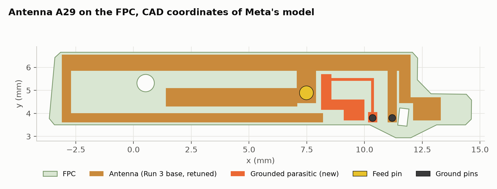
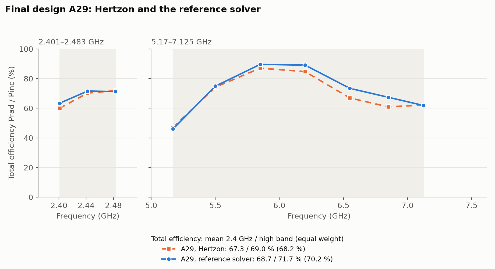
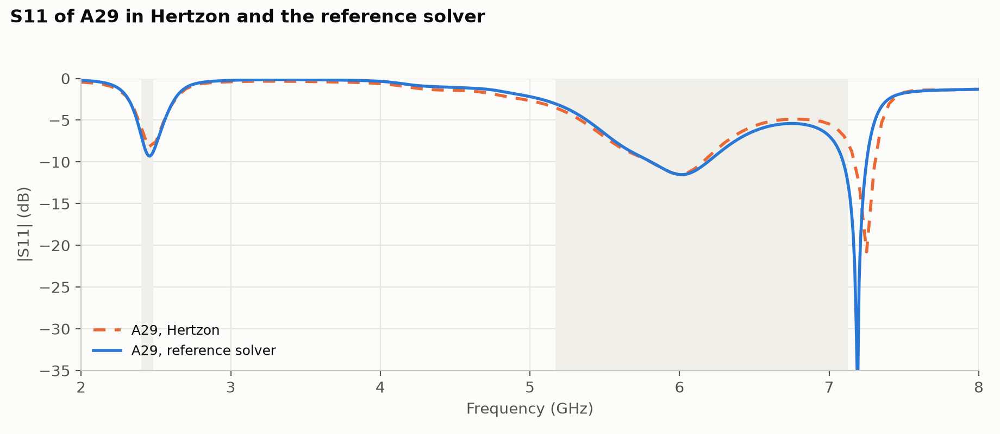
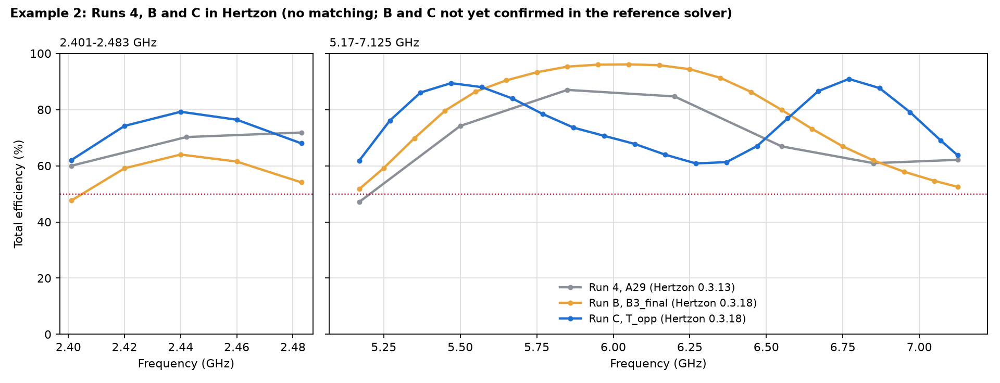
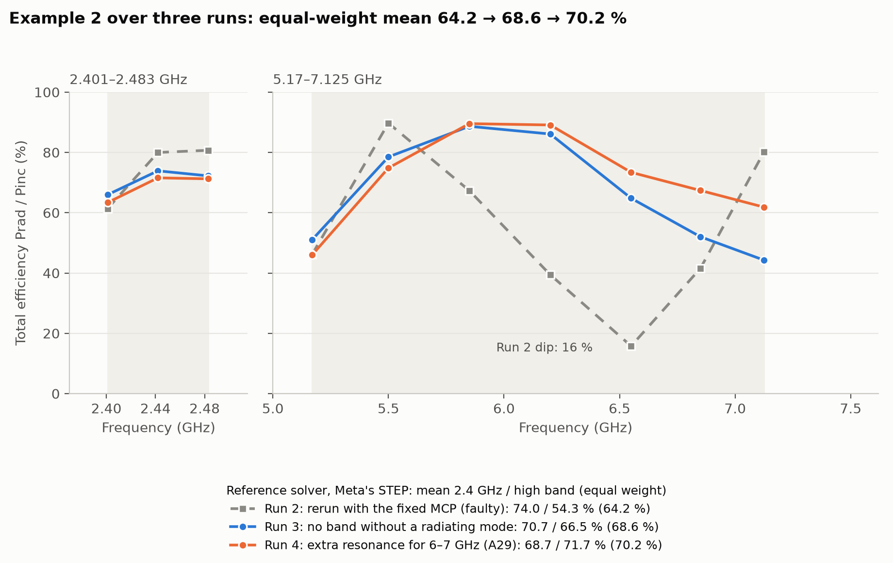
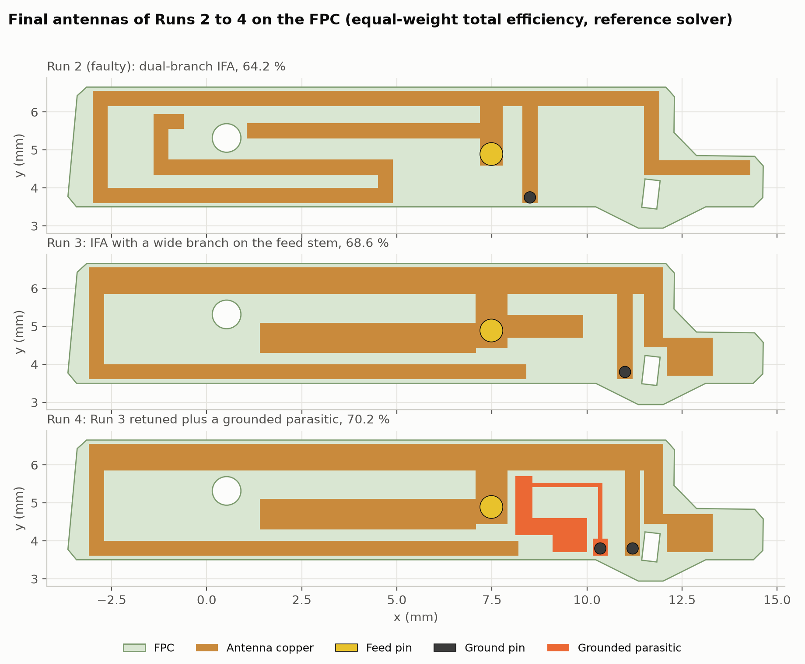
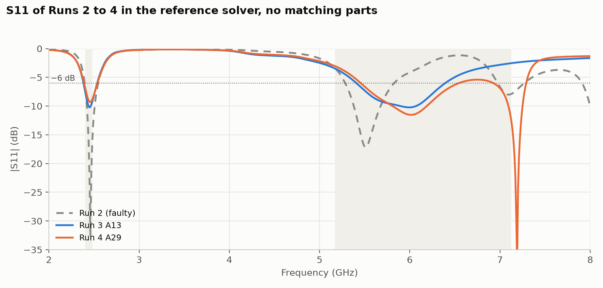
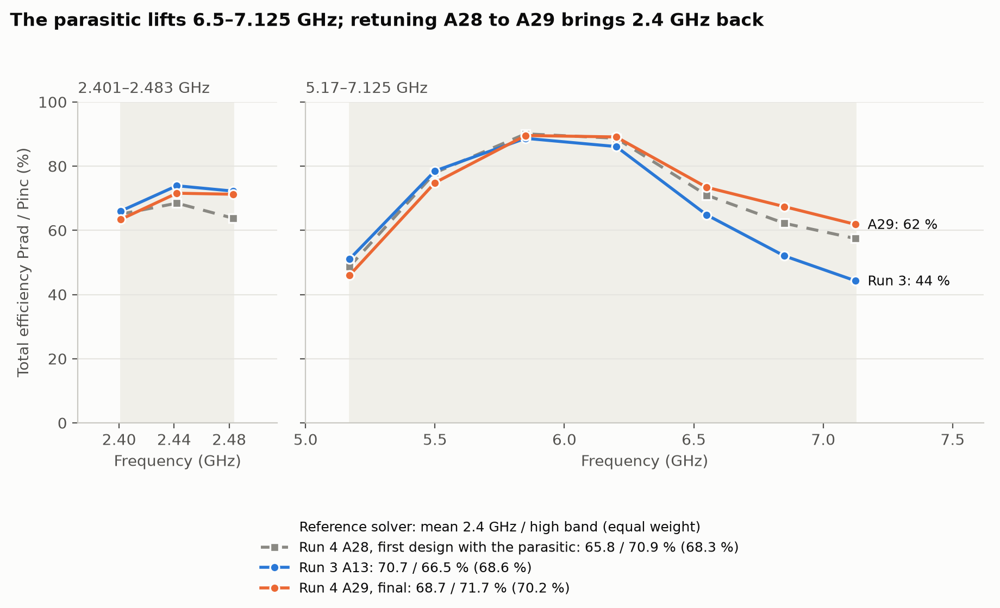
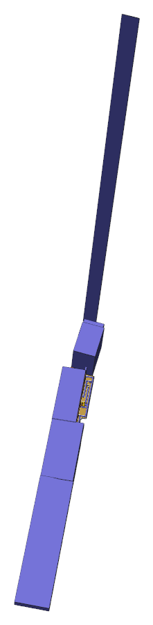
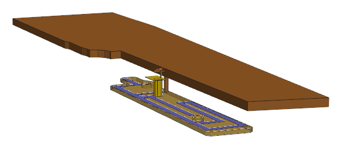

# Meta AI-glasses antenna benchmark, Example 2

Two antenna design benchmarks based on AI-glasses temple arms, shared by Meta Reality Labs within the AI design
benchmark initiative of the IEEE AP-S Industrial Initiative Committee, were published in *IEEE Antennas and Propagation Magazine*, vol. 68, no. 5, Oct. 2026, Industry Activities
([IEEE Xplore 11775874](https://ieeexplore.ieee.org/document/11775874)). This folder holds solutions of Example 2,
found by a general-purpose LLM agent (Claude in Claude Code) that drove Hertzon only through its MCP interface, and
cross-checked with a commercial FEM reference solver. The current solution is **Run 4**; its files are in
[run4/](run4/README.md), the full report is [run4/REPORT.md](run4/REPORT.md).

## Result: Run 4

The final antenna A29, without matching parts, reaches a mean total efficiency of **68.7 % in 2401–2483 MHz and
71.7 % in 5170–7125 MHz in the reference solver** on Meta's original STEP model, **70.2 %** with both bands weighted
equally. This is the highest equal-weight result so far. Run 4 builds on Run 3 and adds a grounded parasitic that
creates a second resonance near 7.2 GHz: at 7.125 GHz the total efficiency rises from 44.3 to 61.8 %.

| A29, no matching | 2.4 GHz band | 5.17–7.125 GHz | Equal weight |
| --- | --- | --- | --- |
| **Reference solver, Meta's STEP** | **68.7 %** | **71.7 %** | **70.2 %** |
| Hertzon 0.3.13 | 67.3 % | 69.0 % | 68.2 % |

Both solvers give the same S11 shape, with the narrow parasitic dip at 7.19 GHz in the reference solver and at
7.25 GHz in Hertzon. Band by band: [run4/REPORT.md](run4/REPORT.md#hertzon-and-the-reference-solver).

## How we got here

Each run was a new session of the agent with its own prompt. The table lists what each run was asked for and what
it reached in the reference solver.

| Run | Prompt (what the run was asked for) | 2.4 GHz band | 5.17–7.125 GHz | Equal weight | Design time | Solves |
| --- | --- | --- | --- | --- | --- | --- |
| Run 1 | Solve Example 2 through the Hertzon MCP | 63.9 % | 68.6 % | 66.3 % | 3.75 h | 74 |
| Run 2 (faulty) | Rerun with the fixed Hertzon MCP | 74.0 % | 54.3 % | 64.2 % | 4.1 h | 24 |
| Run 3 | No band without a radiating mode | 70.7 % | 66.5 % | 68.6 % | about 1.1 h | 13 |
| **Run 4** | **An extra resonance for 6–7 GHz** | **68.7 %** | **71.7 %** | **70.2 %** | **about 2.5 h** | **39** |

Run 1 used its own feed model in the reference solver; Runs 2 to 4 use Meta's STEP unmodified, so only they compare
directly. Run 3 and Run 4 did not start from zero (see their reports), so their design times are not comparable with
Runs 1 and 2.

## From-scratch runs B and C (Hertzon 0.3.18)

Two later runs started from zero with only the benchmark package, no reports, designs or notes of earlier runs, and the
stricter goal of **at least 50 % total efficiency at every frequency** in both bands. Both used the model Fable 5.2
with medium effort. Their numbers are **Hertzon numbers**; they are not yet confirmed in the reference solver and are
not directly comparable with the reference column above.

| Run | Prompt | 2.4 GHz min / mean | 5.17–7.125 GHz min / mean | Equal weight | Design time | Solves | Reference solver |
| --- | --- | --- | --- | --- | --- | --- | --- |
| [Run B](runB/README.md), `B3_final` | From scratch, beat Run 4, then at least 50 % everywhere | 47.6 / 58.9 % | 51.7 / 79.6 % | 69.3 % | 8 h 15 min to `Final`, then 88 min for B1–B3 | 49 + 9 | First run disputes 2.4 GHz (about 4 %); refined run pending |
| [Run C](runC/README.md), `T_opp` | Same task as Run B, from scratch | 62.0 / 72.0 % | 60.8 / 75.4 % | 73.7 % | about 4 h | 26 | Not run yet |
| Run 4, A29, for comparison | | 60.0 / 67.3 % | about 47 / 69.0 % | 68.2 % | | | 68.7 / 71.7 % (means) |

- **Run B** found a loop with a finger capacitor for 2.4 GHz and an open arm for 5–7 GHz. In Hertzon its upper band
  holds 51.7 % everywhere, the lower 2.4 GHz band edge does not (47.6 %). A first reference-solver run moves the loop
  resonance to about 4.2 GHz; a refined run with mesh seeding on the 0.1 mm capacitor gaps will decide which solver is
  right there.
- **Run C** feeds and shorts the antenna near the middle of the FPC and runs two arms in opposite directions. The
  low-band arm's third harmonic and the high-band arm give two resonances in the upper band, so its weakest point in
  Hertzon is 60.8 %.

In S11, Run 2 has two narrow, deep dips (2.45 and 5.5 GHz) and almost no match between 6 and 7 GHz. Run 3 has
one broad dip across the middle of the high band. Run 4 keeps that dip and adds a narrow one at 7.19 GHz from the
parasitic, which raises the match at 6.5–7.125 GHz. A deep dip alone is not efficiency: right at 7.19 GHz the
parasitic also loses power, which is why the total efficiency plot above is the measure.

1. **Run 1** found a folded IFA with about 65 % in both bands. Its reference check used its own feed model, not
   Meta's STEP. It is not kept in this folder.
2. **Run 2** ([run2/](run2/README.md)) is **faulty**. It was made with Hertzon versions that still had bugs in the
   solver and in the MCP interface (lumped-port voltage #336, no efficiency split over MCP #333, loss power #311,
   meshing crash and hanging calls #298, #291). It reached the best 2.4 GHz band but left a dip near 6.5 GHz (15.8 %),
   which it took for a mismatch. Its radiated power is right; its diagnosis and design decisions are not.
3. **Run 3** ([run3/](run3/README.md)) was asked to leave no band without a radiating mode, with the tool fixes and the
   Run 2 findings at hand. One broad high-band mode from a branch on the feed stem removed the dip (6.55 GHz: 64.8 %
   instead of 15.8 %). Its band edges stayed limited by reflection: 51 % at 5.17 GHz and 44 % at 7.125 GHz.
4. **Run 4** ([run4/](run4/README.md)) followed a question from Jiang Zhu, Chair of the Industrial Initiative Committee of the IEEE Antennas and Propagation Society: could a further resonance cover
   6–7 GHz better? Starting from Run 3, a grounded parasitic right of the feed stem adds a resonance just above the band.
   Branches on the stem and a parasitic under it did not work, and a resonance placed right at 7.1 GHz lost most of
   its power in the narrow copper, so it sits just above the band. After one reference check the 2.4 GHz arm and the
   short were retuned (A28 to A29). The upper band rose, the lower band edge and 2.4 GHz lost a little.

## Benchmark (Example 2)

- Simplified temple arm: irregular copper PCB of about 40 mm length, simplified chassis with a stainless rear part,
  FPC (Dk 3.09, tan δ 0.0105) next to the PCB, about 15.2 x 2.7 mm, with two alignment holes.
- Goal: maximize free-space total efficiency in 2401–2483 MHz and 5170–7125 MHz, bands weighted equally.
- One feed, any number of ground connections as vias between FPC and PCB; antenna inside the FPC outline, at least
  0.1 mm from holes and edges; optional matching network of up to five lossy 0201 parts.

## Files of Run 4

| File | What it is |
| --- | --- |
| `run4/Meta_Ex2_Run4.hzn` | Hertzon project of the final design A29 (Setup1: adaptive at 2.45 + 6.1 GHz, S11 and efficiency sweeps) |
| `run4/reference/Meta_Ex2_Run4_reference.py` | IronPython script for the reference solver on Meta's STEP (set `STP_FILE`; the STEP is not included here) |
| `run4/results/` | Reference efficiency and S11 of A29 and A28, comparison of Runs 2–4, plots, layout |
| `run4/tools/make_plots.py`, `run4/tools/plot_layouts.py` | Plots, comparison table, layouts of Runs 2–4 |
| [run4/REPORT.md](run4/REPORT.md), [run4/Timing_Log.md](run4/Timing_Log.md) | Full report and timing |

Reproduce: open `run4/Meta_Ex2_Run4.hzn` in Hertzon 0.3.13 or newer and run Setup1. Total efficiency is radiated
power over incident power of the `Eff` sweep; `get_results` with `kind = efficiency` on the MCP interface gives the
split into mismatch and radiation efficiency.
