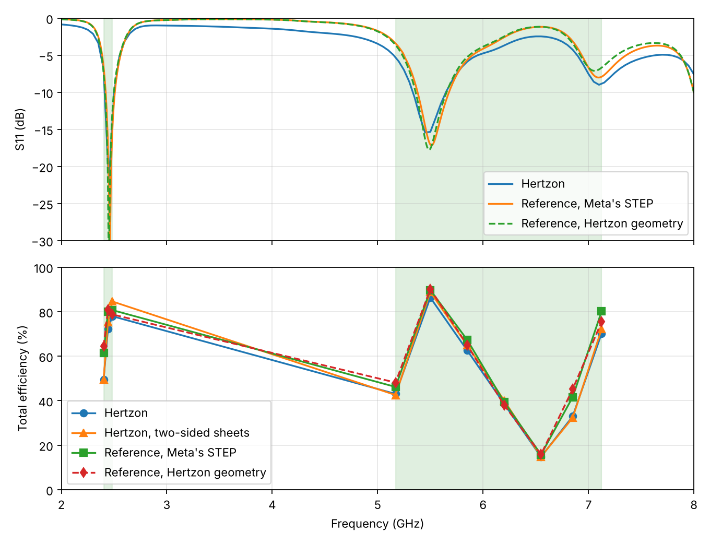
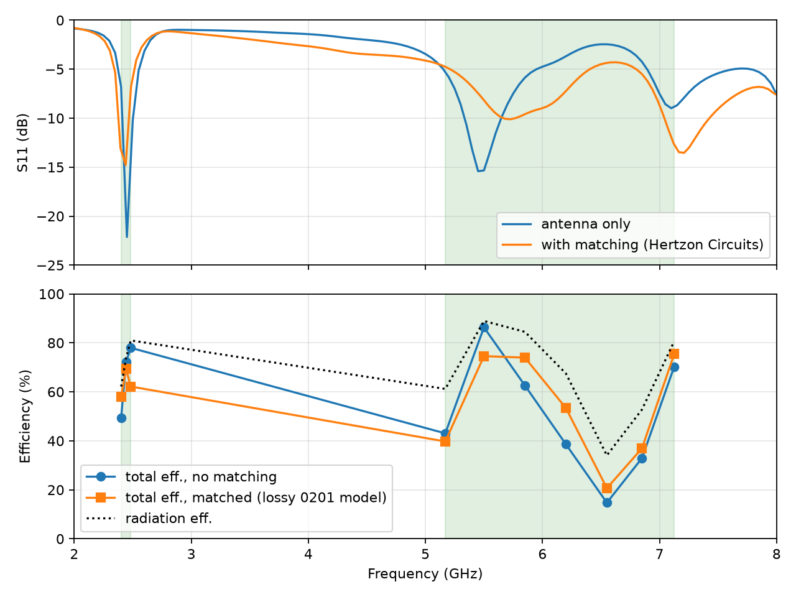
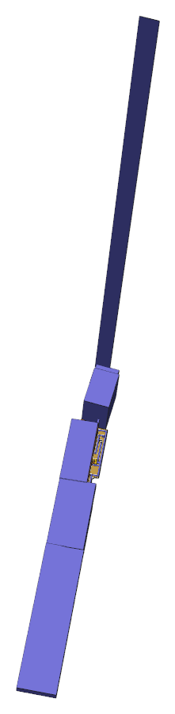
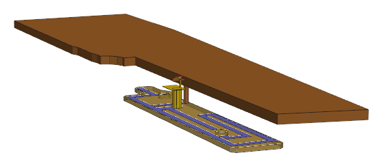
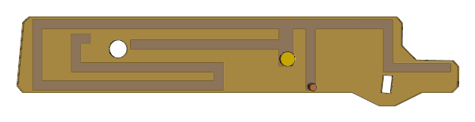
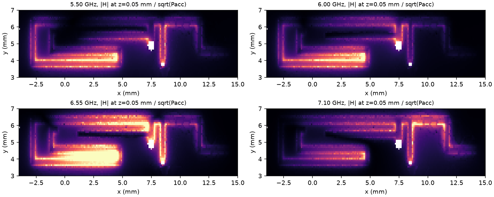

# Meta AI-glasses benchmark, Example 2: rerun with the fixed Hertzon MCP

> **This run (Run 2) is faulty and superseded by [Run 3](run3/README.md).** It was made with Hertzon versions that had MCP bugs and
> weak points, since found and fixed. Lumped ports could jump between adaptive passes, so S11 and accepted power were wrong at badly
> matched frequencies (#336; 6.55 GHz: 43 % accepted against 24 % in the reference solver). The MCP interface offered no split into
> mismatch and radiation efficiency, no Q and no convergence warning, so the agent called the 6.2–6.85 GHz dip a mismatch, which was
> wrong (#333). Displayed loss power and radiation efficiency were far too large or too small (fixed, see the changelog), and meshing and
> MCP hangs cost hours (#298, #291). Radiated power and total efficiency of this run agree with the reference solver;
> the design decisions built on the other values do not hold. The text below is kept as a record.

November 2026

## Result

The final antenna, without matching parts, reaches a mean total efficiency of **74.0 % in 2401–2483 MHz and 54.3 % in 5170–7125 MHz in the reference solver** on Meta's original STEP model, 64.2 % with both bands weighted equally. Hertzon agrees well with the reference solver: the curves have the same shape and the same dip, with 66.5 % and 49.8 % (58.2 %) for the same design, about 6 points lower on average, within 5 points at 6 of the 10 frequencies and at most 12 points lower. Total efficiency is radiated power over incident power (1 W) in both solvers.

In the reference solver the design is **slightly below Run 1** at equal weight (64.2 % against 66.3 %): about 10 points better at 2.4 GHz and 14 points worse in the high band. A fine Hertzon mesh of the same design with a 0.02 mm wider end stub (373k tetrahedra) gave 68.2 % and 49.3 %. Run 1 took less wall time for the design (3.75 h against about 4.1 h), although Run 2 needed 24 solves instead of 74.

| Run | Solver | 2.4 GHz band | 5.17–7.125 GHz | Equal weight | Design time | Solves |
| --- | --- | --- | --- | --- | --- | --- |
| Run 1 (earlier) | Hertzon | ~65 % | ~65 % | ~65 % | 3.75 h | 74 |
| Run 1 (earlier, own feed model) | Reference | 63.9 % | 68.6 % | 66.3 % | | |
| Run 2, final, no matching | Hertzon | 66.5 % | 49.8 % | 58.2 % | ~4.1 h | 24 |
| Run 2, final, no matching, Meta's STEP | Reference | **74.0 %** | **54.3 %** | **64.2 %** | | |
| Run 2, with 3-part match (lossy model) | Hertzon + Circuits | 63.1 % | 53.5 % | 58.3 % | | |

## Comparison with a reference solver

Two reference-solver models (version 2025 R1) of the final design were solved (multi-frequency adaptive at 2.45 and 6.1 GHz, ΔS ≤ 0.01, 3° far-field sphere; about 6 min each):

- **Meta's STEP**: Meta's complete environment, feed parts and port sheet, with only the antenna sheet, the shorting pin and a 30 µm bridge between FPC and feed pin added (`reference/Meta_Ex2_DualBranchIFA_reference.py`).
- **Hertzon geometry**: the simplified primitives exported from Hertzon, to separate the model from the solver (`reference/Meta_Ex2_DualBranchIFA_reference_hertzon_geometry.py`).

| Frequency (GHz) | Hertzon total (%) | Hertzon, two-sided sheets (%) | Reference, Meta's STEP (%) | Reference, Hertzon geometry (%) | Accepted: Hertzon / reference STEP (%) |
| --- | --- | --- | --- | --- | --- |
| 2.401 | 49.5 | 49.5 | 61.4 | 64.4 | 79.6 / 78.0 |
| 2.442 | 72.1 | 75.2 | 80.0 | 81.0 | 97.9 / 98.0 |
| 2.483 | 78.0 | 84.6 | 80.7 | 78.8 | 96.3 / 97.1 |
| 5.17 | 43.0 | 42.5 | 46.2 | 48.1 | 70.4 / 54.2 |
| 5.5 | 86.3 | 88.9 | 89.7 | 90.1 | 97.1 / 98.0 |
| 5.85 | 62.6 | 64.9 | 67.3 | 65.0 | 74.1 / 72.6 |
| 6.2 | 38.6 | 40.1 | 39.4 | 38.0 | 57.2 / 45.0 |
| 6.55 | 14.7 | 14.8 | 15.8 | 15.8 | 43.2 / 23.7 |
| 6.85 | 32.9 | 32.3 | 41.6 | 45.1 | 62.4 / 51.1 |
| 7.125 | 70.2 | 72.2 | 80.2 | 75.5 | 87.1 / 83.8 |
| **Mean, 2.4 GHz / high band** | **66.5 / 49.8** | **69.8 / 50.8** | **74.0 / 54.3** | **74.7 / 54.0** | |

What the comparison shows:

- **The simplified model is fine.** The reference solver on Meta's STEP and on the Hertzon primitives agree within 1 point in both bands, so the simplifications listed under Setup do not explain the difference.
- **Total efficiency agrees well between the solvers.** Shape and dip match, and Hertzon is on average 6 points lower on identical geometry, comparable to the 2 to 7 points in Example 1. Radiated power is within 1 to 4 points at most frequencies (for example 5.5 and 6.55 GHz); the largest differences are 2.401 GHz (49.5 against 61.4 %) and 6.85 and 7.125 GHz (about 9 to 10 points).
- **The sheet loss model explains part of it.** Zero-thickness sheets with one-sided surface impedance count the conductor loss on one side. With two-sided sheets (35 µm) the 2.4 GHz mean rises from 66.5 to 69.8 % and the high band from 49.8 to 50.8 %, so about 40 % of the gap at 2.4 GHz.
- **Two other quantities do not match, but they do not change the result.** Accepted power from 1 − |S11|² in Hertzon is too high at badly matched frequencies (6.55 GHz: 43 % against 24 %; the Hertzon changelog also calls this quantity inaccurate there), and the displayed Radiation Efficiency is wrong (below). Total efficiency Prad/Pinc does not use either of them.
- **The dip at 6.2–6.85 GHz is real** and confirmed by the reference solver. Its radiated power agrees between both solvers. The cause is currently being investigated, see Limits.
- **The definition of total efficiency is the same in both solvers** (Prad/Pinc with 1 W incident). Hertzon's displayed "Radiation Efficiency" is not comparable: since #231 it is Prad/(Prad+Ploss), and Ploss is several times too large in this model (Power Balance +150 to +1200 %). The radiation efficiencies in the Design table below are Prad/(1−|S11|²), not that display, and are too pessimistic at mismatched points (6.55 GHz: 34 %, reference 67 %).

## Setup

The simplified temple arm comes from the supplied STEP and solver project files: FPC (Dk 3.09, tan δ 0.0105 as in Fig. 2 and the supplied solver project; the running text of the paper says 0.00105, which is a typo), copper PCB, simplified chassis with a stainless section, 50 Ω lumped port on the supplied feed location, feed pin r = 0.3 mm from FPC to PCB. All geometry was rebuilt as polylines and primitives. The CAD chassis bodies were replaced by prisms that overlap each other by 0.05 to 0.2 mm.

Simplifications, all near the far side of the PCB or in the feed: the ground tabs and a strip of the 20_ART10 layer outside the PCB outline were dropped except the tab next to the feed; the PCB outline was pruned by removing edges shorter than 0.12 mm; the PCB corner at the hinge was pushed 0.5 mm into the hinge block; the 0.26 mm front plate is a copper sheet; the small via through the PCB is a square bar of equal area; the chassis body above the PCB edge is pulled back 0.1 mm from the port region and the plate between hinge and front is 10 % smaller, both to keep clear faces.

Setup: adaptive meshing at 2.45 and 6.1 GHz together, first-order elements, up to 10 passes, ΔS ≤ 0.02 (A22 ended at 0.095 after 10 passes, mesh noise at high Q; the fine check reached 0.024 at 373k tetrahedra, also not below the target). Efficiency is Prad / Pinc from a far-field sphere with 5° steps at 10 in-band frequencies. Hertzon's loss power and power balance were not used because they are not reliable.

## Design

A dual-branch inverted-F on the top FPC layer, 0.4 mm traces, zero thickness copper, one feed, one shorting pin (r = 0.15 mm, smaller than the feed pin because the PCB overlap at the FPC edge is only about 0.5 mm wide). Coordinates are from the supplied CAD origin.

| Element | Position |
| --- | --- |
| Feed stem (over the feed pin at x = 7.486, y = 4.892) | x 7.19–7.79, y 4.59–6.15 |
| Top arm | y 6.15–6.55, x −3.0 to 11.9 |
| Shorting stub to the PCB, pin at (8.5, 3.75) | x 8.3–8.7, y 3.6–6.15 |
| Left leg | x −3.0 to −2.6, y 3.6–6.15 |
| Lower arm | y 3.6–4.0, x −3.0 to 4.9 |
| Inner return | x 4.5–4.9, y 3.6–4.75, then y 4.35–4.75, x −1.4 to 4.9 |
| Inner end | x −1.4 to −1.0, y 4.35–5.95, then y 5.55–5.95, x −1.4 to −0.6 |
| High-band branch from the feed stem | y 5.3–5.7, x 1.05 to 7.19 |
| Right branch | x 11.5–11.9, y 4.35–6.15, then y 4.35–4.73, x 11.5–14.3 |

All traces are at least 0.1 mm from the FPC edges and holes. No part of Meta's reference design was used.

Hertzon results of the final design (radiation efficiency here is Prad/(1−|S11|²), which is unreliable at mismatched points, see the reference comparison):

| Frequency (GHz) | Radiation eff. (%) | Total eff., no match (%) | Total eff., 3-part match (%) |
| --- | --- | --- | --- |
| 2.401 | 62 | 49.5 | 57.9 |
| 2.442 | 74 | 72.1 | 69.4 |
| 2.483 | 81 | 78.0 | 62.2 |
| 5.17 | 61 | 43.0 | 39.7 |
| 5.5 | 89 | 86.3 | 74.6 |
| 5.85 | 85 | 62.6 | 74.0 |
| 6.2 | 67 | 38.6 | 53.4 |
| 6.55 | 34 | 14.7 | 20.7 |
| 6.85 | 53 | 32.9 | 36.9 |
| 7.125 | 81 | 70.2 | 75.4 |

## Design path

Iteration table and plot: `results/iterations.csv`, `results/Ex2_Run2_progress.png`, with S11 of every iteration in `results/A*.s1p`.

1. Folded monopole, no 2.4 GHz resonance, high-Q and weak radiation (A1).
2. IFA with a short left of the feed plus inner arms and a bottom-layer tail: the band is resonant at 2.4 GHz, but radiation efficiency is only about 42–55 % (A2–A6). A loss split with tan δ = 0 showed the dielectric takes about 15 % of the accepted power, copper the rest.
3. Moving the short to the right of the feed (classic IFA, the feed between short and open end) raises 2.4 GHz radiation efficiency to about 77 % (A7). This is the largest single step. The high band collapses at the same time.
4. Nine variants for the high band (A8–A16): feed branch placed differently, bottom-layer arms, a short on the bottom layer, a grounded parasitic. The best combination of 2.4 GHz and high band is a branch from the feed stem plus a right branch; A17 is the best of these.
5. A18–A21 changed the right branch and the feed branch; none improved the band mean.

## Limits

- The high band has a dip around 6.2–6.85 GHz that both solvers confirm. **Its cause is currently being investigated**; an earlier version of this report called it a mismatch, and that explanation is under review. The findings so far are from the reference solver. At 6.55 GHz, 23.7 % of the incident power is accepted (−6.3 dB) and 66.7 % of that is radiated (−1.8 dB), so total efficiency is 15.8 %. With PEC metal and tan δ = 0 the total is 16.1 %, against 15.8 % with all losses (`results/Ex2_dip_decomposition.csv`), so dissipation is not what limits it there. Almost all dissipation is in the antenna copper and the FPC; PCB, chassis and the stainless section together take about 1 % of it at 6.55 GHz.
- Working hypothesis, not yet confirmed: the design has no radiating resonance in this range. The dip sits between the resonances of the feed branch (5.5 GHz) and the right branch (7.1 GHz), and at 6.55 GHz strong current is present on the long low-band arms. Per accepted watt the magnetic field 0.05 mm above the antenna is 1.5 to 3 times stronger than at 5.5 GHz on the top arm, lower arm, inner return, feed stem and shorting stub, while the field 4.5 mm above the temple arm beyond x = 16 mm is about half as strong (figure below). The input impedance of the lossless model is 15.6+125j Ω with a Q of about 58 from its slope, against 16 at 5.5 GHz and 14 at 7.1 GHz. Radiation efficiency falls from 92 % to 67 % at an almost unchanged absolute loss per incident watt. Run 1, on the same chassis, radiates 74.8 % at 6.55 GHz in the reference solver with 97 % radiation efficiency, so the dip appears to belong to this design and not to the benchmark. A third branch on the bottom layer, a shorter feed branch and a shorter right branch did not remove it. Part of the reactance comes from the fixed feed path (via, trace and feed pin). Hertzon 0.3.10 with two-sided sheets gives radiated power within 2 points of the reference between 6.2 and 6.6 GHz, but its accepted power is still higher there (33.6 % against 23.7 % at 6.55 GHz) and its adaptive mesh did not converge (ΔS 0.28 in the last pass), so the Hertzon S-parameters near the dip need more care.

- In the reference solver most power is reflected in the dip, but so far nothing suggests a matching network can remove it: a Q of about 58 would allow roughly 1 % bandwidth at VSWR 2 from a single-tuned match, against a 5170–7125 MHz band, and in this search the 3-part network did not improve the equal-weight mean. The topology of the design may need to change; this is part of the ongoing investigation.
- Matching parts use a generic loss model (L: Q 35 at 2.4 GHz rising with √f, C: Q 120), not a vendor catalog.
- The matched values are checked in a Hertzon Circuits schematic (`Match` design with the 3D result as a block), but the final design is quoted without matching parts.
- The Hertzon power balance is unreliable, so radiation efficiency is taken as Prad/Pacc, and Hertzon's far-field loss power has been reported as a bug.
- Hertzon reads about 6 points below the reference solver on average; the sheet loss model explains part of that, the rest is open.
- The matching network was tested in Hertzon only, with up to 3 of the allowed 5 parts.
- The solver needed a one-line patch to `facematch.py`, see `Timing_Log.md`.

## Effort

About 4 h 6 min wall time for the design, 24 full-wave solves plus about 15 mesh-only tries, about 200 min of solver time, 360 model calls and 183k output tokens up to the final design (details in `Timing_Log.md`). The investigation of the dip and the reference comparison took another 47 min (4 Hertzon runs, 2 reference models). No Hertzon MCP call hung during this run.
