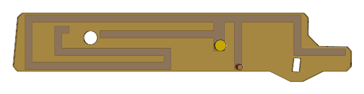
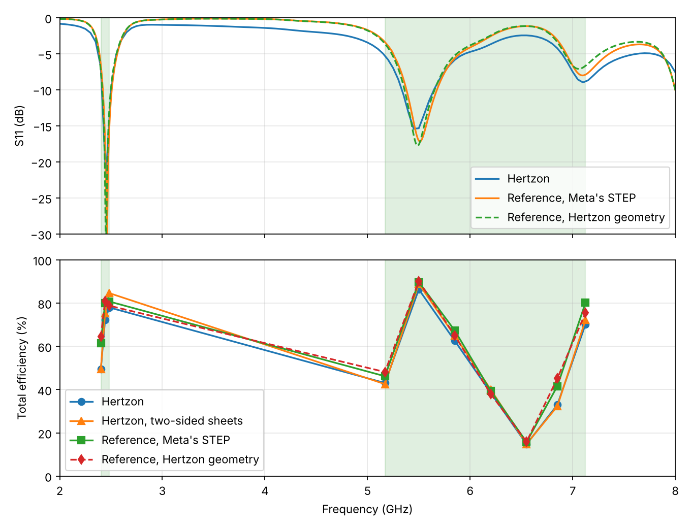
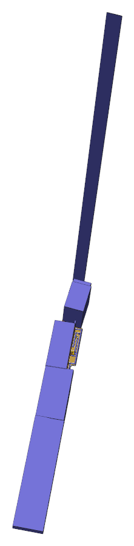
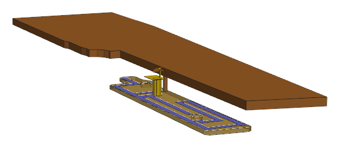

# Meta AI-glasses antenna benchmark, Example 2

**Current solution: [Run 3](../README.md)** (no high-band dip, 68.6 % equal-weighted in the reference solver).

> **This run (Run 2) is faulty and superseded by [Run 3](../run3/README.md).** It was made with Hertzon versions that had MCP bugs and
> weak points, since found and fixed. Lumped ports could jump between adaptive passes, so S11 and accepted power were wrong at badly
> matched frequencies (#336; 6.55 GHz: 43 % accepted against 24 % in the reference solver). The MCP interface offered no split into
> mismatch and radiation efficiency, no Q and no convergence warning, so the agent called the 6.2–6.85 GHz dip a mismatch, which was
> wrong (#333). Displayed loss power and radiation efficiency were far too large or too small (#311), and meshing and
> MCP hangs cost hours (#298, #291). Radiated power and total efficiency of this run agree with the reference solver;
> the design decisions built on the other values do not hold. The text below is kept as a record.

## Run 2, solved through the Hertzon MCP interface

Meta Reality Labs published two antenna design benchmarks based on AI-glasses temple arms in
*IEEE Antennas and Propagation Magazine*, vol. 68, no. 5, Oct. 2026, Industry Activities
([IEEE Xplore 11775874](https://ieeexplore.ieee.org/document/11775874)). This folder holds a solution of
Example 2, found by a general-purpose LLM agent (Claude in Claude Code) that drove Hertzon only
through its MCP interface, and cross-checked with a commercial FEM reference solver.

**Full report:** [REPORT.md](REPORT.md) (setup, design path, reference comparison, timing and token usage).

## Result

Dual-branch inverted-F on the top layer of the FPC, **no matching components**.

| Band | Hertzon total efficiency | Reference total efficiency (Meta's STEP) |
| --- | --- | --- |
| 2401–2483 MHz | 50–78 %, average 66.5 % | 61–81 %, average 74.0 % |
| 5170–7125 MHz | 15–86 %, average 49.8 % | 16–90 %, average 54.3 % |
| Equal weight | 58.2 % | 64.2 % |

Hertzon and the reference solver agree well in shape, about 6 points apart on average. The high band has a real dip around
6.2–6.85 GHz (mismatch, confirmed in the reference solver). An earlier run of the same benchmark with a different design reached
66.3 % equal-weighted in the reference solver (63.9 % and 68.6 %), so this design is about 2 points lower overall.

Effort: about 4 h 6 min wall-clock for the design, 24 full-wave runs, about 200 min solver time on one 64-core
workstation, 183k model output tokens; reference comparison and dip analysis another 47 min.

## Benchmark (Example 2)

- Simplified temple arm: irregular copper PCB of about 40 mm length, simplified chassis with a stainless rear part,
  FPC (Dk 3.09, tan δ 0.0105) next to the PCB, about 15.2 x 2.7 mm, with two alignment holes.
- Goal: maximize free-space total efficiency in 2401–2483 MHz and 5170–7125 MHz, bands weighted equally.
- One feed, any number of ground connections as vias between FPC and PCB; antenna inside the FPC outline, at least
  0.1 mm from holes and edges; optional matching network of up to five lossy 0201 parts.

## Final geometry (mm, in the CAD coordinates of Meta's model, z = 0 on the FPC top face, 0.4 mm traces)

| Element | Position |
| --- | --- |
| Feed stem (over the feed pin at x = 7.486, y = 4.892) | x 7.19–7.79, y 4.59–6.15 |
| Top arm | y 6.15–6.55, x −3.0 to 11.9 |
| Shorting stub, pin r = 0.15 at (8.5, 3.75) into the PCB | x 8.3–8.7, y 3.6–6.15 |
| Left leg | x −3.0 to −2.6, y 3.6–6.15 |
| Lower arm | y 3.6–4.0, x −3.0 to 4.9 |
| Inner return | x 4.5–4.9, y 3.6–4.75, then y 4.35–4.75, x −1.4 to 4.9 |
| Inner end | x −1.4 to −1.0, y 4.35–5.95, then y 5.55–5.95, x −1.4 to −0.6 |
| High-band branch from the feed stem | y 5.3–5.7, x 1.05 to 7.19 |
| Right branch | x 11.5–11.9, y 4.35–6.15, then y 4.35–4.73, x 11.5–14.3 |

## Files

| File | What it is |
| --- | --- |
| `Meta_Ex2_DualBranchIFA.hzn` | Hertzon project of the final design (Setup1: adaptive at 2.45 + 6.1 GHz, S11 and efficiency sweeps), plus the `Match` circuit design |
| `Meta_Ex2_DualBranchIFA.step` | Hertzon geometry, solids only, units corrected to metres in the file header |
| `reference/Meta_Ex2_DualBranchIFA_reference.py` | IronPython script for the reference solver on Meta's STEP (set `STP_FILE`; the STEP is not included here) |
| `reference/Meta_Ex2_DualBranchIFA_reference_hertzon_geometry.py` | Same model from the Hertzon STEP in this folder |
| `results/` | Hertzon and the reference solver S11 and efficiency, iteration table, plots and structure images |
| `tools/` | Band metric, far-field readout, matching search, plots |

## Limitations

- The benchmark is defined in free space; no head model was used.
- The high band dips around 6.2–6.85 GHz; a further resonance near 6.4 GHz is missing.
- The 3-part matching network did not improve the equal-weight mean and is not part of the final design (search
  with generic Q values, up to 3 of 5 allowed parts).
- Hertzon's displayed Radiation Efficiency and Gain values are not usable for this model since #231 (too large
  loss power); total efficiency Prad/Pinc is not affected.
- Hertzon needed a one-line fix to `solver/facematch.py` (in the repo as PR #298) to mesh this model.
- Hertzon's STEP export writes metres but labels them mm; the STEP here has a corrected header.

## Reproduce

- Hertzon: open the `.hzn` and run Setup1 (about 9 min on 64 cores). Total efficiency = radiated power /
  incident power of the Eff sweep.
- Reference solver: Tools > Run Script > `reference/Meta_Ex2_DualBranchIFA_reference.py` (about 6 min), after setting `STP_FILE`. Results
  land in `Documents/Meta_Ex2_reference`.
