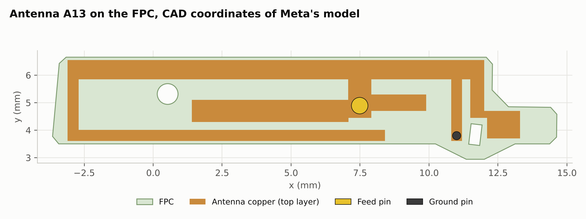
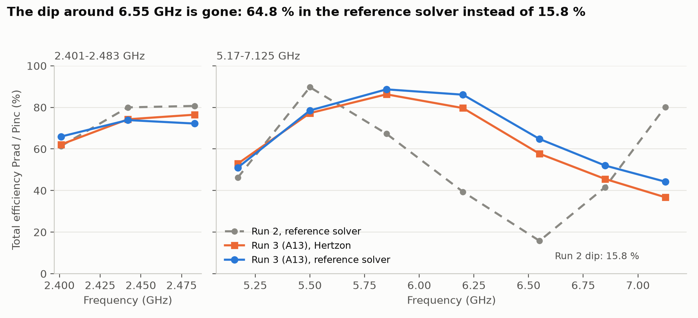

# Meta AI-glasses benchmark, Example 2, Run 3: no band without a radiating mode

A third solution of Example 2, found by Claude in Claude Code driving Hertzon only through its MCP
interface. The goal of this run: an antenna with no part of the high band where nothing radiates, which [Run 2](../run2/README.md)
still had around 6.5 GHz. **Run 2 is faulty** because of MCP bugs and weak points that were found and fixed since; see [REPORT.md](REPORT.md#why-this-run-replaces-run-2). The antenna is new, but the run started with the tool fixes and with knowledge from the earlier runs; see [what it started from](REPORT.md#starting-point-of-this-run). The fixed benchmark environment is the Run 2 model of Meta's STEP.

**Full report:** [REPORT.md](REPORT.md) (result, band table, design path, setup, limits). Timing: [Timing_Log.md](Timing_Log.md).

## Result, no matching components

| Band | Hertzon 0.3.11 total efficiency | Reference total efficiency (Meta's STEP) |
| --- | --- | --- |
| 2401–2483 MHz | 62–76 %, average 71.0 % | 66–74 %, average 70.7 % |
| 5170–7125 MHz | 37–86 %, average 62.3 % | 44–89 %, average 66.5 % |
| Equal weight | 66.6 % | 68.6 % |

At 6.55 GHz the reference solver gives 64.8 % instead of the 15.8 % of Run 2. Effort: about 1 h 07 min for the design, 13 Hertzon solves
(46 min solver time), 74k output tokens, and one run of the reference solver (5 min). The band edges at 5.17 and 7.125 GHz are still limited by reflection.

## Files

| File | What it is |
| --- | --- |
| `Meta_Ex2_Run3.hzn` | Hertzon project of the final design A13 (Setup1: adaptive at 2.45 + 6.1 GHz, S11 and efficiency sweeps) |
| `reference/Meta_Ex2_Run3_reference.py` | IronPython script for the reference solver on Meta's STEP (set `STP_FILE`; the STEP is not included here) |
| `results/` | S11 of A13, reference efficiency and S11, iteration table, comparison table and plot, layout |
| `tools/` | Iteration table, comparison plots, layout plot, and `make_overview.py`, which writes the Example 2 overview from this report |

## Reproduce

Open the `.hzn` in Hertzon 0.3.11 or newer and run Setup1. Total efficiency is radiated power over incident power of the `Eff` sweep;
`get_results` with `kind = efficiency` on the MCP interface gives the split into mismatch and radiation efficiency.
