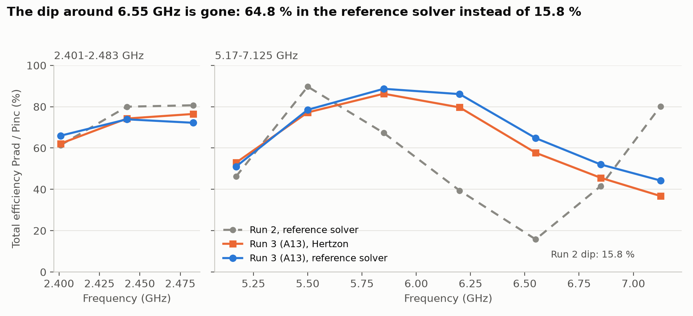
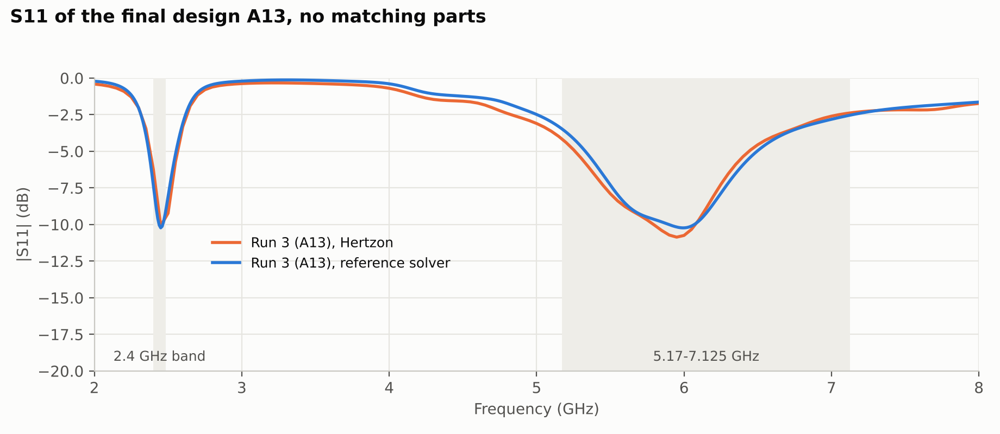
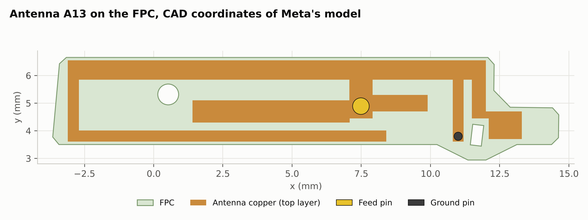

# Meta AI-glasses benchmark, Example 2, Run 3: no band without a radiating mode

November 2026, Hertzon 0.3.11, checked with a commercial FEM reference solver

## Result

The new antenna, without matching parts, reaches a mean total efficiency of **70.7 % in 2401–2483 MHz and 66.5 % in 5170–7125 MHz in the reference solver** on Meta's original STEP model, 68.6 % with both bands weighted equally. Hertzon gives 71.0 % and 62.3 % for the same design (66.6 %). This is the highest equal-weight result of the three runs, and the band around 6.5 GHz that stayed dark in Run 2 now radiates: 64.8 % total efficiency in the reference solver at 6.55 GHz instead of 15.8 %.

| Run | Solver | 2.4 GHz band | 5.17–7.125 GHz | Equal weight | At 6.55 GHz | Design time | Solves |
| --- | --- | --- | --- | --- | --- | --- | --- |
| Run 1 | Reference | 63.9 % | 68.6 % | 66.3 % | 74.8 % | 3.75 h | 74 |
| Run 2 | Reference | 74.0 % | 54.3 % | 64.2 % | 15.8 % | 4.1 h | 24 |
| **Run 3** | **Reference** | **70.7 %** | **66.5 %** | **68.6 %** | **64.8 %** | **about 1.1 h** | **13** |
| Run 3 | Hertzon 0.3.11 | 71.0 % | 62.3 % | 66.6 % | 57.7 % | | |

Run 1 and Run 2 values are from their own reports and used older Hertzon versions; only the reference rows compare directly. The design times are not comparable, because Run 3 started with fixes and with knowledge from the earlier runs (see the starting point below).

S11 of the two solvers agrees closely: both reach about −10 dB at 2.45 GHz and near 6 GHz, Hertzon's high-band minimum is about 0.6 dB deeper (`results/A13.s1p`, `results/reference_S11.csv`).

## Why this run replaces Run 2

Run 2 is kept in [run2](../run2/README.md) but is marked as faulty. It was made with Hertzon versions that had MCP bugs and weak points, all found through this benchmark and fixed before this run:

| Problem in the earlier run | Effect | Fix |
| --- | --- | --- |
| Lumped-port voltage counted samples outside the port tetrahedra as zero field | S11 jumped between adaptive passes; accepted power too high at mismatch (6.55 GHz: 43 % against 24 %) | #336 |
| MCP gave no efficiency split, Q, resonances or convergence warning | The agent called the 6.2–6.85 GHz dip a mismatch. The cause is still being investigated; the working hypothesis is a missing radiating mode, and matching did not recover it | #333 |
| Loss power of copper solids counted wrongly | Displayed power balance and radiation efficiency unusable | #311 |
| `facematch` crash and MCP calls without an answer | Hours lost, no effect on results | #298, #291 |

Radiated power and total efficiency of Run 2 agree with the reference solver, so its curves are correct; its diagnosis and the design decisions based on it were not. This run used the fixed version from the first solve, and the efficiency split decided every design step below.

## Starting point of this run

Run 3 did not start from zero. The session log shows what the agent had when it began. The result still comes from new solves, but the 1 h 07 min design time is not a from-zero effort and does not compare directly with Run 1 and Run 2.

**Fixes in the tool.** Hertzon 0.3.11 with the lumped-port fix (#336) and the MCP diagnostics (#333), plus the earlier fixes for MCP hangs (#291), the meshing crash (#298) and the loss power. The later MCP hints of #339 were not available; they were merged after this run.

**The goal, stated in the prompt.** The task was to redo Example 2 so that no band stays without radiation. This follows from the benchmark goal of maximizing efficiency over the whole band, and it corrects Run 2, which saw the dip but took it for a mismatch because of the port bug and the missing diagnostics. The prompt said so openly: it named the dip near 6.5 GHz, gave the working hypothesis (no radiating resonance, current circulating on the long low-band arms, Q about 58), said that a Meta author had pointed out it is not a mismatch, and asked to check radiation efficiency and current distribution rather than S11 alone.

**Knowledge from earlier runs, in the agent's context.**

- Project memory: the results of Run 1 and Run 2, the optimized variables of Run 1, the Run 2 finding that a short to the right of the feed raised 2.4 GHz radiation efficiency from about 50 to 77 %, the dip analysis, and the meshing and MCP pitfalls.
- Files read before the first solve: the Run 2 report with its design path and final geometry, the Run 1 timing log, and the complete Run 2 Hertzon project including its antenna.
- Taken over from Run 2: the environment model (FPC, PCB and chassis coordinates, feed parts, port and integration line), the setup with its adaptive frequencies and efficiency points, the STEP parser, and the reference-solver script as a template. This is why no mesh debugging was needed.

**What is new.** No earlier antenna was opened or modified, and its coordinates were not copied as a whole. The wide top bar, the wide feed-stem branch, the short at x = 11 mm and the right-hand stub are new. The topology still shares elements with Run 2: a top arm, a left leg and a lower arm for 2.4 GHz, a short to the right of the feed, a branch on the feed stem and a right-hand arm around the slot. Meta's reference design was not used; the supplied files contain no antenna trace.

## Band by band

Total efficiency is Prad / Pinc with 1 W incident in both solvers. Hertzon radiation efficiency is Prad / Pacc from the 0.3.11 efficiency split.

| Frequency (GHz) | Hertzon total (%) | Hertzon radiation (%) | Reference total (%) | Reference accepted (%) | Run 2 reference total (%) |
| --- | --- | --- | --- | --- | --- |
| 2.401 | 62.2 | 81.1 | 66.0 | 81.8 | 61.4 |
| 2.442 | 74.3 | 83.4 | 73.9 | 90.2 | 80.0 |
| 2.483 | 76.5 | 84.4 | 72.2 | 87.7 | 80.7 |
| 5.17 | 52.9 | 86.1 | 51.0 | 54.9 | 46.2 |
| 5.5 | 77.2 | 92.2 | 78.5 | 81.4 | 89.7 |
| 5.85 | 86.3 | 94.9 | 88.7 | 89.6 | 67.3 |
| 6.2 | 79.7 | 94.5 | 86.1 | 86.1 | 39.4 |
| 6.55 | 57.7 | 92.5 | 64.8 | 65.1 | 15.8 |
| 6.85 | 45.6 | 90.2 | 52.0 | 52.1 | 41.6 |
| 7.125 | 36.8 | 87.2 | 44.3 | 44.2 | 80.2 |

## Why there is no dip now

Radiation efficiency stays between 86 and 95 % across the whole high band in Hertzon. In the reference solver the radiated power equals the accepted power to within a few percent from 5.5 GHz up. What is left at the band edges is reflection: the high band is served by one broad, low-Q series resonance near 5.8 GHz (R about 28 Ω, Q about 8.7 in A9), not by a gap between two narrow modes. From `results/A13.s1p` its Q_Z stays below about 15 from 5.17 to 7.125 GHz (highest at the lower band edge); Run 2 had about 58 at the dip.

The path to this shape (`results/iterations.csv` holds the total efficiency of every iteration; the radiation efficiencies and Q values quoted for the iterations were read from the MCP efficiency split during the run and are not stored as files):

1. A1, A3 and A4 used a shorted arm and a wide top bar. The upper band end radiated well, but 5.17–5.85 GHz had radiation efficiency of only 32 to 77 % and high Q wherever the short was placed. A short anywhere on the driven structure produced this.
2. A2 removed the short: radiation efficiency 82–97 % over the whole high band, but 2.4 GHz had R of only 5 Ω and did not match.
3. A5 tried a separate grounded parasitic for 2.4 GHz. It radiated badly at 2.4 GHz (33–39 %) and its folded arm reintroduced loss at 7 GHz, so it was dropped.
4. A6 to A9 kept the short for 2.4 GHz and added a branch directly on the feed stem. Shortening that branch from x = −2.6 to 1.4 mm moved the high-band mode into the band centre; radiation efficiency stayed above 83 % throughout, and the 2.4 GHz arm stayed in band.
5. A10 to A13 widened the branch to 0.8 mm, added a short wide stub to the right of the feed, retuned the 2.4 GHz arm and set the 0.1 mm edge clearance. A11 and A12 changed little, so the design is not sensitive to the right-hand lobe.

## Design

One feed through Meta's feed pin, one ground pin r = 0.15 mm, copper on the top FPC layer only, no matching parts. Coordinates in mm from the supplied CAD origin, all with at least 0.1 mm clearance from FPC edges and holes.

| Element | x | y |
| --- | --- | --- |
| Top bar | −3.1 to 12.0 | 5.85–6.55 |
| Feed stem over the feed pin at (7.486, 4.892) | 7.066–7.906 | 4.442–5.85 |
| High-band branch on the stem | 1.4–7.086 | 4.3–5.1 |
| Stub right of the stem | 7.886–9.9 | 4.7–5.3 |
| Short stub, pin at (11.0, 3.8) | 10.8–11.2 | 3.605–5.85 |
| Left leg | −3.1 to −2.7 | 3.605–5.85 |
| Lower arm for 2.4 GHz | −3.1 to 8.4 | 3.605–4.005 |
| Right drop | 11.5–12.0 | 4.45–5.85 |
| Right lobe | 11.5–13.3 | 4.45–4.7 |
| Right lobe, wide part | 12.1–13.3 | 3.7–4.45 |

The antenna coordinates are new, and Meta's reference design was not used; the section on the starting point lists what the agent knew from the earlier runs. The environment (FPC, PCB, chassis, feed parts, port) is Meta's benchmark geometry, taken over from the Run 2 model, which was built from the STEP data. The benchmark itself (chassis, PCB, FPC, goal and rules) is described in the [Example 2 overview](../README.md#benchmark-example-2).

## Setup

Hertzon 0.3.11 (lumped-port voltage fix, MCP diagnostics), first-order elements, adaptive at 2.45 and 6.1 GHz, up to 10 passes, ΔS ≤ 0.02. The final run converged after 7 passes at 33.6k tetrahedra (ΔS 0.0198). Antenna copper is a two-sided sheet of 35 µm. The reference solver (version 2025 R1) uses Meta's STEP unmodified plus the antenna sheet, the ground pin and a 30 µm bridge to the feed pin (`reference/Meta_Ex2_Run3_reference.py`), adaptive at 2.45 and 6.1 GHz, ΔS ≤ 0.01, 3° far-field sphere, two-sided copper sheet.

## Limits

- The high band is a single broad mode, so total efficiency falls towards both edges: 51 % at 5.17 GHz and 44 % at 7.125 GHz in the reference solver, 53 % and 37 % in Hertzon. Those edges are limited by reflection, not by missing radiation; a matching network or a second mode near 7 GHz could improve them, and this was not tried.
- Hertzon is 4 points lower than the reference solver on the high-band mean and within 0.3 on the 2.4 GHz mean. The difference is largest at 6.2–7.125 GHz (up to 7.5 points).
- The reference solver reports a radiation efficiency of 99.6 to 100.1 % above 6 GHz, which is above what a lossy FPC and finite copper can give, so its far-field integration is optimistic by up to a few percent and the high-band reference figures should be read with that margin. Hertzon's split gives 87–95 % at the same frequencies.
- The Hertzon final run met ΔS only just (0.0198 against 0.02). The nearly identical designs A11 and A12 reached 76.9k and 58.3k tetrahedra with ΔS 0.0306 and 0.0187; their band means are within 1.5 points of A13.
- The current distribution was judged from the radiation efficiency split and Q, not from a field plot.

## Effort

About 67 minutes wall time from the prompt to the final design, including 4 minutes waiting for the Hertzon update, 13 full-wave solves with 46 minutes of solver time, plus one reference-solver run of 5 minutes. The agent wrote about 74k output tokens up to the final design. See `Timing_Log.md`.
