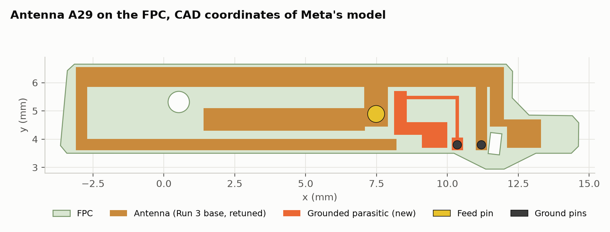
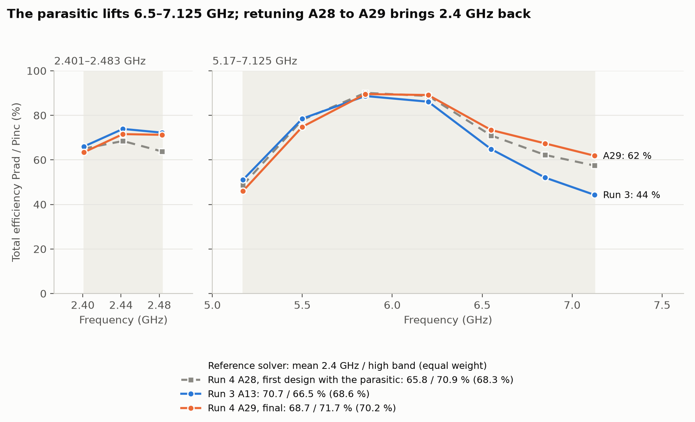

# Meta AI-glasses benchmark, Example 2, Run 4: an extra resonance for 6–7.125 GHz

A refinement of [Run 3](../run3/README.md) by Claude in Claude Code, driving Hertzon only through its MCP interface. Prompted by
a question from Jiang Zhu (Meta): could a further resonance cover 6–7 GHz better? A grounded parasitic next to the feed stem adds
that resonance. The run started from the Run 3 design and project; see [REPORT.md](REPORT.md).

**Full report:** [REPORT.md](REPORT.md) (result, band table, how the resonance works, design path, limits). Timing: [Timing_Log.md](Timing_Log.md).

## Result, no matching components

| Band | Reference total efficiency (Meta's STEP) | Run 3 |
| --- | --- | --- |
| 2401–2483 MHz | 63–72 %, average 68.7 % | 70.7 % |
| 5170–7125 MHz | 46–90 %, average 71.7 % | 66.5 % |
| Equal weight | 70.2 % | 68.6 % |

At 7.125 GHz the reference solver gives 61.8 % instead of 44.3 %. Effort: about 2.5 h until A29, 39 Hertzon solves and two runs of
the reference solver. The lower band edge (5.17 GHz, 46 %) got worse.

## Files

| File | What it is |
| --- | --- |
| `Meta_Ex2_Run4.hzn` | Hertzon project of the final design A29 (Setup1: adaptive at 2.45 + 6.1 GHz, S11 and efficiency sweeps) |
| `reference/Meta_Ex2_Run4_reference.py` | IronPython script for the reference solver on Meta's STEP (set `STP_FILE`; the STEP is not included here) |
| `results/reference_*.csv` | Reference efficiency and S11 of A29 (and of A28, `_A28`), efficiency of Runs 2–4 side by side |
| `results/*.png` | Run comparison, Run 3 against Run 4, S11, layout, layouts of Runs 2–4 |
| `tools/make_plots.py` | Writes the plots and the comparison table from these files and from `../run2`, `../run3` |
| `tools/plot_layouts.py` | Draws the final antennas of Runs 2–4 from their Hertzon projects |

## Reproduce

Open the `.hzn` in Hertzon 0.3.11 or newer and run Setup1. Total efficiency is radiated power over incident power of the `Eff` sweep;
`get_results` with `kind = efficiency` on the MCP interface gives the split into mismatch and radiation efficiency.
