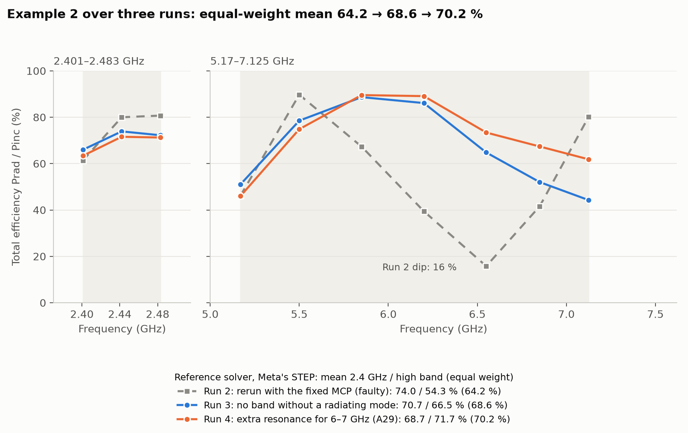
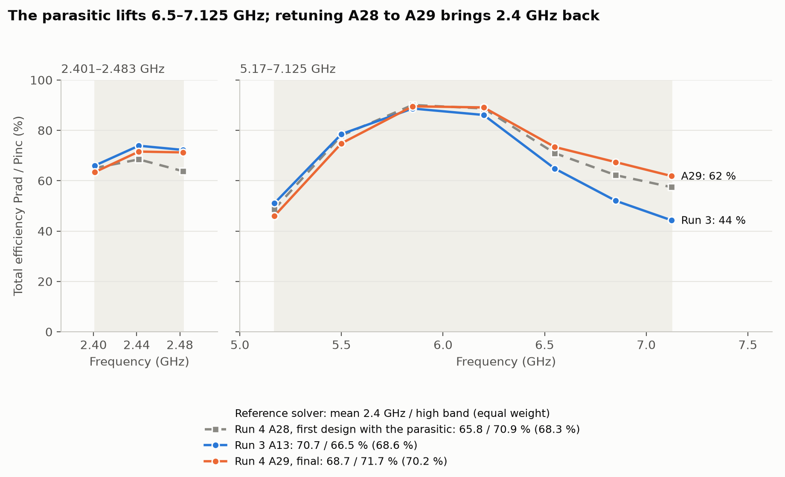
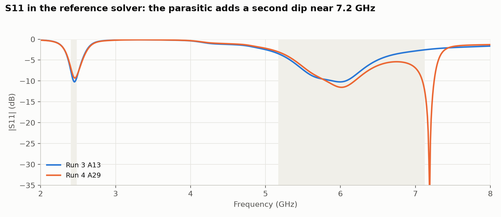
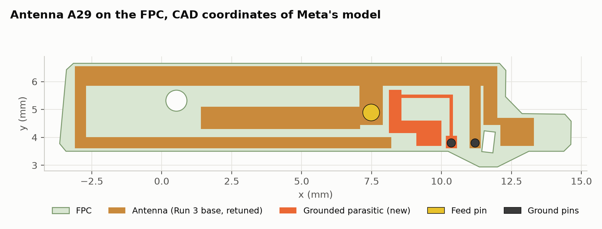

# Meta AI-glasses benchmark, Example 2, Run 4: an extra resonance for 6–7.125 GHz

November 2026, Hertzon 0.3.11, checked with a commercial FEM reference solver

Run 4 is a refinement of [Run 3](../run3/README.md), not a run from scratch. It started from the Run 3 design (A13) and its Hertzon project, with the Run 3 report and the project memory in the agent's context. The prompt passed on a question from Jiang Zhu (Meta), one of the benchmark authors: could a further resonance cover the 6–7 GHz band better? The user asked to try it.

## Result

The final design, A29, has a mean total efficiency without matching parts of **68.7 % in 2401–2483 MHz and 71.7 % in 5170–7125 MHz in the reference solver** on Meta's original STEP model, **70.2 %** with both bands weighted equally. That is 1.6 points above Run 3 and the highest equal-weight result of all runs. At 7.125 GHz it reaches 61.8 % instead of 44.3 %.

| Run | What the run was asked for | 2.4 GHz band | 5.17–7.125 GHz | Equal weight | At 7.125 GHz | Design time | Solves |
| --- | --- | --- | --- | --- | --- | --- | --- |
| Run 2 (faulty) | Rerun with the fixed Hertzon MCP | 74.0 % | 54.3 % | 64.2 % | 80.2 % | 4.1 h | 24 |
| Run 3 | No band without a radiating mode | 70.7 % | 66.5 % | 68.6 % | 44.3 % | 1.1 h | 13 |
| Run 4, A28 | Extra resonance for 6–7 GHz, first design | 65.8 % | 70.9 % | 68.3 % | 57.4 % | | |
| **Run 4, A29** | **A28 retuned, final** | **68.7 %** | **71.7 %** | **70.2 %** | **61.8 %** | **about 2.5 h** | **39 + 2 reference** |

All values are from the reference solver on Meta's STEP, total efficiency Prad / Pinc with 1 W incident, one reference run per design. Run 1 used its own feed model in the reference solver, so it is left out of this comparison (63.9 / 68.6 %, 66.3 %).

## Band by band (reference solver)

| Frequency (GHz) | Run 3 (%) | A28 (%) | A29 total (%) | A29 accepted (%) |
| --- | --- | --- | --- | --- |
| 2.401 | 66.0 | 65.0 | 63.4 | 79.0 |
| 2.442 | 73.9 | 68.5 | 71.6 | 87.7 |
| 2.483 | 72.2 | 63.8 | 71.2 | 86.7 |
| 5.17 | 51.0 | 48.7 | 46.0 | 50.3 |
| 5.5 | 78.5 | 77.9 | 74.8 | 78.2 |
| 5.85 | 88.7 | 90.1 | 89.5 | 90.9 |
| 6.2 | 86.1 | 88.7 | 89.1 | 89.6 |
| 6.55 | 64.8 | 70.9 | 73.4 | 74.7 |
| 6.85 | 52.0 | 62.2 | 67.4 | 72.2 |
| 7.125 | 44.3 | 57.4 | 61.8 | 94.4 |

## How the extra resonance works

Run 3 has one broad high-band mode near 5.7 GHz. Above 6.4 GHz its input impedance is inductive (R about 25 Ω, X rising to 83 Ω at 7.1 GHz), so the upper band edge is limited by reflection.

The new element is a **grounded parasitic** in the slot to the right of the feed stem, with its own ground pin in the same style as the existing one (r = 0.15 mm, into the PCB). It is a stepped-impedance resonator: a narrow neck (0.12 mm) from the pin up and along the top, and a wide tail that ends 0.21 mm from the feed stem and couples to it. The parasitic adds a parallel resonance near 7.3 GHz and a narrow series resonance at 7.19 GHz (S11 −38 dB in the reference solver), which pull the impedance towards 50 Ω over 6.5–7.125 GHz. Moving the short stub of the 2.4 GHz arm to x = 11.2 mm also tunes the parasitic.

What did not work:

1. **A second branch on the feed stem** (A14) and a fork of a long and a short branch (A17): no effect on the high band. Both lie between conductors on the same potential as the stem, so they are not excited.
2. **A grounded parasitic on the FPC bottom layer, under the feed stem** (A15, A16): coupling too strong. It made a narrow mode (Q about 75) with R of only 2–3 Ω and destroyed the main mode.
3. **A longer right lobe beyond the short** (A18): no effect. The short at x = 11 mm isolates everything to its right at these frequencies.
4. **The resonance right at 7.1 GHz** (A27): well matched (mismatch efficiency 0.92), but radiation efficiency was only 25 % and total 21 %. Near its own resonance the parasitic stores energy and loses it in the narrow copper, so the resonance was placed just above the band. Even in A29 the reference solver shows 34 % loss at 7.125 GHz (accepted 94 %, radiated 62 %).

## Design A29

One feed through Meta's feed pin, two ground pins r = 0.15 mm, copper on the top FPC layer only, no matching parts. Coordinates in mm from the supplied CAD origin, all at least 0.1 mm from FPC edges and holes.

| Element | x | y |
| --- | --- | --- |
| Top bar | −3.1 to 12.0 | 5.85–6.55 |
| Feed stem over the feed pin at (7.486, 4.892) | 7.066–7.906 | 4.442–5.85 |
| High-band branch on the stem | 1.4–7.086 | 4.3–5.1 |
| Short stub, pin at (11.2, 3.8) | 11.0–11.4 | 3.605–5.85 |
| Left leg | −3.1 to −2.7 | 3.605–5.85 |
| Lower arm for 2.4 GHz | −3.1 to 8.2 | 3.605–4.005 |
| Right drop | 11.5–12.0 | 4.45–5.85 |
| Right lobe | 11.5–13.3 | 4.45–4.7 |
| Right lobe, wide part | 12.1–13.3 | 3.7–4.45 |
| Parasitic: pad over its pin at (10.35, 3.8) | 10.15–10.55 | 3.605–4.055 |
| Parasitic: neck, vertical | 10.29–10.41 | 4.0–5.535 |
| Parasitic: neck, horizontal | 8.38–10.41 | 5.415–5.535 |
| Parasitic: top end | 8.12–8.4 | 5.25–5.7 |
| Parasitic: tail next to the stem | 8.12–8.57 | 4.15–5.7 |
| Parasitic: lower tail | 8.12–10.0 | 4.15–4.6 |
| Parasitic: tail end | 9.1–10.0 | 3.7–4.6 |

Compared with Run 3, the stub right of the stem (x 7.886–9.9) is gone, because the parasitic needs that space and Run 3 had shown that it changed little. The lower arm ends at 8.2 instead of 8.4 mm and the short moved from x = 11.0 to 11.2 mm. Meta's reference design was not used; the supplied files contain no antenna trace.

## Design path

1. **A13 rerun as baseline** (Hertzon 69.3 / 63.4 %), impedance analysis: no resonance above 6.4 GHz.
2. **A14–A18**: five ideas without effect or with a bad side effect (see above).
3. **A19–A27**: grounded parasitic right of the stem. Its parallel resonance moved from above 8 GHz to 7.0 GHz through a longer tail, the narrow neck and a smaller gap to the stem. A27 showed the loss problem.
4. **A28**: resonance just above the band. Hertzon 69.8 / 67.6 %; reference solver 65.8 / 70.9 %, with 2.4 GHz detuned towards low frequencies.
5. **Parametric studies on S11**: arm length (5 variants) and branch end × short position (16 variants). The short at x = 11.2 mm helps 7.125 GHz most.
6. **A29, final**: arm 8.2 mm, short at 11.2 mm. Hertzon 67.5 / 68.5 %; reference solver 68.7 / 71.7 %.

## Setup

As Run 3: Hertzon 0.3.11, first-order elements, adaptive at 2.45 and 6.1 GHz, up to 10 passes, ΔS ≤ 0.02, two-sided 35 µm copper sheets. The parasitic is a second sheet on the top FPC face with its own pin. The reference solver (version 2025 R1) uses Meta's STEP unmodified plus the two copper sheets, the two ground pins and a 30 µm bridge to the feed pin (`reference/Meta_Ex2_Run4_reference.py`), adaptive at 2.45 and 6.1 GHz, ΔS ≤ 0.01, 3° far-field sphere.

## Limits

- **The reference solver was not only the final check.** The A28 result there (2.4 GHz too low) led to the arm retune in A29. Run 3 used it only once at the end.
- The lower band edge got worse: 5.17 GHz is 46.0 % in A29 against 51.0 % in Run 3, and the 2.4 GHz band is 2 points lower. The gain is all in 6.2–7.125 GHz.
- At 7.125 GHz a third of the accepted power is lost in the parasitic (radiation efficiency 66 % in the reference solver). A resonator with less loss, such as a wider neck, could add a few points.
- Hertzon reads 3 points lower than the reference solver on the high-band mean of A29 and is not reproducible pass by pass, about ±1 point on the band means.
- A second ground pin is needed. It has the style of the existing one; whether that fits the benchmark's interconnect rules should be confirmed.

## Effort

About 2.5 h until the final antenna A29: 2 h 25 min of design (19:20–21:45 UTC on 9 November 2026) plus 6 min for the reference check of A29. Hertzon ran 17 single solves and 22 parametric variants (39 in total, 2–6 min each); the reference solver ran twice (A28 and A29). Tokens per step were not measured. See [Timing_Log.md](Timing_Log.md).
