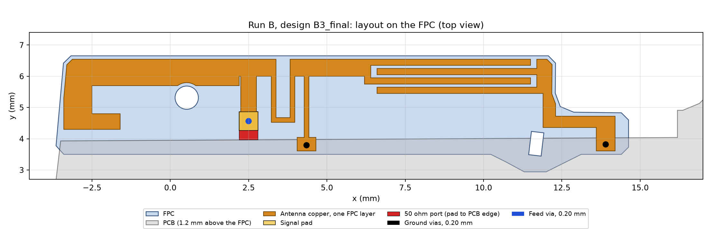
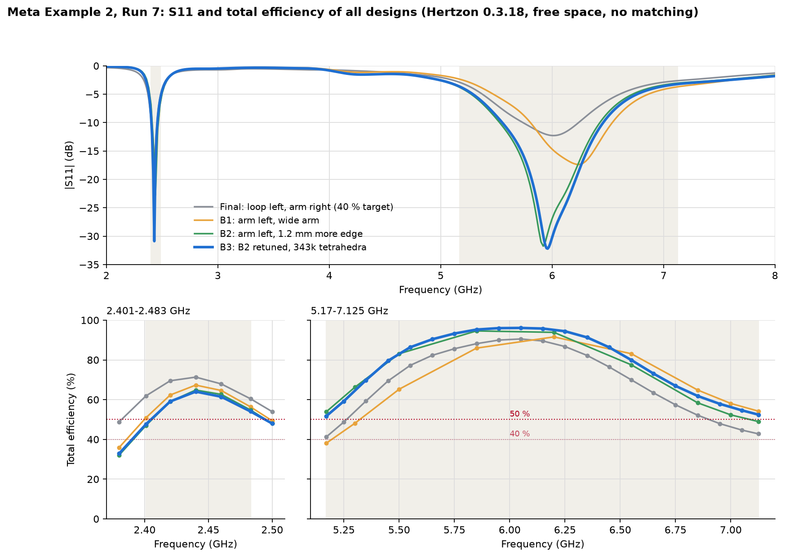
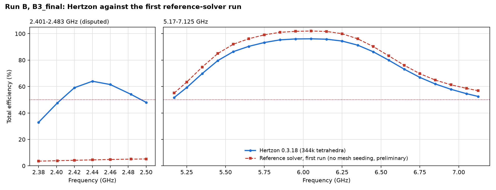

# Meta AI-glasses benchmark, Example 2, Run B: from scratch, at least 50 % everywhere (Hertzon 0.3.18)

A from-scratch run by Claude in Claude Code (model Fable 5.2, medium effort), driving Hertzon 0.3.18 only through its
MCP interface. The agent got only the benchmark package (task statement, prompt, Hertzon project and STEP of the
environment without antenna, and the Run 4 curves as yardstick, without layout) and read no reports, designs or notes
of earlier runs. Internally this run was called Run 7; its first final design is `Final`, the follow-up study for
"at least 50 % at every frequency" produced `B1`, `B2`, `B3` and `B3_final`.

No matching network, no lumped components, one FPC copper layer, three copper-cylinder vias of 0.2 mm diameter.

> **Status of the results.** All numbers below are Hertzon numbers. A first reference-solver run of `B3_final`
> confirms the upper band but **disputes the 2.4 GHz band** (about 4 % instead of about 59 %, the loop resonance moves
> to about 4.2 GHz). That run had no mesh seeding on the 0.1 mm capacitor gaps. A refined reference run (0.1 mm length
> seeding on the copper, 1.76 M tetrahedra) is still running; until it is done, the 2.4 GHz values of Run B are not
> independently confirmed. See [Reference solver](#reference-solver-preliminary).

## Result in Hertzon (total efficiency, free space, 50 ohm)

| Design | Mesh | 2401–2483 MHz min / mean | 5170–7125 MHz min / mean | Mean of both bands |
| --- | --- | --- | --- | --- |
| `Final` (40 % target) | 221k tetrahedra, 26 points | 60.4 / 67.4 % | 41.2 / 70.8 % | 69.1 % |
| `B1` | 97k, 14 points | 50.9 / 62.0 % | 38.0 / 73.4 % | 67.7 % |
| `B2` | 97k, 14 points | 47.0 / 59.4 % | 49.0 / 77.7 % | 68.6 % |
| `B3` | 222k, 26 points | 51.8 / 59.5 % | 51.7 / 79.7 % | 69.6 % |
| **`B3_final`** | **344k, 26 points** | **47.6 / 58.9 %** | **51.7 / 79.6 %** | **69.3 %** |
| Run 4, A29 (yardstick) | Hertzon 0.3.13 | 60.0 / 67.3 % | about 47 / 69.0 % | 68.2 % |

- **Upper band:** `B3_final` holds at least 51.7 % at all 21 points, confirmed on two meshes; peak 96.1 % at 6.05 GHz.
- **2.4 GHz:** 64 % at band centre, 47.6 to 51.8 % at the lower band edge depending on the mesh. **The 50 % target
  is not secured there**, and the band is about 8 points worse than with `Final`.
- **60 % everywhere** (asked for afterwards) is not reachable with this layout: design `C1` with 1.5 mm more arm
  length widened the upper resonance only from 22.1 to 23.2 %.
- Power balance of `B3_final` within 1.3 % of the incident power at all points. Delta S 0.01 was not reached
  (0.014 in the last pass).

The S11 curve of B3 is the interpolating sweep on the 222k mesh; the efficiency points are from the 344k mesh.

## Reference solver (preliminary)

First run of `B3_final` in the commercial reference solver (version 2025 R1), with PCB, FPC and chassis from the
benchmark STEP and the antenna rebuilt from `reference/hfss_B3_final.json`. Adaptive at 2.44 and 6.1 GHz, converged
after 7 passes, **no mesh seeding** on the copper.

| `B3_final` | 2401–2483 MHz min / mean | 5170–7125 MHz min / mean |
| --- | --- | --- |
| Hertzon 0.3.18 (344k) | 47.6 / 58.9 % | 51.7 / 79.6 % |
| Reference solver, first run | **3.9 / 4.5 %** | 55.1 / 82.3 % |

- The upper band agrees in shape and resonance (5.96 GHz in Hertzon, 5.98 GHz in the reference solver); the
  reference values lie 3 to 6 points higher, and its radiated power exceeds the accepted power by up to 2.5 %, so its
  far-field integration in this run is about 2 % high.
- At 2.4 GHz the two solvers disagree completely: in the reference solver the loop with the finger capacitor
  resonates near 4.2 GHz. The suspicion is that this run did not resolve the 0.1 mm capacitor gaps (it refined only
  at 2.44 and 6.1 GHz and saw no field on the loop); a hand estimate of the capacitor and the loop gives 2.1 to
  2.5 GHz, which favours Hertzon but is no proof.
- The refined reference run decides the question. Its numbers will be added here; until then the Run B 2.4 GHz
  results count as **disputed**. `Final` has not been run in the reference solver yet.

Files: `results/reference_prelim/` (efficiency, S11, convergence of the first run) and
`reference/Meta_Ex2_RunB_reference.py` (IronPython script, batch mode).

## Prompts

The run started from `input/Prompt.md` (German) with the benchmark rules in `input/Benchmark_Angabe.md`. In short:

1. Design the best antenna on the FPC without matching network or lumped parts. Mandatory: at least 40 % total
   efficiency at every frequency in 2401–2483 MHz and 5170–7125 MHz, and a radiating mode everywhere in both bands
   (no band covered only by the tail of a neighbouring resonance). Then maximise the mean of both band means. Beat
   Run 4 (Hertzon 67.3 / 69.0 %, mean 68.2 %). Compare several different concepts before refining one.
2. Modelling rules: vias as copper cylinders of equal diameter, a clean feed (via to a signal pad, port between two
   straight edges), power balance within 2 %, every simplification checked by a comparison solve, mesh converged
   and confirmed on a finer mesh, efficiency at discrete points with stored fields, design-rule check with numbers.
3. From scratch: no reports, geometries, projects or notes of earlier runs.

Follow-up messages of the user in the same session (translated):

| After | Message | Result |
| --- | --- | --- |
| `Final` | "And maximum total efficiency without drops." "So the area to 100 % as small as possible. At worst 50 %, though." | Study B: B1, B2 |
| B1 (agent: 50 % not reachable with one resonance) | "Yes, keep trying." | B2, B3 |
| B3 | "Now 60 %." | C1: not reachable with this layout |
| C1 | "Secure B3." | B3 check on 343k, B3_final |
| B3_final | Report on B1–B3, combined plot, example folder, times and tokens per study, check in the reference solver | Reports, this folder, reference run |

## Effort

| Part | Wall time | Hertzon solves | Solver time | Tokens |
| --- | --- | --- | --- | --- |
| Run up to `Final` (concepts K1–K18, tuning, mesh check, report) | 8 h 15 min | 49 (+13 aborted by tool errors) | most of it | context about 590k at the end of the session (whole run incl. study B) |
| B1 | 17 min | 2 | 15.8 min | 26.7k output, 29.6k new context |
| B2 | 17 min | 2 | 16.1 min | 12.9k output, 18.1k new context |
| B3 | 54 min | 2 | 53.0 min | 36.7k output, 35.1k new context |
| **Sum B1–B3** | **88 min** | **6** | **84.9 min** | **76.4k output, 82.8k new context** |
| C1 (60 % check) | 6 min | 1 | 6.1 min | 8.1k output |
| B3 check, 343k mesh | 13 min | 1 | 13.1 min | 8.2k output |
| B3_final, report, example folder | 33 min | 1 | 25.9 min | 60.3k output |
| Reference solver, first run of B3_final | about 3 min | | | |

Times per step and how the tokens were counted: [Timing_Log.md](Timing_Log.md). Output tokens come from the session
log and are an upper bound; each step also reads the whole session from the cache (35 M tokens for B1–B3).

## Files

| File | What it is |
| --- | --- |
| `Meta_Ex2_RunB.hzn` | Hertzon project with all designs (concepts K1–K18, `Final`, `B1`, `B2`, `B3`, `B3_final`, `C1`), without result folders |
| `input/` | Benchmark input as the agent got it: prompt, task statement (both German), benchmark STEP of PCB, FPC and chassis |
| `REPORT_B1-B3_de.md` | Report on study B (German): designs, `B3_final` table, open points, limits, times and tokens |
| `REPORT_Final_de.md` | Report on the run up to `Final` (German): concept study, assumptions and their check solves, Hertzon issues |
| `results/*_efficiency.txt` | Mismatch, radiation and total efficiency, loss, power balance and impedance per frequency |
| `results/*.s1p` | S11 at the evaluation points and from the interpolating sweep (2–8 GHz) |
| `results/reference_prelim/` | First reference-solver run of `B3_final` (preliminary, see above) |
| `results/*.png` | Layouts, S11 and efficiency of all designs, Hertzon against the reference solver |
| `reference/` | Reference-solver script and the antenna geometry of `Final` and `B3_final` as JSON |
| `tools/ant_lib.py`, `tools/final_geometry.py`, `tools/b3_geometry.py` | Geometry builder run through `run_python`, geometry of `Final` and `B3_final` |
| `tools/eff.py`, `tools/s11.py`, `tools/plots.py`, `tools/plot_all.py` | Tables and plots from the Hertzon result folder (`Meta_Ex2_RunB.hznresults`, after a solve) |
| `tools/make_plots.py` | Layouts in mm and the reference comparison, from the files in this folder |

## Reproduce

Open `Meta_Ex2_RunB.hzn` in Hertzon 0.3.18 or newer, select design `B3_final` and run its setup. Total efficiency
is radiated power over incident power of the `Eff` sweep; `get_results` with `kind = efficiency` on the MCP interface
gives the split into mismatch and radiation efficiency.
