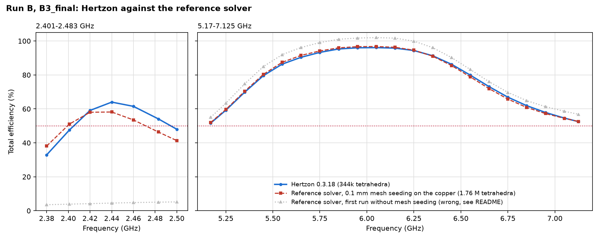

# Meta AI-glasses benchmark, Example 2, Run B: from scratch, at least 50 % everywhere (Hertzon 0.3.18)

A from-scratch run by Claude in Claude Code (model Fable 5.2, medium effort), driving Hertzon 0.3.18 only through its
MCP interface. The agent got only the benchmark package (task statement, prompt, Hertzon project and STEP of the
environment without antenna, and the Run 4 curves as yardstick, without layout) and read no reports, designs or notes
of earlier runs. Internally this run was called Run 7; its first final design is `Final`, the follow-up study for
"at least 50 % at every frequency" produced `B1`, `B2`, `B3` and `B3_final`.

No matching network, no lumped components, one FPC copper layer, three copper-cylinder vias of 0.2 mm diameter.

> **Status of the results.** `B3_final` has been checked in the commercial reference solver: the upper band is
> confirmed within 1.5 points, the 2.4 GHz band is lower there (mean 53.4 instead of 57.3 %, **46.4 % at 2.483 GHz**).
> The 50 % target is met in the upper band in both solvers, at 2.4 GHz in neither. `Final`, `B1` and `B2` have not
> been run in the reference solver.

## Result in Hertzon (total efficiency, free space, 50 ohm)

Band means are arithmetic means over the evaluation points, as for Run 4 and Run C.

| Design | Mesh | 2401–2483 MHz min / mean | 5170–7125 MHz min / mean | Mean of both bands |
| --- | --- | --- | --- | --- |
| `Final` (40 % target) | 221k tetrahedra, 26 points | 60.4 / 66.2 % | 41.2 / 68.9 % | 67.5 % |
| `B1` | 97k, 14 points | 50.9 / 60.3 % | 38.0 / 65.5 % | 62.9 % |
| `B2` | 97k, 14 points | 47.0 / 57.7 % | 49.0 / 69.9 % | 63.8 % |
| `B3` | 222k, 26 points | 51.8 / 58.1 % | 51.7 / 77.9 % | 68.0 % |
| **`B3_final`** | **344k, 26 points** | **47.6 / 57.3 %** | **51.7 / 77.7 %** | **67.5 %** |
| Run 4, A29 (yardstick) | Hertzon 0.3.13 | 60.0 / 67.3 % | about 47 / 69.0 % | 68.2 % |

- **Upper band:** `B3_final` holds at least 51.7 % at all 21 points, confirmed on two meshes; peak 96.1 % at 6.05 GHz.
- **2.4 GHz:** 64 % at band centre, 47.6 to 51.8 % at the lower band edge depending on the mesh. **The 50 % target
  is not met there**, and the band is about 9 points worse than with `Final`.
- **Against Run 4:** with the same arithmetic mean, neither `Final` (67.5 %) nor `B3_final` (67.5 %) beats Run 4
  (68.2 %) in Hertzon. `B3_final` has the better upper band and minimum there, Run 4 the better 2.4 GHz band.
- **60 % everywhere** (asked for afterwards) is not reachable with this layout: design `C1` with 1.5 mm more arm
  length widened the upper resonance only from 22.1 to 23.2 %.
- Power balance of `B3_final` within 1.3 % of the incident power at all points. Delta S 0.01 was not reached
  (0.014 in the last pass).
- The German reports give frequency-weighted (trapezoidal) means, which weight the band edges half: for `B3_final`
  58.9 / 79.6 %, 69.2 % for both bands, for `Final` 67.4 / 70.8 %, 69.1 %. They are not comparable with the means of
  Run 4 and Run C.

The S11 curve of B3 is the interpolating sweep on the 222k mesh; the efficiency points are from the 344k mesh.

## Reference solver

`B3_final` in the commercial reference solver (version 2025 R1), with PCB, FPC and chassis from the benchmark STEP
(not Meta's original STEP as in Run 4) and the antenna rebuilt from `reference/hfss_B3_final.json`: the same copper
outline, vias, pad and port as in Hertzon, copper sheets as finite-conductivity boundaries, radiation boundary at
40 mm, adaptive at 2.44 and 6.1 GHz to Delta S 0.01, the same 28 frequency points, far field in 3° steps.

| `B3_final` | 2401–2483 MHz min / mean / max | 5170–7125 MHz min / mean / max | Mean of both bands |
| --- | --- | --- | --- |
| Hertzon 0.3.18, 344k tetrahedra | 47.6 / 57.3 / 64.0 % | 51.7 / 77.7 / 96.1 % | 67.5 % |
| **Reference solver, 0.1 mm mesh seeding on the copper, 1.76 M tetrahedra** | **46.4 / 53.4 / 58.2 %** | **52.1 / 77.8 / 96.7 %** | **65.6 %** |
| Reference solver, first run without mesh seeding (wrong) | 3.9 / 4.5 / 5.1 % | 55.1 / 82.3 / 102.0 % | 43.4 % |

| f (GHz) | Hertzon total | Reference total | Difference | Hertzon mismatch | Reference mismatch |
| --- | --- | --- | --- | --- | --- |
| 2.401 | 47.6 % | 51.1 % | +3.5 | 82.8 % | 93.7 % |
| 2.420 | 59.1 % | 58.0 % | -1.1 | 96.8 % | 100.0 % |
| 2.440 | 64.0 % | 58.2 % | -5.9 | 99.4 % | 94.9 % |
| 2.460 | 61.5 % | 53.5 % | -8.0 | 91.3 % | 83.5 % |
| 2.483 | 54.1 % | 46.4 % | -7.7 | 77.2 % | 69.6 % |
| 5.170 | 51.7 % | 52.1 % | +0.4 | 55.7 % | 55.8 % |
| 5.550 | 86.4 % | 87.5 % | +1.1 | 91.0 % | 91.2 % |
| 6.050 | 96.1 % | 96.7 % | +0.6 | 99.9 % | 99.9 % |
| 6.550 | 79.9 % | 78.9 % | -1.0 | 82.7 % | 81.8 % |
| 7.125 | 52.5 % | 52.6 % | +0.1 | 53.3 % | 54.5 % |

- **Upper band confirmed:** within 1.5 points at every point, band edges 52.1 and 52.6 %.
- **2.4 GHz confirmed in principle, but lower:** the reference solver puts the loop resonance at 2.42 to 2.43 GHz
  (Hertzon 2.44 GHz) and finds a 3 to 6 points lower radiation efficiency (55 to 67 % instead of 58 to 70 %). The band
  edges come out at 51.1 % (2.401 GHz) and 46.4 % (2.483 GHz).
- **The first reference run was wrongly converged.** Without mesh seeding it reported Delta S below 0.01 after 7
  passes but put the loop resonance near 4.2 GHz (4.5 % at 2.44 GHz), because it did not resolve the 0.1 mm gaps of
  the finger capacitor. With 0.1 mm seeding on the copper it needed 17 passes (S11 at 2.44 GHz from -3.5 to
  -12.9 dB) and 1.76 M tetrahedra; its radiated power also no longer exceeds the accepted power.
- Effort: first run 3 min; refined run 10 h 40 min for the adaptive passes and the 28 points (17 to 23 min per point
  on 32 cores). Its S11 sweep from 2 to 8 GHz was stopped, so there is no reference S11 curve; the S11 sweep of the
  first run is wrong and not included.

Files: `results/reference_refined/` and `results/reference_first_run/` (efficiency, S11 at the points, convergence),
`reference/Meta_Ex2_RunB_reference.py` (IronPython script, batch mode) and `reference/export_only.py` (export from a
solved project after stopping the sweep).

## Prompts

The run started from `input/Prompt.md` (German) with the benchmark rules in `input/Benchmark_Angabe.md`. In short:

1. Design the best antenna on the FPC without matching network or lumped parts. Mandatory: at least 40 % total
   efficiency at every frequency in 2401–2483 MHz and 5170–7125 MHz, and a radiating mode everywhere in both bands
   (no band covered only by the tail of a neighbouring resonance). Then maximise the mean of both band means. Beat
   Run 4 (Hertzon 67.3 / 69.0 %, mean 68.2 %). Compare several different concepts before refining one.
2. Modelling rules: vias as copper cylinders of equal diameter, a clean feed (via to a signal pad, port between two
   straight edges), power balance within 2 %, every simplification checked by a comparison solve, mesh converged
   and confirmed on a finer mesh, efficiency at discrete points with stored fields, design-rule check with numbers.
3. From scratch: no reports, geometries, projects or notes of earlier runs.

Follow-up messages of the user in the same session (translated):

| After | Message | Result |
| --- | --- | --- |
| `Final` | "And maximum total efficiency without drops." "So the area to 100 % as small as possible. At worst 50 %, though." | Study B: B1, B2 |
| B1 (agent: 50 % not reachable with one resonance) | "Yes, keep trying." | B2, B3 |
| B3 | "Now 60 %." | C1: not reachable with this layout |
| C1 | "Secure B3." | B3 check on 343k, B3_final |
| B3_final | Report on B1–B3, combined plot, example folder, times and tokens per study, check in the reference solver | Reports, this folder, reference run |

## Effort

| Part | Wall time | Hertzon solves | Solver time | Tokens |
| --- | --- | --- | --- | --- |
| Run up to `Final` (concepts K1–K18, tuning, mesh check, report) | 8 h 15 min | 49 (+13 aborted by tool errors) | most of it | context about 590k at the end of the session (whole run incl. study B) |
| B1 | 17 min | 2 | 15.8 min | 26.7k output, 29.6k new context |
| B2 | 17 min | 2 | 16.1 min | 12.9k output, 18.1k new context |
| B3 | 54 min | 2 | 53.0 min | 36.7k output, 35.1k new context |
| **Sum B1–B3** | **88 min** | **6** | **84.9 min** | **76.4k output, 82.8k new context** |
| C1 (60 % check) | 6 min | 1 | 6.1 min | 8.1k output |
| B3 check, 343k mesh | 13 min | 1 | 13.1 min | 8.2k output |
| B3_final, report, example folder | 33 min | 1 | 25.9 min | 60.3k output |
| Reference solver, `B3_final` | 3 min first run, 10 h 40 min refined run | | | |

Times per step and how the tokens were counted: [Timing_Log.md](Timing_Log.md). Output tokens come from the session
log and are an upper bound; each step also reads the whole session from the cache (35 M tokens for B1–B3).

## Files

| File | What it is |
| --- | --- |
| `Meta_Ex2_RunB.hzn` | Hertzon project with all designs (concepts K1–K18, `Final`, `B1`, `B2`, `B3`, `B3_final`, `C1`), without result folders |
| `input/` | Benchmark input as the agent got it: prompt, task statement (both German), benchmark STEP of PCB, FPC and chassis |
| `REPORT_B1-B3_de.md` | Report on study B (German): designs, `B3_final` table, open points, limits, times and tokens |
| `REPORT_Final_de.md` | Report on the run up to `Final` (German): concept study, assumptions and their check solves, Hertzon issues |
| `results/*_efficiency.txt` | Mismatch, radiation and total efficiency, loss, power balance and impedance per frequency |
| `results/*.s1p` | S11 at the evaluation points and from the interpolating sweep (2–8 GHz) |
| `results/reference_refined/`, `results/reference_first_run/` | Reference-solver runs of `B3_final` (see above) |
| `results/*.png` | Layouts, S11 and efficiency of all designs, Hertzon against the reference solver |
| `reference/` | Reference-solver scripts and the antenna geometry of `Final` and `B3_final` as JSON |
| `tools/ant_lib.py`, `tools/final_geometry.py`, `tools/b3_geometry.py` | Geometry builder run through `run_python`, geometry of `Final` and `B3_final` |
| `tools/eff.py`, `tools/s11.py`, `tools/plots.py`, `tools/plot_all.py` | Tables and plots from the Hertzon result folder (`Meta_Ex2_RunB.hznresults`, after a solve) |
| `tools/make_plots.py` | Layouts in mm and the reference comparison, from the files in this folder |

## Reproduce

Open `Meta_Ex2_RunB.hzn` in Hertzon 0.3.18 or newer, select design `B3_final` and run its setup. Total efficiency
is radiated power over incident power of the `Eff` sweep; `get_results` with `kind = efficiency` on the MCP interface
gives the split into mismatch and radiation efficiency.
