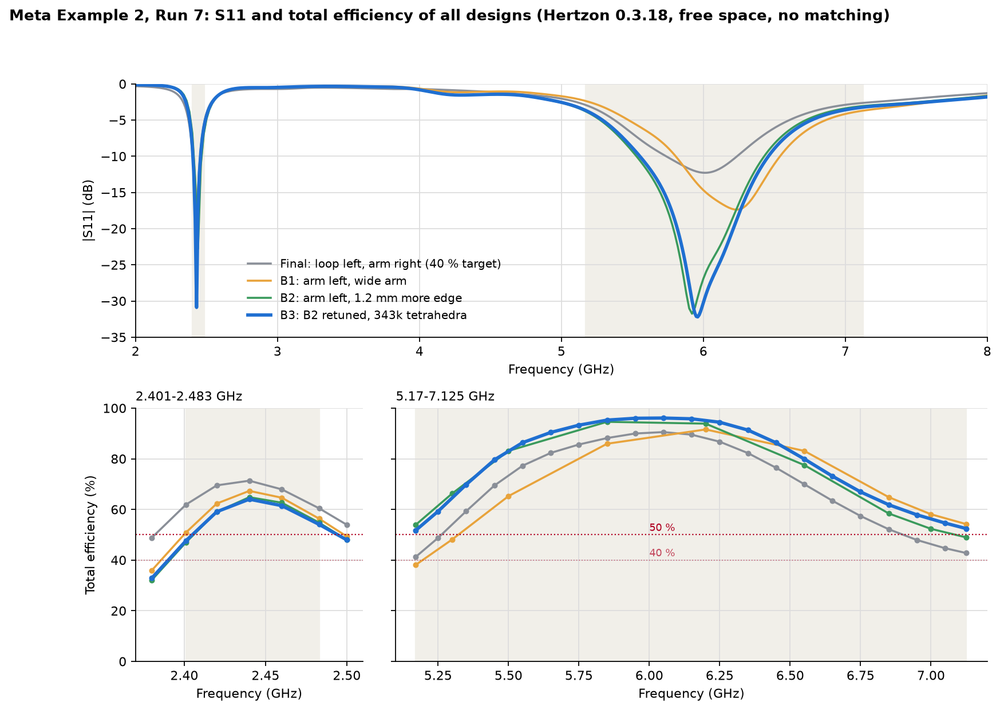

# Meta Example 2, Run 7: Entwürfe B1 bis B3 (Ziel: mindestens 50 % an jeder Frequenz)

Stand 12.11.2026, Hertzon 0.3.18 über die MCP-Schnittstelle. Projekt `Meta_Ex2_RunB.hzn`, Designs `Final`, `B1`, `B2`, `B3`, `B3_final`. Kein Anpassnetzwerk, keine Bauteile, eine FPC-Lage, drei Kupferzylinder-Vias mit 0.2 mm Durchmesser. Total-Effizienz = Fernfeld-Leistung / einfallende Leistung an 50 Ohm.

## Ergebnis

| Design | Netz | 2401-2483 MHz: Min / Mittel / Max | 5170-7125 MHz: Min / Mittel / Max | Mittel beider Bänder |
|---|---|---|---|---|
| Final (Ausgangspunkt, 40-%-Ziel) | 221k, 26 Punkte | 60.4 / 67.4 / 71.3 % | 41.2 / 70.8 / 90.5 % | 69.1 % |
| B1 | 97k, 14 Punkte | 50.9 / 62.0 / 67.3 % | 38.0 / 73.4 / 91.6 % | 67.7 % |
| B2 | 97k, 14 Punkte | 47.0 / 59.4 / 64.8 % | 49.0 / 77.7 / 94.6 % | 68.6 % |
| B3 | 222k, 26 Punkte | 51.8 / 59.5 / 64.4 % | 51.7 / 79.7 / 96.1 % | 69.6 % |
| **B3_final** | **344k, 26 Punkte** | **47.6 / 58.9 / 64.0 %** | **51.7 / 79.6 / 96.1 %** | **69.3 %** |
| Messlatte Run 4 | | Mittel 67.3 % | Mittel 69.0 %, Min rund 47 % | 68.2 % |

- **Oberes Band:** B3 hält mindestens 51.7 % an allen 21 Punkten, in zwei Netzen bestätigt. Gegenüber Final sind die Bandkanten 10 Punkte besser und das Mittel 9 Punkte.
- **2.4 GHz:** B3 liegt in der Mitte bei 64 %, an der unteren Kante je nach Rechnung bei 47.6 bis 51.8 %. **Die 50 % sind dort nicht gesichert.** Das Band ist 8 Punkte schlechter als bei Final.
- **60 % überall:** mit diesem Aufbau nicht erreichbar (siehe Grenzen).
- B1 und B2 sind Zwischenschritte mit grobem Netz und nur 9 Punkten im oberen Band; ihre Bandmittel sind deshalb ungenauer als die von B3.

Im Bild stammt die S11-Kurve von B3 aus dem 222k-Netz (interpolierender Sweep), die Effizienz aus dem 344k-Netz.

## Was B1, B2 und B3 unterscheidet

Alle drei haben den 5-7-GHz-Arm links neben dem Scharnierblock und die 2.4-GHz-Schleife rechts, also gespiegelt zu Final. Der Arm ist 0.9 mm breit, läuft an der Außenkante nach links, als Fahne die linke Seite hinunter und als Fuß zurück. Zwischen Arm-Knoten und Schleife sitzt eine Haarnadel (0.15 mm Leiter), die Schleife hat einen dünnen Masse-Steg und einen Finger-Kondensator mit 0.1 mm Spalten.

| | B1 | B2 | B3 / B3_final |
|---|---|---|---|
| Speise-Via x | 1.3 mm | 2.5 mm | 2.5 mm |
| Masse-Vias x | 3.15 und 13.9 mm | 4.35 und 13.9 mm | 4.35 und 13.9 mm |
| Kantenlänge des Arms ab Speisung | 4.7 mm | 5.9 mm | 5.9 mm |
| Fuß des Arms bis x | 0.35 mm | -1.45 mm | -1.6 mm |
| Haarnadel bei x | 2.1 bis 2.7 mm | 3.3 bis 3.9 mm | 3.3 bis 3.9 mm |
| Kondensator | 3 Finger, 5.9 mm Überlappung | 4 Finger, 5.0 mm | 4 Finger, 5.05 mm (B3), 5.10 mm (B3_final) |
| Schleifenlänge an der Außenkante | 10.7 mm | 9.5 mm | 9.5 mm |
| Resonanz oben, -6-dB-Breite | 6.24 GHz, 19.9 % | 5.92 GHz, 22.3 % | 5.96 GHz, 22.1 % |
| Resonanz unten, -6-dB-Breite | 2.44 GHz, 4.9 % | 2.44 GHz, 4.9 % | 2.43 GHz, 4.5 % |

- **B1:** Arm nach links verlegt und verbreitert. Die Resonanz oben wird breiter (19.9 statt 17.8 %), reicht aber nicht: 38.0 % bei 5.17 GHz, 54.2 % bei 7.125 GHz, mittig abgestimmt etwa 44 bis 45 % an beiden Kanten.
- **B2:** Knoten 1.2 mm nach rechts, der Arm bekommt mehr Außenkante. Breite 22.3 %, Kanten 53.9 und 49.0 %. Die Schleife wird kürzer und braucht vier Finger.
- **B3:** B2 nachgestimmt (Fuß 0.15 mm kürzer, Kondensator angepasst) und mit feinerem Netz und 28 Punkten gerechnet.

## B3_final im Detail (13 Pässe, 343 597 Tetraeder)

| f / GHz | Mismatch % | Strahlung % | Total % | Bilanz % |
|---|---|---|---|---|
| 2.401 | 82.8 | 57.5 | 47.6 | -0.1 |
| 2.420 | 96.8 | 61.1 | 59.1 | -0.1 |
| 2.440 | 99.4 | 64.4 | 64.0 | -0.0 |
| 2.460 | 91.3 | 67.3 | 61.5 | +0.2 |
| 2.483 | 77.2 | 70.0 | 54.1 | +0.3 |
| 5.170 | 55.7 | 92.8 | 51.7 | -1.1 |
| 5.250 | 63.6 | 93.2 | 59.2 | -1.3 |
| 5.350 | 74.4 | 93.8 | 69.8 | -1.4 |
| 5.450 | 84.2 | 94.5 | 79.6 | -1.4 |
| 5.550 | 91.0 | 95.0 | 86.4 | -1.4 |
| 5.650 | 94.9 | 95.2 | 90.4 | -1.4 |
| 5.750 | 97.8 | 95.4 | 93.3 | -1.3 |
| 5.850 | 99.5 | 95.7 | 95.3 | -1.2 |
| 5.950 | 100.0 | 96.0 | 96.0 | -1.0 |
| 6.050 | 99.9 | 96.1 | 96.1 | -1.0 |
| 6.150 | 99.6 | 96.2 | 95.8 | -1.0 |
| 6.250 | 98.2 | 96.2 | 94.4 | -0.9 |
| 6.350 | 94.9 | 96.2 | 91.3 | -0.7 |
| 6.450 | 89.6 | 96.4 | 86.3 | -0.5 |
| 6.550 | 82.7 | 96.6 | 79.9 | -0.1 |
| 6.650 | 75.4 | 97.0 | 73.1 | +0.2 |
| 6.750 | 68.8 | 97.3 | 66.9 | +0.4 |
| 6.850 | 63.3 | 97.7 | 61.9 | +0.6 |
| 6.950 | 59.1 | 98.0 | 57.9 | +0.8 |
| 7.050 | 55.6 | 98.3 | 54.6 | +0.9 |
| 7.125 | 53.3 | 98.5 | 52.5 | +0.9 |

- Leistungsbilanz an allen Punkten innerhalb 1.3 % der einfallenden Leistung.
- Strahlungseffizienz oben 93 bis 99 %, bei 2.4 GHz 57 bis 70 %. Der Verlust bei 2.4 GHz sitzt im Finger-Kondensator auf dem FPC (tan d 0.0105).
- Designregeln: Kupfer zur FPC-Kontur 0.110 mm, zum Rundloch 0.110 mm, zum Langloch 0.168 mm. Alle Vias vollständig auf Kupfer und unter der PCB.
- Eine Resonanz je Band (2.43 und 5.96 GHz), keine Einbrüche. Die Kanten des oberen Bands liegen auf den Flanken dieser einen Resonanz.

## Offene Punkte

1. **2.4 GHz an der unteren Kante:** 51.8 % (B3, 222k), 48.0 % (dieselbe Geometrie, 343k), 47.6 % (B3_final, 344k). Die Lage der schmalen Resonanz streut zwischen den Rechnungen um etwa 0.3 %, das sind rund 3 Punkte an jeder Bandkante. Das Nachstimmen von 5.05 auf 5.10 mm Überlappung hat die Resonanz nicht wie erwartet verschoben.
2. **Netz:** Delta S 0.01 wurde nicht erreicht (0.014 im letzten Pass von B3_final, einmal 0.0096 bei der Bestätigung von B3, nie zwei Pässe in Folge).
3. **Geteilte Kupferfläche:** Hertzon bricht bei ungeteilter Fläche ab, die Fläche ist deshalb bei x = 5.5 mm in zwei aneinanderstoßende Stücke geteilt. Ein Vergleich gegen die ungeteilte Fläche war nicht rechenbar.
4. **Umgebung:** PCB, FPC und Chassis unverändert aus dem Benchmark-Paket, dessen Abweichungen vom Original-STEP sind hier nicht nachgeprüft.
5. Kein Vergleich in einem Referenz-Solver.

## Grenzen

- **Oberes Band:** Mit noch 1.5 mm mehr Kantenlänge (Design `C1`) wächst die Breite nur von 22.1 auf 23.2 %, mittig abgestimmt etwa 53 bis 55 % an den Kanten. Für 60 % bräuchte es eine zweite strahlende Resonanz.
- **2.4 GHz:** Die Effizienz hängt an der Schleifenlänge und an der Seite. Links und 9.2 mm lang (Final): 60 bis 71 %. Rechts und 9.5 mm lang (B3): 48 bis 64 %.
- Arm und Schleife konkurrieren um die 15 mm Außenkante und um die linke Seite am Scharnierblock. Final und B3 sind die beiden Enden dieses Tauschs bei fast gleichem Mittel (69.1 und 69.3 %).

## Zeiten und Tokens der Studien B1, B2 und B3

Zeiten aus dem Hertzon-MCP-Log (Ortszeit, 12.11.2026). "Studie" reicht vom Anlegen des Designs bis zum letzten Ergebnis, Wartezeiten auf Rückmeldung zwischen den Studien sind nicht enthalten. Tokens aus dem Sitzungsprotokoll von Claude Code, summiert über das Zeitfenster der jeweiligen Studie.

| Studie | Zeitfenster | Dauer | Solves | Solver-Zeit | Netz | Ausgabe-Tokens | Neu geschriebener Kontext | Gelesener Kontext (Cache) |
|---|---|---|---|---|---|---|---|---|
| B1 | 05:51-06:08 | 17 min | 2 | 15.8 min | 97k Tetraeder | 26.7k | 29.6k | 13.3 M |
| B2 | 06:22-06:39 | 17 min | 2 | 16.1 min | 97k | 12.9k | 18.1k | 6.8 M |
| B3 | 06:39-07:33 | 54 min | 2 | 53.0 min | 222k, 28 Punkte | 36.7k | 35.1k | 15.1 M |
| **Summe B1 bis B3** | | **88 min** | **6** | **84.9 min** | | **76.4k** | **82.8k** | **35.1 M** |
| C1 (60-%-Prüfung) | 08:09-08:15 | 6 min | 1 | 6.1 min | 74k | 8.1k | 9.9k | 5.1 M |
| B3_check | 08:15-08:29 | 13 min | 1 | 13.1 min | 343k, 10 Punkte | 8.2k | 13.5k | 7.1 M |
| B3_final | 09:15-09:42 | 26 min | 1 | 25.9 min | 344k, 28 Punkte | siehe unten | | |
| **Summe mit C1, Bestätigung und B3_final** | | **133 min** | **9** | **130 min** | | | | |

- Vom ersten Solve von B1 bis zum Ergebnis von B3 vergingen auf der Uhr 1 h 42 min, bis zum Ergebnis von B3_final 3 h 51 min. Darin stecken 14 min und zweimal rund 40 min Warten auf Rückmeldung.
- Die Dauer ist fast vollständig Solver-Zeit: 8 min je Solve mit 97k Tetraedern und beiden Sweeps, 26 min mit 222k oder 344k Tetraedern und 28 Feldpunkten.
- Tokens: Das Fenster von B1 enthält auch das angeforderte Bild von S11 und Effizienz, das Fenster von B3 die erste Antwort zum 60-%-Ziel. Für B3_final lässt sich die Rechnung nicht von Bericht, Sammelplot und Beispielordner trennen, die im selben Fenster entstanden sind; zusammen waren das 60.3k Ausgabe-Tokens, 80.8k neuer Kontext und 25.7 M gelesener Kontext.
- "Gelesener Kontext" ist so groß, weil bei jedem Schritt die gesamte bisherige Sitzung (rund 600k Tokens) aus dem Cache gelesen wird. Die Ausgabe-Tokens stammen aus den Zählern des Protokolls und können mehrteilige Antworten doppelt enthalten; sie sind eine obere Schranke.
- Zum Vergleich der ganze Lauf Run 7 bis zum Entwurf Final: 49 Solves in 8 h 15 min (siehe `Timing_Log.md`).
