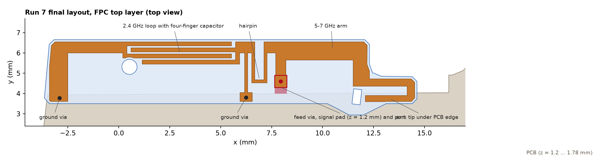
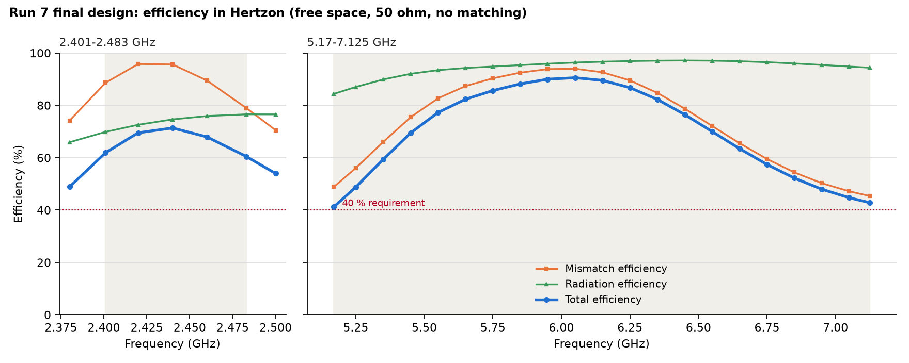
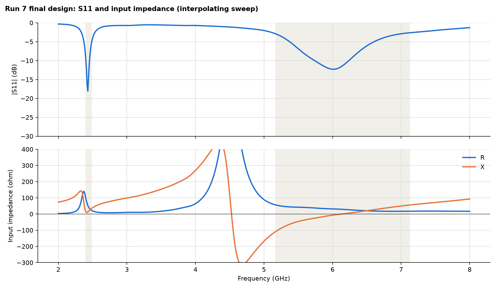

# Run 7: Meta Example 2, Antenne ohne Anpassnetzwerk (from scratch)

Stand 12.11.2026. Projekt: `Meta_Ex2_RunB.hzn`, finales Design `Final`, Netz-Bestätigung `Final_check`. Geometrie-Skripte: `work\ant_lib.py`, `work\final_geometry.py`.

## Ergebnis in Kürze

| | 2401-2483 MHz | 5170-7125 MHz | Mittel beider Bänder | Minimum |
|---|---|---|---|---|
| Run 7, 221k Tetraeder (Tabelle unten) | 67.4 % | 70.8 % | 69.1 % | 41.2 % bei 5.17 GHz |
| Run 7, 343k Tetraeder (Bestätigung, 10 Punkte) | 66.7 % | ca. 70.2 % | ca. 68.5 % | 40.4 % bei 5.17 GHz |
| Messlatte Run 4 in Hertzon | 67.3 % | 69.0 % | 68.2 % | rund 47 % bei 5.17 GHz |

- **40-%-Pflicht erfüllt: ja**, aber knapp. Der schwächste Punkt ist 5.17 GHz mit 41.2 % (feineres Netz 40.4 %), der zweitschwächste 7.125 GHz mit 42.8 %.
- **Messlatte:** Das Mittel liegt 0.3 bis 0.9 Punkte über Run 4, das obere Band 1.2 bis 1.8 Punkte darüber, das 2.4-GHz-Band gleichauf (plus 0.1 mit 221k, minus 0.6 mit 343k Tetraedern). Das ist innerhalb der Netz-Unsicherheit ein Gleichstand und kein klarer Sieg. Das Minimum ist schlechter als bei Run 4.
- **Strahlende Mode überall:** nur eingeschränkt belegt, siehe Abschnitt "Pflicht 2".
- Kein Anpassnetzwerk, keine Bauteile, nur eine FPC-Lage, drei Vias.

Die Bandmittel sind Trapezmittel über die Tabellenpunkte. Total-Effizienz ist Prad aus dem Fernfeld geteilt durch die einfallende Leistung.

## Entwurf

Alles Kupfer liegt auf der FPC-Oberseite (z = 0), als 2D-Fläche mit Kupfer-Leitfähigkeit, beidseitig stromführend.

1. **2.4-GHz-Schleife (links):** Masse-Via bei x = -2.9 mm, Streifen an der Außenkante, vierfingriger Serien-Kondensator (Finger 0.2 mm, Spalte 0.1 mm, 5.13 mm Überlappung), dünner Masse-Steg (0.15 mm) mit Via bei x = 6.25 mm. Der Strom läuft auf 9 mm Länge in einer Richtung an der Außenkante.
2. **Haarnadel (0.15 mm Leiter, 4 mm lang):** trennt den Knoten des 5-7-GHz-Arms von der Schleife. Für den Arm wirkt die Masseverbindung dadurch hochohmig (rund 6 nH), das hat die Bandbreite im oberen Band von 15 % auf 18 bis 20 % erhöht.
3. **5-7-GHz-Arm (rechts):** 0.9 mm breiter Streifen an der Außenkante, an der rechten Seite nach unten, in den Lappen und mit der Spitze zurück unter die PCB-Kante. Viertelwellen-Resonanz bei 6.1 GHz.
4. **Speisung:** Via bei x = 7.95, y = 4.59 mm, endet auf einem Signal-Pad 0.6 × 0.6 mm in der Ebene der PCB-Unterseite. Der Port (0.6 × 0.3 mm) liegt zwischen der geraden PCB-Kante und der parallelen Pad-Kante und berührt sonst kein Metall.
5. **Vias:** Kupferzylinder, Durchmesser 0.2 mm für alle drei, von z = 0 bis z = 1.2 mm. Der Durchmesser ist so klein, weil FPC und PCB sich nur auf 0.33 bis 0.42 mm Breite überlappen.

### Designregel-Check (aus der Geometrie gerechnet)

| Abstand | Wert |
|---|---|
| Kupfer zur FPC-Außenkontur, kleinster Wert | 0.110 mm |
| Kupfer zum Rundloch (16-Eck des Modells und Kreis r = 0.372) | 0.110 mm |
| Kupfer zum Langloch | 0.125 mm |
| Masse-Via x = -2.9: Rand zur PCB-Kante / zur Pad-Kante | 0.061 mm / 0.062 mm |
| Masse-Via x = 6.25: Rand zur PCB-Kante / zur Pad-Kante | 0.087 mm / 0.087 mm |
| Kleinster Kupfer-Kupfer-Spalt (Kondensator) | 0.100 mm |

Alle Vias sitzen vollständig auf Kupfer und vollständig unter der PCB. In der Draufsicht des finalen Modells geprüft: Aussparungen an beiden Löchern stimmen, nichts überlappt.

## Ergebnistabelle (Design `Final`, 11 Pässe, 221 193 Tetraeder, diskrete Punkte mit Feldern)

| f / GHz | Mismatch % | Strahlung % | Total % | Bilanz % von Pinc | Z / Ohm |
|---|---|---|---|---|---|
| 2.401 | 88.6 | 69.8 | 61.9 | -1.5 | 96+19j |
| 2.420 | 95.8 | 72.6 | 69.5 | -0.7 | 68+17j |
| 2.440 | 95.6 | 74.6 | 71.3 | -0.2 | 49+21j |
| 2.460 | 89.5 | 75.9 | 67.9 | 0.0 | 38+27j |
| 2.483 | 78.9 | 76.6 | 60.4 | -0.2 | 29+34j |
| 5.170 | 48.8 | 84.4 | 41.2 | -4.8 | 56-108j |
| 5.250 | 56.0 | 87.0 | 48.8 | -4.3 | 49-88j |
| 5.350 | 66.0 | 89.9 | 59.3 | -3.6 | 45-68j |
| 5.450 | 75.4 | 92.0 | 69.4 | -2.9 | 43-52j |
| 5.550 | 82.7 | 93.4 | 77.2 | -2.3 | 41-41j |
| 5.650 | 87.3 | 94.3 | 82.3 | -1.9 | 40-32j |
| 5.750 | 90.3 | 94.8 | 85.6 | -1.5 | 37-25j |
| 5.850 | 92.5 | 95.3 | 88.2 | -1.1 | 34-17j |
| 5.950 | 93.8 | 95.9 | 90.0 | -0.7 | 32-10j |
| 6.050 | 94.0 | 96.3 | 90.5 | -0.4 | 31-4j |
| 6.150 | 92.6 | 96.7 | 89.5 | -0.1 | 29+1j |
| 6.250 | 89.5 | 96.9 | 86.7 | +0.1 | 26+6j |
| 6.350 | 84.7 | 97.1 | 82.3 | +0.3 | 23+11j |
| 6.450 | 78.7 | 97.1 | 76.5 | +0.4 | 21+17j |
| 6.550 | 72.1 | 97.1 | 70.0 | +0.4 | 19+23j |
| 6.650 | 65.5 | 96.8 | 63.4 | +0.3 | 18+30j |
| 6.750 | 59.5 | 96.5 | 57.4 | +0.1 | 17+35j |
| 6.850 | 54.4 | 96.0 | 52.2 | -0.2 | 17+41j |
| 6.950 | 50.2 | 95.4 | 47.9 | -0.4 | 17+47j |
| 7.050 | 47.1 | 94.8 | 44.7 | -0.7 | 17+52j |
| 7.125 | 45.3 | 94.4 | 42.8 | -0.9 | 17+56j |

| Band | Minimum | Mittel |
|---|---|---|
| 2401-2483 MHz | 60.4 % (2.483 GHz) | 67.4 % |
| 5170-7125 MHz | 41.2 % (5.17 GHz) | 70.8 % |

**40-%-Pflicht erfüllt: ja** (Reserve 1.2 Punkte, im feineren Netz 0.4 Punkte).

## Pflicht 2: strahlende Mode überall

| f / GHz | R / Ohm | X / Ohm | Q_Z | Strahlungseffizienz |
|---|---|---|---|---|
| 2.40 | 98 | 14 | 26 | 70 % |
| 2.44 | 44 | 17 | 25 | 75 % |
| 2.48 | 24 | 32 | 24 | 77 % |
| 5.17 | 56 | -108 | 13.9 | 84 % |
| 5.40 | 43 | -59 | 9.7 | 91 % |
| 5.60 | 41 | -36 | 5.9 | 94 % |
| 6.00 | 31 | -7 | 5.8 | 96 % |
| 6.20 | 27 | 3 | 6.5 | 97 % |
| 6.60 | 19 | 27 | 11.0 | 97 % |
| 7.00 | 17 | 49 | 10.9 | 95 % |
| 7.125 | 17 | 55 | 9.7 | 94 % |

- **2.4 GHz:** eigene Resonanz der Schleife im Band (S11 -18 dB bei 2.43 GHz, -6-dB-Breite 4.1 %).
- **5.17-7.125 GHz:** eine einzige Resonanz des Arms, Reihenresonanz (X = 0) bei 6.13 GHz, Parallelresonanz bei 4.52 GHz außerhalb des Bandes, -6-dB-Breite 5.44-6.51 GHz (17.8 %). Es gibt im Band keine zweite Resonanz und keine Stelle mit hoher Güte und fehlender Abstrahlung: Q_Z bleibt unter 14, die Strahlungseffizienz über 84 %, der Strom liegt überall auf demselben Arm.
- **Schwäche, offen gesagt:** Die Bandkanten 5.17-5.35 und 6.9-7.125 GHz liegen auf den Flanken dieser einen Resonanz (S11 -2.6 bis -3.5 dB). Wer die Vorgabe "nicht nur der Ausläufer einer benachbarten Resonanz" streng liest, sieht sie an den Kanten nicht erfüllt. Eine zweite Resonanz mit guter Abstrahlung habe ich nicht gefunden, ohne das 2.4-GHz-Band zu verschlechtern (siehe Grenzen).

## Netz

- Delta S: Ziel 0.01 wurde nicht erreicht. Letzte Pässe 0.037 (221k) und 0.021 (343k Tetraeder), also auch nicht zweimal in Folge unter dem Ziel. Ursache ist die schmale 2.4-GHz-Resonanz an der adaptiven Frequenz 2.44 GHz, deren Phase auf jede Netzänderung reagiert.
- Bestätigung mit feinerem Netz (`Final_check`, 13 Pässe, 343 354 Tetraeder), Total-Effizienz 221k gegen 343k: 2.401 GHz 61.9 / 58.2, 2.42 GHz 69.5 / 67.7, 2.44 GHz 71.3 / 71.2, 2.46 GHz 67.9 / 68.4, 2.483 GHz 60.4 / 61.0, 5.17 GHz 41.2 / 40.4, 6.05 GHz 90.5 / 89.8, 6.55 GHz 70.0 / 69.3, 7.125 GHz 42.8 / 43.1. Die 2.4-GHz-Resonanz wandert um etwa 0.15 % nach oben, das obere Band ändert sich um höchstens 0.8 Punkte.
- Ein früherer Stand derselben Bauart (K14) mit 98k gegen 460k Tetraedern: oberes Band 71.5 gegen 71.9 %, 2.4-GHz-Resonanz 1 % höher.

## Annahmen und ihre Prüfrechnungen

| Annahme | Prüfung | Ergebnis |
|---|---|---|
| Leistungsbilanz des Ports | Prad + Pverlust gegen 1 - S11² an jedem Punkt | Im 2.4-GHz-Band und von 5.55 bis 7.125 GHz innerhalb 2.3 %. **Von 5.17 bis 5.45 GHz fehlen 2.9 bis 4.8 % der einfallenden Leistung, mehr als die erlaubten 2 %.** |
| Ursache der Bilanzlücke bei 5.17 GHz | Fünf Vergleichsrechnungen am Vorgänger K14: 460k statt 98k Tetraeder; Chassis als PEC; 90 mm statt 50 mm Luft; Antennenkupfer als PEC; Vias und PCB als PEC; Fernfeld mit 3° statt 10° | Lücke bleibt jedes Mal bei 5.2 bis 5.7 %. Sie ist also weder Netz, noch Randabstand, noch ein vergessener Metallverlust, noch die Fernfeld-Abtastung. Nicht geklärt, ob S11 oder die Fernfeld-Leistung abweicht. Ich berichte die Fernfeld-Zahl, das ist die vorsichtige: über die Verlustbilanz gerechnet wären es bei 5.17 GHz 45.9 % statt 41.2 %. |
| Kupfer als 2D-Fläche | laut Angabe zulässig | nicht weiter geprüft, beidseitige Oberflächenimpedanz verwendet |
| Kupferfläche in vier aneinanderstoßende Flächen geteilt (bei x = 0.2 und 9.5 mm) | Ungeteilt und mit zwei anderen Teilungen bricht Hertzon ab ("tuple index out of range", "Singular matrix"), ein Vergleich war deshalb nicht rechenbar | **Nicht durch Vergleichsrechnung belegt.** Indiz: Schleife und Arm laufen beide über eine Teilungslinie und resonieren dort, wo ihre volle Länge es erwarten lässt. |
| FPC-Verlust bestimmt die 2.4-GHz-Effizienz | Rechnung mit tan d = 0 (K14) | Spitze 86.5 % statt 67.7 %. Der Verlust sitzt im Finger-Kondensator, 75 % seines Feldes liegen im FPC. |
| Vias und Speisung | keine Vereinfachung: Zylinder, Pad, Port zwischen geraden Kanten | Validierung ohne Warnung |
| Umgebung (PCB, FPC, Chassis) | unverändert aus dem Paket | Abweichungen des Pakets vom Original-STEP sind dort genannt und hier nicht nachgeprüft |

## Verglichene Konzepte

| Konzept | 2.4 GHz | 5-7 GHz | Befund |
|---|---|---|---|
| K1 gefaltete IFA | 2.54 GHz, 3.9 % breit | 3λ/4-Mode, 7.6 % breit | zu schmal oben |
| K2/K4 IFA über volle Länge, Kapazität am Ende | 74 % Bandmittel | keine brauchbare Mode | innerer Zusatzarm strahlt nur mit 59 % |
| K3 T-Antenne | Strahlungseffizienz 55 % | 16.8 % breit, 96 % Strahlung | kurzer 2.4-GHz-Arm zu verlustreich |
| K5/K6 Trennstelle, Drossel, Platte | gut | Mode bleibt bei 7.5-8.2 GHz | Mäander isoliert nicht |
| K8 Schlitz mit Serien-C über volle Länge | 85 % Strahlung | Schlitzmode 9 % breit | oben zu schmal |
| K9/K13 Arm links, Schleife rechts | 58-62 % | 73-75 %, Minimum 38-45 % | Schleife rechts strahlt schlechter |
| K12/K14-K18 Schleife links, Arm rechts mit Haarnadel | 62-67 % | 71-74 % | gewählt |

## Was die Grenze setzt

1. **Länge der Außenkante.** Für 2.4 GHz zählt die Schleifenlänge quadratisch: 16.8 mm ergaben 85 % Strahlungseffizienz, 9 mm noch 75 %. Der 5-7-GHz-Arm braucht ein offenes Ende an derselben Kante. Mehr Schleife (K15) hob 2.4 GHz um rund 2 Punkte und drückte das Minimum oben auf 38 %.
2. **FPC-Verlust im Kondensator.** Mit tan d = 0.0105 kostet er rund 19 Punkte Spitzen-Effizienz bei 2.4 GHz. Luftkapazität reicht bei 9 mm Schleife nicht (Platten zur PCB-Kante hatten kaum Wirkung).
3. **Eine Mode oben.** Mit der Güte des Arms (Q etwa 6 bis 7) sagt das angepasste Ersatzschaltbild höchstens 0.45 bis 0.5 Mismatch-Effizienz an beiden Kanten und 0.77 im Mittel voraus. Der Entwurf liegt mit 0.45 bis 0.49 und 0.745 daran.

## Hertzon-Probleme (zur Behebung, keine Workarounds für spätere Läufe)

1. "tuple index out of range" in der Randbedingungs-Phase bei bestimmten zusammenhängenden 2D-Polygonen auf der FPC-Fläche. Geteilte Flächen laufen.
2. "Singular matrix" sofort beim Start, ebenfalls abhängig davon, wie dieselbe Kupferfläche in Polygone geteilt ist.
3. "NaN detected in the a-posteriori error estimate (tet 0, er = 1-4.27e8i)" bei einer Fläche im Lappen des FPC, obwohl die Validierung ohne Warnung durchlief.
4. Leistungsbilanz: bis 5.7 % der einfallenden Leistung fehlen bei 5.17 GHz, unabhängig von Netz, Luftabstand und Metallverlusten.
5. Mit PML als offene Berandung sind Verlust und Fernfeld-Leistung unbrauchbar (Verlust 540 % der einfallenden Leistung, Prad halbiert). S11 stimmt mit der Radiation-Berandung überein.
6. Interpolierender Sweep liefert an der schmalen 2.4-GHz-Resonanz einzelne unphysikalische Punkte (S11 +10 dB, R negativ).
7. Ergebnis-Datei des Sweeps ließ sich nicht umbenennen ("Zugriff verweigert"), nachdem ein Skript über `run_python` sie gelesen hatte.
8. Mesh-Statistik: Luftelemente bis 33 mm Kantenlänge auch bei 7 GHz, die adaptive Verfeinerung erreicht den Außenraum nicht.

## Dateien

- `Meta_Ex2_RunB.hzn`: alle Designs (K1 bis K18, `Final`, `Final_check`)
- `Final_efficiency_table.txt`, `Run7_Layout.png`, `Run7_Total_Effizienz.png`, `Run7_S11_Impedanz.png`
- `Timing_Log.md`: 49 Solves, 8 h 15 min

---

# Nachtrag Run 7b: neues Ziel "Minimum 50 % überall, Fläche zu 100 % minimal" (Design `B3`)

Geometrie: `work\b3_geometry.txt` (Funktion `b2_top` im Verlauf, Aufruf `b2_top(x1=6.4, lov=5.05, foot=-1.6)`, Masse-Vias bei x = 4.35 und 13.9 mm, Speisung bei x = 2.5 mm). Gegenüber `Final` gespiegelt: der 5-7-GHz-Arm liegt links neben dem Scharnierblock (0.9 mm breit, 5.9 mm Kantenlänge, Fahne und Fuß), die 2.4-GHz-Schleife rechts (9.5 mm). Haarnadel und dünner Masse-Steg wie bei `Final`. Eine FPC-Lage, drei Vias mit 0.2 mm.

| | 2401-2483 MHz | 5170-7125 MHz | Mittel | Minimum |
|---|---|---|---|---|
| B3 (11 Pässe, 221 697 Tetraeder) | 59.5 % | 79.7 % | 69.6 % | 51.7 % bei 7.125 GHz, 51.8 % bei 2.401 GHz |
| Final (40-%-Ziel) | 67.4 % | 70.8 % | 69.1 % | 41.2 % |
| Run 4 | 67.3 % | 69.0 % | 68.2 % | rund 47 % |

- **50 % überall: erfüllt, mit 1.7 Punkten Reserve.** Schwächste Punkte: 7.125 GHz 51.7 %, 2.401 GHz 51.8 %, 2.483 GHz 52.1 %, 5.17 GHz 53.0 %.
- Maximum 96.1 % bei 6.05 GHz und 64.4 % bei 2.44 GHz, keine Einbrüche, -6-dB-Breite oben 5.35-6.67 GHz (22.1 %).
- Leistungsbilanz an allen 28 Punkten innerhalb 1.2 % der einfallenden Leistung. Strahlungseffizienz oben 93 bis 99 %, bei 2.4 GHz 59 bis 70 %.
- Designregeln: Kupfer zur FPC-Kontur 0.110 mm, zum Rundloch 0.110 mm, zum Langloch 0.168 mm.
- Volle Tabelle: `B3_efficiency_table.txt`. Bild: `Run7b_B3_S11_und_Total_Effizienz.png`.

Offen bei B3:
- Noch **nicht mit feinerem Netz bestätigt**. Delta S im letzten Pass 0.020, Ziel 0.01 nicht erreicht. Bei `Final` änderten sich die Werte zwischen 221k und 343k Tetraedern um bis zu 0.8 Punkte oben und die 2.4-GHz-Resonanz um 0.15 %; die Reserve von 1.7 Punkten ist damit nicht sicher.
- Das 2.4-GHz-Band ist 8 Punkte schlechter als bei `Final` und Run 4, weil die Schleife rechts sitzt und kürzer ist (Strahlungseffizienz 59 bis 70 % statt 70 bis 77 %).
- Oben weiterhin nur eine Resonanz (5.96 GHz), die Kanten liegen auf ihren Flanken. Die geteilte Kupferfläche ist auch hier nicht per Vergleich belegt.
- Weg dorthin (5 Solves): Arm links ohne mehr Kantenlänge ergab abgestimmt nur 44 bis 45 % an den Kanten; 1.2 mm mehr Kantenlänge für den Arm senkte seine Güte und brachte 22 % Breite.

## B3 mit feinerem Netz (`B3_check`, 13 Pässe, 343 463 Tetraeder, Delta S im letzten Pass 0.0096)

Total-Effizienz 222k gegen 343k Tetraeder: 2.401 GHz 51.8 / **48.0**, 2.42 GHz 61.7 / 59.3, 2.44 GHz 64.4 / 63.6, 2.46 GHz 60.3 / 60.4, 2.483 GHz 52.1 / 52.7, 5.17 GHz 53.0 / 51.6, 5.5 GHz 83.1 / 83.7, 6.05 GHz 96.1 / 96.4, 6.55 GHz 81.2 / 80.4, 7.125 GHz 51.7 / 53.1.

- Oberes Band: 50 % an beiden Kanten bestätigt (51.6 % und 53.1 %).
- 2.4 GHz: Die Resonanz liegt im feineren Netz rund 0.2 % höher, damit fällt 2.401 GHz auf 48.0 %. **Die 50 % sind im 2.4-GHz-Band also nicht bestätigt.** Mit 0.3 % tieferer Abstimmung lägen beide Bandkanten bei etwa 50 bis 51 %, ohne Reserve.

## Ziel 60 % überall

Mit diesem Aufbau nicht erreichbar. Design `C1` (Arm mit 7.3 mm Kantenlänge): Resonanzbreite oben 23.2 % statt 22.1 %, mittig abgestimmt etwa 53 bis 55 % an den Kanten, und die Schleife resoniert dann bei 2.92 GHz. Über 60 % im ganzen 2.4-GHz-Band lag nur `Final` (Minimum 60.4 %), dort hat das obere Band 41 % an den Kanten.

## B3 abgesichert (`B3_final`, Finger-Überlappung 5.10 mm, 13 Pässe, 343 597 Tetraeder, 28 Punkte)

Volle Tabelle: `B3_final_efficiency_table.txt`. Delta S im letzten Pass 0.014 (Ziel 0.01 nicht erreicht).

| Band | Minimum | Mittel | Maximum |
|---|---|---|---|
| 2401-2483 MHz | **47.6 %** (2.401 GHz), 54.1 % bei 2.483 GHz | 58.9 % | 64.0 % (2.44 GHz) |
| 5170-7125 MHz | 51.7 % (5.17 GHz), 52.5 % bei 7.125 GHz | 79.6 % | 96.1 % (6.05 GHz) |

- Oberes Band: 50 % an jedem der 21 Punkte bestätigt, Leistungsbilanz innerhalb 1.3 %.
- 2.4 GHz: 50 % an der unteren Kante **nicht** erreicht. Das Nachstimmen (Überlappung 5.05 auf 5.10 mm, erwartet 0.3 % tiefer) hat die Resonanz nicht verschoben. Zwischen den Rechnungen streut ihre Lage um etwa 0.3 % (2.422 / 2.432 / 2.437 / 2.443 GHz bei 5.12 / 5.05 / 5.05 / 5.10 mm und 222k / 222k / 343k / 343k Tetraedern), das sind rund 3 Punkte an jeder Bandkante. Mit mittiger Resonanz liegen beide Kanten bei etwa 50 bis 51 %; genauer lässt sich das mit diesem Netz nicht festlegen.
- Mittel beider Bänder 69.3 %.
