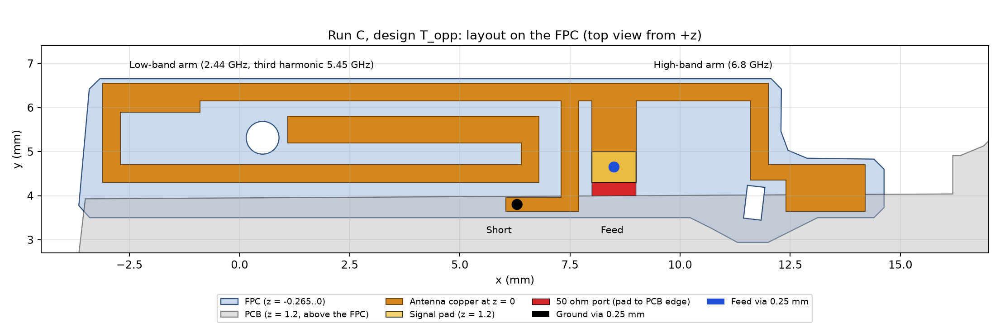
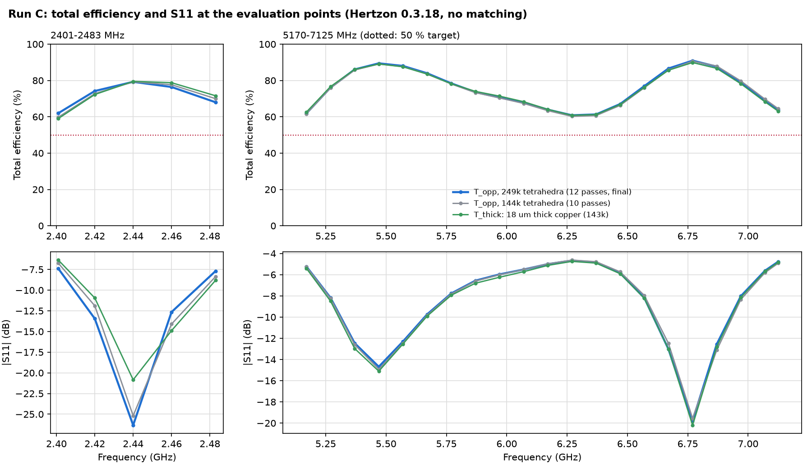
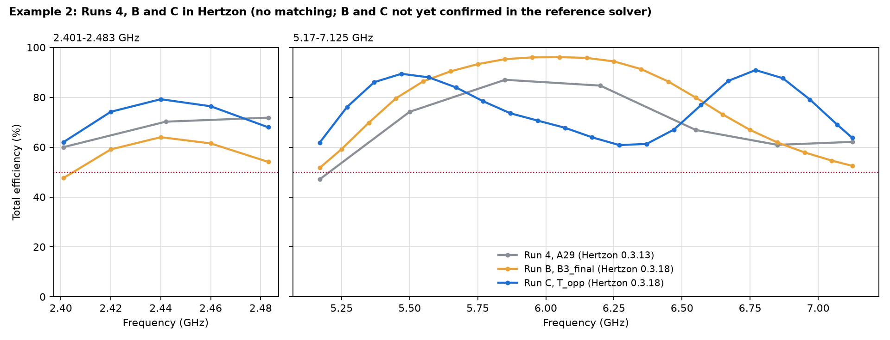

# Meta AI-glasses benchmark, Example 2, Run C: from scratch, two opposed arms (Hertzon 0.3.18)

A second from-scratch run by Claude in Claude Code (model Fable 5.2, medium effort), driving Hertzon 0.3.18 only
through its MCP interface, with the same task as [Run B](../runB/README.md): at least 50 % total efficiency at every
frequency in both bands, then the highest mean. The agent worked in a fresh folder outside the earlier runs and got
only the benchmark package and the goals and constraints of Run B, none of its designs or results.

No matching network, no lumped components, one FPC copper layer, one feed via and one ground via (copper cylinders,
0.25 mm).

> **Status of the results.** All numbers below are Hertzon numbers. Run C has **not yet been checked in the
> reference solver**.

## Result in Hertzon (design `T_opp`, total efficiency, free space, 50 ohm)

| | 2401–2483 MHz min / mean | 5170–7125 MHz min / mean | Mean of both bands |
| --- | --- | --- | --- |
| **`T_opp`, 249k tetrahedra (12 passes)** | **62.0 / 72.0 %** | **60.8 / 75.4 %** | **73.7 %** |
| `T_opp`, 144k tetrahedra (10 passes, converged) | 59.8 / 71.9 % | 60.2 / 75.1 % | 73.5 % |
| `T_thick`: 18 µm thick copper instead of sheets (143k) | 59.1 / 72.2 % | 60.8 / 75.1 % | 73.7 % |
| Run 4, A29 (yardstick, Hertzon 0.3.13) | 60.0 / 67.3 % | about 47 / 69.0 % | 68.2 % |
| Run B, `B3_final` (Hertzon 0.3.18, 344k) | 47.6 / 58.9 % | 51.7 / 79.6 % | 69.3 % |

**50 % target met at all 26 points in Hertzon.** Run C lies above Run 4 in both bands in Hertzon (+4.7 and +6.4
points) and its weakest point is 60.8 % (6.27 GHz). Power balance within 1.2 % of the incident power at all points.

## How it works

Short and feed sit near the middle of the FPC (x = 7.5 to 9 mm), and two arms run in opposite directions:

- **Low-band arm to the left** (about 32 mm along the outer edge, the left leg, back along the PCB edge and a hook into
  the middle): fundamental at 2.44 GHz, its third harmonic at 5.45 GHz gives the lower high-band resonance.
- **High-band arm to the right** into the FPC tab, ending in a 1.8 x 1.05 mm patch: resonance at 6.8 GHz.
- **Short:** a leg at x = 7.3 to 7.7 mm led 1.2 mm to the left to the ground via at (6.3, 3.8). This longer short path
  raised the high-band minimum from 53 to 61 %.
- **Feed:** 1.0 mm wide feed strip, via at (8.5, 4.65) onto a 1.0 x 0.7 mm signal pad, port 1.0 x 0.3 mm between the
  straight pad edge and the PCB edge.

Because the arms point away from each other they hardly couple, and the two high-band resonances (5.45 and 6.8 GHz)
can be placed separately. Between them the input impedance stays moderate (57 + 73j ohm at 6.2 GHz), so the dip goes
only down to 61 %. The geometry is fully parametric in the design (variables `xs, xf, xe, xk, xtab, wtb, xsv, xw, ...`).

Concepts compared before (26 solves in total): folded IFA fed at the left end, mirrored IFA with a high-band branch
between the low-band conductors (only one high-band resonance, 13–36 % at the band edges), high-band conductor on the
outer edge (4 variants, modes not separately tunable), grounded parasitic strip at the PCB edge (radiation efficiency
0.33 at 7 GHz), plate instead of a branch. The agent's limit estimate: one high-band resonance has a Q of about 10 in
the 2.25 mm high space and covers only about 1.3 GHz at 50 %; 1.96 GHz needs two radiating resonances.

## Checks

| Assumption | Check | Difference |
| --- | --- | --- |
| Copper as sheets without thickness | `T_thick`: antenna and pad as 18 µm copper bodies, same setup | at most 1.5 points at any frequency (7.07 GHz) |
| Mesh | 10 passes (Delta S below 0.01 twice in a row) against 12 passes | at most 2.2 points (2.401 GHz, resonance 3 MHz lower) |
| Far-field sphere 5° instead of 10° | power balance at most 1.2 % with 5° and the fine mesh | not separated from the mesh effect |

Design-rule check (`tools/drc.py`): copper to the FPC edge 0.105 mm, to the round hole 0.203 mm, to the slot
0.123 mm; ground via fully on copper and under the PCB, 0.06 mm from the PCB edge.

Not checked: second-order basis, larger air box, the reference solver and Meta's original STEP.

Weak points: the ground via sits only 0.06 mm inside the PCB edge (FPC and PCB overlap by only 0.49 mm there); the
2.4 GHz resonance is narrow (3 MHz shift changes the band edge by 2 points); radiation efficiency at 2.4 GHz is only
0.76 to 0.82; the signal pad lies in the PCB plane next to the PCB edge, not on the FPC; tuning was by hand in 13
steps, no optimizer run.

## Prompt

`input/Prompt.md` (German) and the task statement `input/Benchmark_Angabe.md`, the same package as Run B, plus the
goals and constraints of Run B's follow-up: total efficiency at least 50 % at every frequency in 2401–2483 MHz and
5170–7125 MHz, then maximise the mean over both bands; 26 evaluation points (5 in the low band, 21 in the upper band);
no matching network, no lumped parts, one FPC copper layer, vias as copper cylinders; confirm on a refined mesh.
The user's own request was: "Now start C from scratch with the same specification as B. Only that Fable 5.2 is used."

## Effort

About 4 h (15:49 to about 19:50 local time, 12 November 2026), 26 Hertzon solves, session context about 360k tokens at
the end (measured, including about 100k for tool and system texts). Tokens per step are estimates.
Per step: [Timing_Log.md](Timing_Log.md).

| Phase | Solves |
| --- | --- |
| Model setup (antenna sheet, pad, port, vias, setup, sweeps) | 0 |
| Concepts A, B, D, E, G and diagnosis | 12 |
| Concept T and its tuning (coarse mesh) | 7 |
| T on the fine mesh, feed strip, short path, low-band retuning | 5 |
| Thick-copper check | 1 |
| Final solve, 249k tetrahedra, 26 points | 1 |

## Files

| File | What it is |
| --- | --- |
| `Meta_Ex2_RunC.hzn` | Hertzon project with all designs (`A_IFA`, `B_mirror`, `D_outer`, `E_par`, `G_plate`, `T_opp`, `T_thick`), without result folders |
| `input/` | Prompt and task statement as the agent got them (German) |
| [REPORT_de.md](REPORT_de.md) | Full report (German): result, design, concepts, tables, checks, design rules, Hertzon issues |
| `results/T_opp_12passes_249k.csv` and `.s1p` | Final table: S11, mismatch, radiation and total efficiency, power balance per point |
| `results/T_opp_10passes_144k.*`, `results/T_thick_18um_copper.*` | Mesh and copper-thickness checks; `*_convergence.json` per solve |
| `results/*.png` | Layout, efficiency and S11, comparison with Runs 4 and B |
| `tools/drc.py` | Antenna polygon and design-rule check against the FPC outline and holes |
| `tools/export_tables.py`, `tools/eff.py`, `tools/s11.py` | Tables from a Hertzon result folder or Touchstone file |
| `tools/make_plots.py` | All plots of this folder from the CSV files |

## Reproduce

Open `Meta_Ex2_RunC.hzn` in Hertzon 0.3.18 or newer, select design `T_opp` and run its setup (adaptive at 2.44,
5.35 and 6.8 GHz, first-order basis as in the benchmark project). Total efficiency is radiated power over incident
power of the `Eff` sweep; `get_results` with `kind = efficiency` on the MCP interface gives the split into mismatch
and radiation efficiency.
