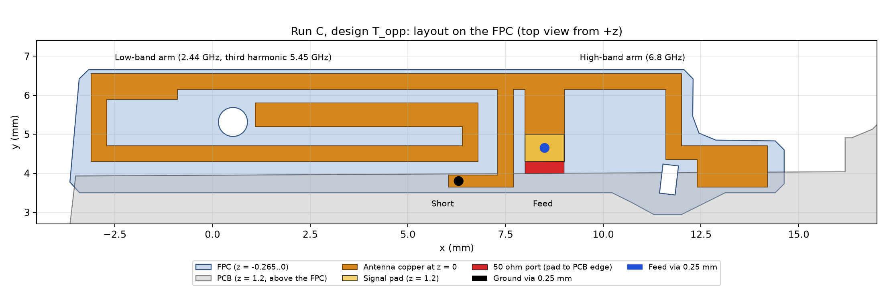
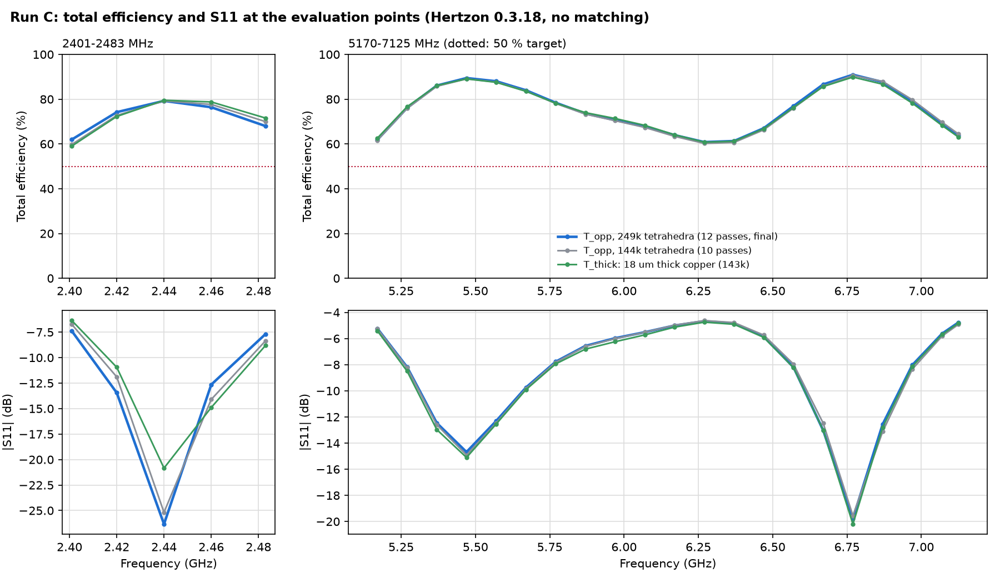

# Bericht Run C: Meta Example 2, von Grund auf (Fable 5.2, Effort medium)

Hertzon 0.3.18 über MCP, Projekt `Meta_Ex2_RunC.hzn`, finaler Entwurf im Design `T_opp`. Eingaben waren nur das Benchmark-Zip (Angabe, Prompt, Projekt ohne Antenne) und die Aufgabenstellung von Studie B. Berichte, Geometrien und Notizen früherer Läufe wurden nicht gelesen.

## Ergebnis

**50-%-Ziel an jedem Punkt erfüllt: ja.** (Die 40-%-Pflicht aus dem Prompt damit ebenfalls.)

| | Minimum | Mittel |
|---|---|---|
| 2401-2483 MHz (5 Punkte) | 62.0 % (2.401 GHz) | 72.0 % |
| 5170-7125 MHz (21 Punkte) | 60.8 % (6.27 GHz) | 75.4 % |
| Mittel beider Bänder | | 73.7 % |

Messlatte Run 4 in Hertzon laut Prompt: 67.3 % / 69.0 %, Mittel 68.2 %, schwächster Punkt rund 47 %. Run C liegt in beiden Bändern darüber (plus 4.7 und plus 6.4 Punkte) und hat ein Minimum von 60.8 %. Eine Gegenrechnung im Referenz-Solver gibt es für Run C nicht.

Kein Anpassnetzwerk, keine konzentrierten Bauteile, eine Kupferlage (FPC-Oberseite, z = 0), eine Speisung, ein Masse-Via.

## Entwurf

Kurzschluss und Speisung sitzen nicht am Ende, sondern bei x = 7.5 bis 9 mm. Von dort laufen zwei Arme in entgegengesetzte Richtungen:

- **LB-Arm nach links:** oberer Randleiter bis x = -3.1, linker Schenkel, Rückleiter an der PCB-Kante, Haken zurück in den Mittelgang (rund 32 mm). Grundmode bei 2.44 GHz, seine dritte Harmonische bei 5.45 GHz bildet die untere HB-Resonanz.
- **HB-Arm nach rechts:** oberer Randleiter bis x = 12, rechter Schenkel, Fläche im FPC-Lappen (1.8 x 1.05 mm, teils unter der PCB). Resonanz bei 6.8 GHz.
- **Kurzschluss:** Schenkel bei x = 7.3 bis 7.7 mm, unten 1.2 mm nach links geführt zum Masse-Via bei (6.3, 3.8). Diese Verlängerung des Kurzschlusspfads hat das HB-Minimum von 53 auf 61 % gehoben.
- **Speisung:** 1.0 mm breiter Speiseleiter, Via bei (8.5, 4.65) auf ein Signal-Pad 1.0 x 0.7 mm in der Ebene der PCB-Unterseite; Port 1.0 x 0.3 mm zwischen der geraden Pad-Kante und der PCB-Kante (parallel zur leicht schrägen PCB-Kante gezeichnet, ragt nicht in Metall).
- Vias: Kupferzylinder, Durchmesser 0.25 mm, Länge 1.2 mm, beide gleich.

Warum das funktioniert: Weil die beiden Arme voneinander weg zeigen, koppeln sie kaum und ihre Resonanzen (5.45 und 6.8 GHz) lassen sich getrennt legen. Dazwischen bleibt die Eingangsimpedanz moderat (57+73j Ohm bei 6.2 GHz), der Einbruch geht nur auf 61 %.

Die Geometrie ist im Design vollständig parametrisch (Variablen `xs, xf, xe, xk, xtab, wtb, xsv, xw, ...`), das Polygon steht im Objekt `Ant`.

## Verglichene Konzepte (26 Solves insgesamt)

| Konzept | Befund | Entscheidung |
|---|---|---|
| A: gefaltete IFA, Speisung am linken Ende | LB 2.36 GHz mit 13 Ohm, HB nur eine schmale Resonanz | verworfen |
| B: gespiegelt, Kurzschluss im Lappen, HB-Zweig zwischen den LB-Leitern | LB 69-87 %, HB eine Resonanz mit 1.3 GHz Breite, 13-36 % an den Bandkanten. Diagnose ohne Zweig: der Zweig belastet nur die dritte Harmonische, er erzeugt keine eigene Resonanz | verworfen |
| D: HB-Leiter am Außenrand, LB innen (4 Varianten) | LB-Spitze koppelt auf den HB-Leiter, Moden nicht getrennt abstimmbar | verworfen |
| E: parasitärer Massestreifen an der PCB-Kante | Strahlungseffizienz fällt bei 7 GHz auf 0.33 | verworfen |
| G: Platte statt Zweig | schmaler als B | verworfen |
| T: gegenläufige Arme | zwei HB-Resonanzen, 13 Solves Abstimmung | gewählt |

Was die Grenze setzt: Eine einzelne HB-Resonanz hat in diesem 2.25 mm hohen Bauraum Q von etwa 10 und deckt mit mindestens 50 % nur rund 1.3 GHz ab, gebraucht werden 1.96 GHz. Das geht nur mit zwei strahlenden Resonanzen. Dicke Arme (1.4 mm) haben die obere Resonanz auf 8.4 GHz verschoben und wurden deshalb nicht weiterverfolgt.

## Tabelle finaler Entwurf (feines Netz, 249k Tetraeder, Felder gespeichert)

| f / GHz | Mismatch | Strahlung | Total | Leistungsbilanz |
|---|---|---|---|---|
| 2.401 | 0.818 | 0.758 | 0.620 | -0.1 % |
| 2.420 | 0.955 | 0.777 | 0.742 | 0.0 % |
| 2.440 | 0.998 | 0.794 | 0.792 | 0.0 % |
| 2.460 | 0.946 | 0.808 | 0.764 | -0.1 % |
| 2.483 | 0.830 | 0.819 | 0.680 | -0.3 % |
| 5.170 | 0.700 | 0.884 | 0.619 | +1.1 % |
| 5.270 | 0.848 | 0.897 | 0.761 | +1.0 % |
| 5.370 | 0.943 | 0.912 | 0.861 | +0.6 % |
| 5.470 | 0.966 | 0.926 | 0.894 | +0.1 % |
| 5.570 | 0.941 | 0.935 | 0.880 | -0.2 % |
| 5.670 | 0.894 | 0.939 | 0.840 | -0.5 % |
| 5.770 | 0.833 | 0.941 | 0.784 | -0.7 % |
| 5.870 | 0.779 | 0.944 | 0.736 | -0.9 % |
| 5.970 | 0.747 | 0.946 | 0.707 | -0.9 % |
| 6.070 | 0.719 | 0.943 | 0.678 | -0.9 % |
| 6.170 | 0.684 | 0.935 | 0.639 | -0.8 % |
| 6.270 | 0.659 | 0.923 | 0.608 | -0.7 % |
| 6.370 | 0.672 | 0.912 | 0.613 | -0.4 % |
| 6.470 | 0.740 | 0.906 | 0.670 | +0.1 % |
| 6.570 | 0.848 | 0.906 | 0.769 | +0.5 % |
| 6.670 | 0.950 | 0.911 | 0.866 | +0.8 % |
| 6.770 | 0.989 | 0.919 | 0.909 | +0.7 % |
| 6.870 | 0.945 | 0.928 | 0.877 | +0.2 % |
| 6.970 | 0.843 | 0.938 | 0.791 | -0.4 % |
| 7.070 | 0.726 | 0.950 | 0.690 | -0.9 % |
| 7.125 | 0.667 | 0.956 | 0.638 | -1.2 % |

Total = im Fernfeld abgestrahlte Leistung / einfallende Leistung an 50 Ohm (Fernfeldkugel 5 Grad). Leistungsbilanz = akzeptiert minus abgestrahlt minus Verlust, in Prozent der einfallenden Leistung; größte Abweichung 1.2 %, also unter der 2-%-Grenze.

## Netz

| Netz | LB min / Mittel | HB min / Mittel |
|---|---|---|
| 10 Pässe, 143 712 Tetraeder (Delta S 0.0085 und 0.0071, zwei Pässe in Folge unter 0.01) | 59.8 / 71.9 % | 60.2 / 75.1 % |
| 12 Pässe, 248 715 Tetraeder | 62.0 / 72.0 % | 60.8 / 75.4 % |

Größter Unterschied an einem Punkt: 2.2 Punkte (2.401 GHz), die LB-Resonanz liegt im feinen Netz etwa 3 MHz tiefer. In den Pässen 11 und 12 meldet Hertzon Delta S 0.018 und 0.024; das kommt aus der Phase (Delta Mag 0.009 und 0.004), weil S11 an zwei der drei Adaptionsfrequenzen unter -20 dB liegt und die Phase dort wenig aussagt. Adaptiert wurde bei 2.44, 5.35 und 6.8 GHz, Basis erster Ordnung wie im Benchmark-Projekt vorgegeben.

## Annahmen und Prüfrechnungen

| Annahme | Prüfung | Unterschied |
|---|---|---|
| Kupfer als Fläche ohne Dicke (Finite Conductivity, zweiseitig) für Antenne und Pad | Design `T_thick`: beide als 18 µm dicke Kupferkörper, Vias entsprechend gekürzt, gleiches Setup (143k Tetraeder) | LB min 59.1 statt 59.8 %, Mittel 72.2 statt 71.9 %; HB min 60.8 statt 60.2 %, Mittel 75.1 statt 75.1 %; größter Einzelunterschied 1.5 Punkte (7.07 GHz). Die Rechnung mit dickem Kupfer ist weniger gut konvergiert (Delta S 0.04). |
| Fernfeldkugel 5 Grad statt 10 Grad | Leistungsbilanz: mit 10 Grad und grobem Netz bis 5.9 % Abweichung, mit 5 Grad und feinem Netz höchstens 1.2 % | kein Einzelvergleich bei gleichem Netz, die beiden Einflüsse sind nicht getrennt |
| Vias | keine Vereinfachung: Kupferzylinder mit echter Rundung | |

Nicht geprüft und deshalb offen: Second-Order-Basis, größerer Luftraum, Vergleich mit Metas Original-STEP und dem Referenz-Solver, Deckfolie oder Lötstopp (in der Angabe nicht enthalten).

## Designregel-Check (Skript `tools/drc.py`, Polygon gegen FPC-Kontur)

- Kleinster Abstand Kupfer zu FPC-Kante: 0.105 mm (Oberkante y = 6.55 gegen 6.655)
- Kleinster Abstand zum Rundloch: 0.203 mm, zum Langloch: 0.123 mm
- Alle Polygonecken innerhalb der FPC-Kontur, kein Loch überdeckt
- Kleinste Leiterbreite und kleinster Leiterabstand: 0.3 mm
- Masse-Via bei (6.3, 3.8): liegt ganz auf Kupfer und ganz unter der PCB, Abstand Via-Rand zur PCB-Kante 0.06 mm
- Speise-Via bei (8.5, 4.65): liegt ganz auf Kupfer und trifft das Pad (y = 4.29 bis 5.0)
- Draufsicht in Hertzon geprüft (Vias zusätzlich über Koordinaten): Aussparungen um beide Löcher an der richtigen Stelle, keine ungewollte Überlappung

## Schwächen

- Das Masse-Via sitzt nur 0.06 mm innerhalb der PCB-Kante und sein Kupfer 0.05 mm über der 0.1-mm-Grenze zur FPC-Kante. Der Überlapp von FPC und PCB ist dort nur 0.49 mm breit, mehr Platz gibt es für ein Masse-Via nicht.
- Die 2.4-GHz-Resonanz ist schmal: 3 MHz Verschiebung zwischen den Netzen ändern die Bandkante um 2 Punkte. Die Reserve zum 50-%-Ziel beträgt dort 12 Punkte.
- Strahlungseffizienz im unteren Band nur 0.76 bis 0.82 (im oberen 0.88 bis 0.96); der Rückleiter und der Haken des LB-Arms liegen eng beieinander.
- Das Signal-Pad liegt in der PCB-Ebene neben der PCB-Kante, nicht auf dem FPC. Das entspricht dem in der Angabe beschriebenen Speisestil, ist aber Kupfer außerhalb der FPC-Lage.
- Kein Optimierer-Lauf; die Abstimmung erfolgte von Hand in 13 Schritten. Weiterer Gewinn ist wahrscheinlich bei 6.2 bis 6.4 GHz und an den LB-Bandkanten möglich.

## Hertzon-Auffälligkeiten (zur Behebung in Hertzon, keine Workarounds notiert)

1. Der Interpolating-Sweep wich an der schmalen 2.4-GHz-Resonanz deutlich vom Discrete-Sweep auf demselben Netz ab (Design `B_mirror`: Mismatch-Effizienz bei 2.48 GHz 0.62 interpoliert gegen 0.98 diskret bei 2.483 GHz), ohne Warnung.
2. `set_design` löscht Variablen, die noch in Objekten verwendet werden, ohne Hinweis; der Fehler erscheint erst beim nächsten Geometrieaufbau.
3. Delta S springt wegen der Phase, wenn |S11| sehr klein ist, und meldet dann "nicht konvergiert", obwohl Delta Mag unter 0.01 liegt.
## Aufwand

Rund 4 Stunden, 26 Solves, Kontext am Ende rund 360k Tokens. Einzelheiten in `Timing_Log.md`.
