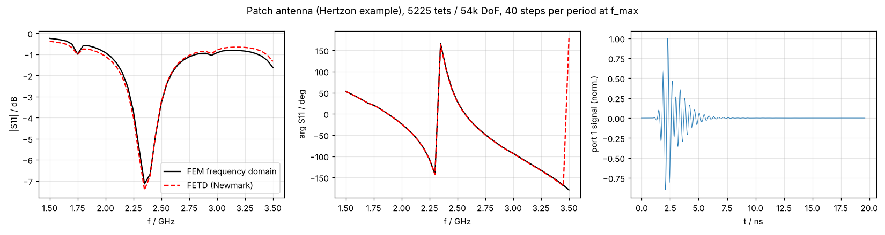
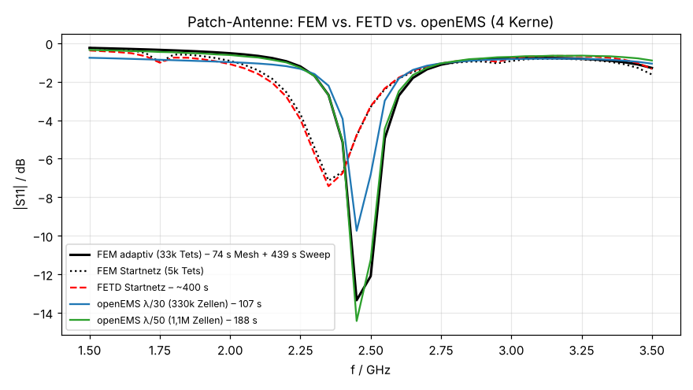

# FETD experiment (time domain FEM on EMerge matrices)

Status: **experiment**, not wired into Hertzon. Question it answers: how far does a true time
integration on top of the existing Nédélec FEM get, without forking EMerge?

## How it works

`fetd.py` lets EMerge assemble its frequency domain system at four frequencies, with the solve
replaced by a capture. For frequency independent materials, lumped ports and first-order absorbing
boundaries the system is exactly

    A(k0) = K + j k0 C - k0^2 M        (fit error ~1e-16)

so K (curl-curl), C (ports, ABC, conductivity) and M (permittivity) come out directly. In
`tau = c0 t` it integrates

    M e'' + C e' + K e = b' g'(tau)

with the average acceleration Newmark scheme (beta = 1/4, gamma = 1/2: unconditionally stable,
second order, so small elements of the adaptive mesh do not limit the time step). One PARDISO
factorization, then one forward/back substitution per step. A running DFT of e(tau), divided by
the DFT of the pulse, gives X(f), which is fed back into EMerge's own post processing; FD and TD
S-parameters therefore use identical port integrals.

## Findings

1. **EMerge's boundary matrices are indefinite.** `robinbc.ned2_tri_stiff` integrates the Gram
   matrix of the Robin terms (lumped ports, ABC, surface impedance) with the 4-point triangle rule,
   whose centre weight is negative (-27/48). In the frequency domain this is a small accuracy error;
   in the time domain it is negative damping and the scheme blows up after a few thousand steps.
   `fix_robin_quadrature()` re-compiles the routine with the 6-point degree-4 rule (all weights
   positive, exact for the quadratic Nédélec products). Worth reporting upstream.
2. **Loss tangent** is not causal as a constant in the time domain. The prototype turns it into an
   equivalent conductivity at the band centre (too lossy below, too little above). A Debye or
   Djordjevic-Sarkar auxiliary equation (roadmap 1.3) would remove that error.

## Results (container, 4 cores)

Microstrip through line, FR4, 1-6 GHz, 1516 tets / 9.8k DoF (`run_microstrip.py`):

| steps per period at f_max | max abs(S_TD - S_FD) |
|---|---|
| 20 | 0.078 |
| 40 | 0.019 |
| 80 | 0.0048 |

Clean second order convergence.

Patch antenna (`examples/PatchAntenna.hzn` via Hertzon's Bridge, curved elements, auto open
region), 1.5-3.5 GHz, 5225 tets / 54k DoF, 40 steps per period (`run_patch.py`):

- max abs(dS11) = 0.043, resonance at 2.35 GHz: -7.43 dB (TD) vs -7.14 dB (FD), phase within ~2.5°.
  The remaining difference is mostly the tan(delta) approximation.
- Time (4 cores, no other load): frequency domain 41 points in 56 s; FETD 2747 steps (stop when the
  port signal is 80 dB below its peak) at ~0.15 s per step, about 400 s, i.e. 7x slower. The
  ring-down of a resonant structure costs thousands of substitutions, so for narrowband
  S-parameters the frequency domain (and its fast sweep) stays faster. FETD pays off for time
  signals (TDR, pulses) and very many frequency points, which come for free from the DFT.

## Not covered yet

Time domain PML (EMerge's PML is a frequency domain coordinate stretch), wave ports (dispersive
gamma(k0)), surface impedance / finite conductivity (sqrt(f)), second-order ABC (1/k0 term),
frequency dependent materials, TDR report, GUI integration.

## Run

    pip install emerge==2.8.9 pypardiso   # plus Hertzon on the path for run_patch.py
    python run_microstrip.py 40
    python run_patch.py ../../examples/PatchAntenna.hzn 40

## Comparison with openEMS (same patch, 4 cores)

`patch_oems.py` rebuilds `PatchAntenna.hzn` in openEMS (thirds rule at metal edges, PML_8, -50 dB end
criterion). Reference: Hertzon adaptive FEM, converged after 8 passes (33k tets, delta S 0.0056),
resonance 2.45 GHz / -13.4 dB.

| solver | mesh | time | max d\|S11\| vs adaptive FEM |
|---|---|---|---|
| FEM adaptive + 41 discrete points | 33k tets | 74 s + 439 s | reference |
| openEMS lambda/30 | 330k cells | 107 s | 5.3 dB (resonance depth) |
| openEMS lambda/50 | 1.1M cells | 188 s | 1.1 dB (0.1 dB off resonance) |
| FETD on the initial FEM mesh | 5k tets | ~400 s | resonance 4 % too low (mesh, not FETD) |

The initial FEM mesh used for the FETD validation is not converged (resonance 2.35 GHz instead of
2.45 GHz). On the converged mesh (303k unknowns) FETD would need several times longer per step.

